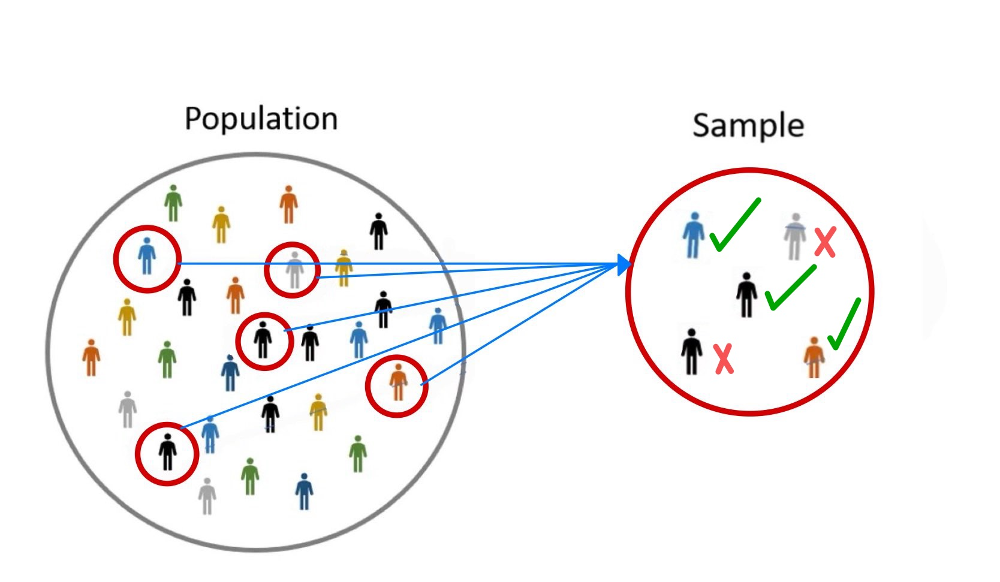
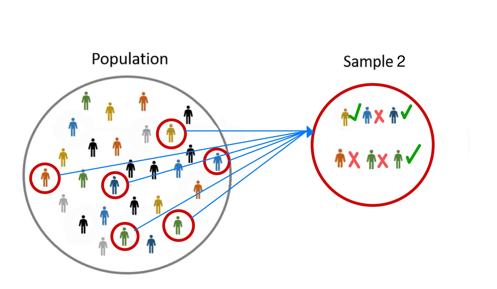

```{r, echo=FALSE, results='hide', message=FALSE}
library("tidyverse");theme_set(theme_minimal());library("patchwork");library("ggfunction")
```




## Inferential Statistics

:::{.absolute top=80px left=400px}
::: {style="width:200px;height:100px;background:transparent;border:4px solid; color:#bf5700;"}
:::
:::

:::{.absolute top=105px left=450px}
**Statistics**
:::

:::{.absolute top=130px left=300px}
::: {style="width:100px;height:0px;background:transparent;border:2px solid;"}
:::
:::

:::{.absolute top=130px right=340px}
::: {style="width:100px;height:0px;background:transparent;border:2px solid;"}
:::
:::

:::{.absolute top=205px right=265px}
::: {style="width:150px;height:0px;background:transparent;border:2px solid;transform:rotate(90deg);"}
:::
:::

:::{.absolute top=205px left=225px}
::: {style="width:150px;height:0px;background:transparent;border:2px solid;transform:rotate(90deg);"}
:::
:::

:::{.absolute top=280px left=200px}
::: {style="width:200px;height:100px;background:transparent;border:4px solid; color:#bf5700;"}
:::
:::

:::{.absolute top=280px right=240px}
::: {style="width:200px;height:100px;background:transparent;border:4px solid; color:#bf5700;"}
:::
:::

:::{.absolute top=305px left=235px}
**Descriptive**
:::

:::{.absolute top=305px right=275px}
**Inferential**
:::

:::{.absolute top=432px left=255px}
::: {style="width:90px;height:0px;background:transparent;border:2px solid;transform:rotate(90deg);"}
:::
:::

:::{.absolute top=480px left=200px}
::: {style="width:200px;height:100px;background:transparent;border:4px solid; color:#bf5700;"}
:::
:::

:::{.absolute top=475px left=195px}
:::{style="font-size:.60em;"}
- **Collecting (Mining) Data**
- **Processing Data**
- **Visualizing Data**
- **Summarizing Data**
:::
:::

:::{.absolute top=475px right=245px}
:::{style="font-size:.65em;"}
- **Making inferences and** <br>
**drawing conclusions** <br> **from data**
:::
:::

:::{.absolute top=432px right=295px}
::: {style="width:90px;height:0px;background:transparent;border:2px solid;transform:rotate(90deg);"}
:::
:::

:::{.absolute top=480px right=240px}
::: {style="width:200px;height:100px;background:transparent;border:4px solid; color:#bf5700;"}
:::
:::

## Inferential Statistics
:::{.incremental}
- **Inferential Statistics:** *the process of making judgments about a population based on properties of a sample randomly drawn from the population*
  - **Estimation:** *involves approximating the unknown value of a parameter*
    - Point Estimate [Ex: $\bar{x} = 4.50$]{.subtext}
    - Confidence Interval [Ex: 95% Confident that $3.50 < \mu < 5.50$]{.subtext}
  - **Hypothesis Testing**...
:::


## Mathematical vs Statistical Difference
:::{.incremental}
- **Mathematical Difference:** *simply the mathematical difference/distance between objects* [also called euclidean distance]{.subtext}
:::

:::{.callout-tip title="Example" style=font-size:1.2em;" .fragment}
Consider the numbers 4.3 and 4.2. What is the a mathematical difference between the numbers?
:::

:::{.fragment}
:::{.mysolution}
Just 0.10 [i.e. 4.3 - 4.1]{.subtext}
:::
:::

## Basketball Difference Example

:::{.callout-tip title="Basketball Example" style="font-size:1.2em;"}
Consider a basketball game between the Texas and A&M. We want to guess who will win based off points scored and time left in the game. 
:::

:::: {.columns .center}

::: {.column width="55%"}

:::

:::{.column width="10%"}
:::

::: {.column width="20%"}

:::

::::

:::{.absolute top=400 left=500}
:::{style="font-size:1.5em;"}
vs
:::
:::

## Basketball Difference Example Cont.

::::{.columns}

:::{.column width="25%"}
[[Texas]{style="color:#BF5700;"} points]{.underline}
:::

:::{.column width="25%"}
[[A&M]{style="color:#500000;"} points]{.underline}
:::

:::{.column width="25%"}
[Time]{.underline}
:::

:::{.column width="25%"}
[Winner Guess]{.underline}
:::

::::

:::: {.columns}

::: {.column width="25%" .fragment data-fragment-index="1"}
1. 22
:::

::: {.column width="25%" .fragment data-fragment-index="1"}
20
:::

::: {.column width="25%" .fragment data-fragment-index="1"}
End $1^{\text{st}}$ Q
:::

::: {.column width="25%" .fragment data-fragment-index="2"}
[? Too much time & points too close]{.mysolution}
:::

::::

:::: {.columns}

::: {.column width="25%" .fragment data-fragment-index="3"}
2. 102
:::

::: {.column width="25%" .fragment data-fragment-index="3"}
100
:::

::: {.column width="25%" .fragment data-fragment-index="3"}
1 minute left
:::

::: {.column width="25%" .fragment data-fragment-index="4"}
[UT? Points close, but less time left]{.mysolution}
:::

::::

:::: {.columns}

::: {.column width="25%" .fragment data-fragment-index="5"}
3. 102
:::

::: {.column width="25%" .fragment data-fragment-index="5"}
100
:::

::: {.column width="25%" .fragment data-fragment-index="5"}
1 second left
:::

::: {.column width="25%" .fragment data-fragment-index="6"}
[Almost definitely UT.  Points close, but no time left]{.mysolution}
:::

::::


:::{.fragment}
- Every scenario had a mathematical difference of 2 points

:::{.fragment .subbullets .absolute top=500px}
- BUT, that was not all we considered!
:::
  
:::{.mysolution}
:::{.absolute top=175px left=70px}
::: {style="width:200px;height:0px;background:transparent;border:2px solid;"}
:::
:::

:::{.absolute top=175px left=70px}
[2 point difference]{style="color:red;"}
:::

:::{.absolute top=275px left=70px}
::: {style="width:200px;height:0px;background:transparent;border:2px solid;"}
:::
:::

:::{.absolute top=275px left=70px}
[2 point difference]{style="color:red;"}
:::


:::{.absolute top=375px left=70px}
::: {style="width:200px;height:0px;background:transparent;border:2px solid;"}
:::
:::

:::{.absolute top=375px left=70px}
[2 point difference]{.mysolution}
:::
:::
:::


:::{.fragment}
:::{.absolute top=550px}
:::{.callout-note title="Interpretation" style="font-size:1em;"}
To guess who would win, we had to consider the points ([math difference]{style="visibility:hidden;"}) AND the time left ([variability]{style="visibility:hidden;"}) [i.e. the statistical difference]{style="visibility:hidden;"}
:::
:::
:::

## Differences Examples Cont.

:::{.callout-tip title="Ramen Example" style="font-size:1.2em;"}
Suppose we are wanting to pick which ramen package we buy for dinner. Consider the two scenarios. 
:::

:::{.center}

:::: {.columns}

::: {.column width="30%"}
[Price: \$0.50]{.underline} <br>
{width=70%}
:::

:::{.column width="40%"}
[Difference?]{.underline}

:::{.fragment data-fragment-index="1"}
1.Broke College Student:
:::
:::{.fragment data-fragment-index="2"}
[Yes, big (\$) difference!]{.mysolution}
:::
:::{.fragment data-fragment-index="3"}
2.Elon Musk:
:::
:::{.fragment data-fragment-index="4"}
[No]{.mysolution}
:::
:::

::: {.column width="30%"}
[Price: \$4.50]{.underline} <br>
{width=50%}
:::

::::

:::

:::{.fragment}

- [Differences are only meaningful relative to something!]{.mysolution}

:::

## Mathematical vs Statistical Difference Cont.


:::{.fragment}
:::{.callout-note title="Reminder" style="font-size:1.2em;"}
Different samples may produce different results due to sampling variability
:::


::: {.absolute width=500px left=275px top=170px}

:::

:::

::: {.fragment .absolute width=500px left=275px top=170px}

:::

:::{.incremental .absolute top=70%}
- In statistics, we use variability as a reference for determining a meaningful difference <br>
- **Statistical Difference:** *The difference between objects relative to the variability.*

<!-- *We say something is statistically significantly different if there is a large enough difference GIVEN the variability* -->
:::

<!-- ## Basketball Difference Example Cont. -->

<!-- ::::{.columns style="font-size:.8em;"} -->

<!-- :::{.column width="25%"} -->
<!-- [[Texas]{style="color:#BF5700;"} points]{.underline} -->
<!-- ::: -->

<!-- :::{.column width="25%"} -->
<!-- [[A&M]{style="color:#500000;"} points]{.underline} -->
<!-- ::: -->

<!-- :::{.column width="25%"} -->
<!-- [Time]{.underline} -->
<!-- ::: -->

<!-- :::{.column width="25%"} -->
<!-- [Winner Guess]{.underline} -->
<!-- ::: -->

<!-- :::: -->

<!-- :::: {.columns style="font-size:.8em;"} -->

<!-- ::: {.column width="25%"} -->
<!-- 1. 22 -->
<!-- ::: -->

<!-- ::: {.column width="25%"} -->
<!-- 20 -->
<!-- ::: -->

<!-- ::: {.column width="25%"} -->
<!-- End $1^{\text{st}}$ Q -->
<!-- ::: -->

<!-- ::: {.column width="25%"} -->
<!-- [? Too much time & points too close]{.mysolution} -->
<!-- ::: -->

<!-- :::: -->

<!-- :::: {.columns style="font-size:.8em;"} -->

<!-- ::: {.column width="25%"} -->
<!-- 2. 102 -->
<!-- ::: -->

<!-- ::: {.column width="25%"} -->
<!-- 100 -->
<!-- ::: -->

<!-- ::: {.column width="25%"} -->
<!-- 1 minute left -->
<!-- ::: -->

<!-- ::: {.column width="25%"} -->
<!-- [UT? Points close, but less time left]{.mysolution} -->
<!-- ::: -->

<!-- :::: -->

<!-- :::: {.columns style="font-size:.8em;"} -->

<!-- ::: {.column width="25%"} -->
<!-- 3. 102 -->
<!-- ::: -->

<!-- ::: {.column width="25%"} -->
<!-- 100 -->
<!-- ::: -->

<!-- ::: {.column width="25%"} -->
<!-- 1 second left -->
<!-- ::: -->

<!-- ::: {.column width="25%"} -->
<!-- [Almost definitely UT.  Points close, but no time left]{.mysolution} -->
<!-- ::: -->

<!-- :::: -->


<!-- :::{.absolute top=165px left=60px} -->
<!-- ::: {style="width:200px;height:0px;background:transparent;border:2px solid;"} -->
<!-- ::: -->
<!-- ::: -->

<!-- :::{.absolute top=165px left=65px style="font-size:.8em;"} -->
<!-- [2 point difference]{.mysolution} -->
<!-- ::: -->

<!-- :::{.absolute top=248px left=60px} -->
<!-- ::: {style="width:200px;height:0px;background:transparent;border:2px solid;"} -->
<!-- ::: -->
<!-- ::: -->

<!-- :::{.absolute top=248px left=65px style="font-size:.8em;"} -->
<!-- [2 point difference]{.mysolution} -->
<!-- ::: -->


<!-- :::{.absolute top=332px left=60px} -->
<!-- ::: {style="width:200px;height:0px;background:transparent;border:2px solid;"} -->
<!-- ::: -->
<!-- ::: -->

<!-- :::{.absolute top=332px left=65px style="font-size:.8em;"} -->
<!-- [2 point difference]{.mysolution} -->
<!-- ::: -->

<!-- - Every scenario had a mathematical difference of 2 points -->
<!--   - BUT,  that was not all we considered! -->

<!-- :::{.callout-note title="Interpretation" style="font-size:1.2em;" .fragment} -->
<!-- To guess who would win, we had to consider the points ([[math difference]{.mysolution}]{.fragment}) AND the time left ([[variability]{.mysolution}]{.fragment}) [[i.e. the statistical difference]{.mysolution}]{.fragment} -->
<!-- ::: -->

## Hypothesis Testing Introduction

- **Statistical Significance:** We say something is statistically significantly different if there is a large enough difference GIVEN the variability

:::{.incremental}
- **Hypothesis Testing:** *involves choosing between opposing statements* [often concerning a parameter]{.subtext}
  - Is something different than claimed or assumed to be true?
  - Has a parameter changed?
    - That is, is something *statistically significantly different*?
:::

:::{.fragment}
- Hypothesis Testing Use Cases:
  - Pharmaceuticals/Drug Approval
  - Medical Procedure Approval
  - Genetic association
  - Product Control 
  - Marketing Strategies
:::

## Motivating Example

:::{.callout-tip title="---------- Example" style="font-size:1.15em;"}
According to Chips Ahoy, the mean number of chocolate chips  in a chewy Chips Ahoy cookie is 25 and the standard deviation is 4. Suppose those in SDS 320E really love chocolate chips and they always count how many chocolate chips are in every Chips Ahoy cookie they eat. After many cookies, they begin to complain that there are not enough chocolate chips. That is, they believe the true mean number of chocolate chips is less than 25.
:::
:::{.absolute top=68px left=50px width=67px}

:::


:::{.fragment}
- What is the parameter of interest?
:::

:::{.fragment}
:::{.center}
[$\mu$ = mean number of chocolate chips in chew Chips Ahoy]{.mysolution}
:::

:::{.absolute top=325px width=75px right=150px}

:::
:::

:::{.fragment}
- What does  claim to be true about this parameter?
:::

:::{.center .fragment}
[$\mu$ = 25]{.mysolution}
:::

:::{.fragment}
- What does those in SDS 320E think is true about this parameter?
:::

:::{.center .fragment}
[$\mu$ < 25]{.mysolution}
:::


## Motivating Example Cont. 

:::{.callout-tip title="---------- Example" style="font-size:1.2em;"}
According to Chips Ahoy, the mean number of chocolate chips  in a chewy Chips Ahoy cookie is 25 and the standard deviation is 4. Suppose those in SDS 320E really love chocolate chips and they always count how many chocolate chips are in every Chips Ahoy cookie they eat. After many cookies, they begin to complain that there are not enough chocolate chips. That is, they believe the true mean number of chocolate chips is less than 25.
:::
:::{.absolute top=68px left=50px width=67px}

:::


- If we want to access whether Chips Ahoy claim may not be true, what might we do?

:::{.fragment .center}
[Take a sample of Chips Ahoy cookies and calculate the mean number of chocolate chips]{.mysolution} []{.mysolution} [to compare it to Chips Ahoy's claim that $\mu$ = 25]{.mysolution}
:::

## Motivating Example Cont.
:::{.center}
{width=90%}
:::

## Our Real Data

```{r}
cookies <- read.csv("datasets/cookies.csv")
```

::: panel-tabset

### Data

:::{style="font-size:.75em;"}
```{r, echo=FALSE}
cookies |> 
  head() |> 
  knitr::kable(caption = "Format of Cookies Dataset")
```
:::

### Plot

:::{style="font-size:.65em;"}
```{r, eval=FALSE}
#| code-fold: true
#| code-summary: "Show code"
cookie |> 
  ggplot(aes(chips))+
  geom_histogram(fill = "#D72A20")  
```
:::


```{r, fig.height=3.5, echo=FALSE}
cookies |> 
  ggplot(aes(chips))+
  geom_histogram(fill = "#D72A20")  
```

:::

## Our Real Data Cont. 

```{r, echo=FALSE}
total <- sum(cookies$chips)
```

```{r, echo=FALSE}
n <- length(cookies$chips)
```

- For our sample, we found a total of [`{r} total`]{.mysolution} chocolate chips, 
```{r, eval=FALSE}
sum(cookies$chips)
```

[$\quad$ [1] `{r} total`]{.mysolution style="font-size:.7em;"}

$\quad$ and we had a total sample size of [n = `{r} n`]{.mysolution}. 
```{r, eval=FALSE}
length(cookies$chips)
```

[$\quad$ [1] `{r} n`]{.mysolution style="font-size:.7em;"}

```{r, echo=FALSE}
xbar <- mean(cookies$chips)
```

:::{.fragment}
- Thus, our sample mean is 

:::{.center .mysolution}
$\bar{x}$ = `{r} total`/`{r} n` = `{r} round(xbar, 2)` chocolate chips
:::
:::

```{r, echo=FALSE}
mu <- 25
sigma <- 4
se <- sigma/sqrt(n)
peak <- dnorm(mu, mean = mu, sd = se)
lo <- min(mu - 4*se, xbar - se)
hi <- max(mu + 4*se, xbar + se)
```

## Mathematical vs Statistical Difference

:::{.callout-note title="Reminder" style="font-size:1.25em;"}
Chips Ahoy claims the true mean number of chocolate chips  is $\mu$ = 25. We test this by taking a sample and comparing our sample mean to 25.
:::

:::{.incremental}
- Chips Ahoy claims that the true mean number of chocolate chips is $\mu$ = 25 and for our sample we found that [$\bar{x}$ = `{r} round(xbar, 2)`]{.mysolution}
  - Thus, the mathematical difference is 25 $-$ [`{r} round(xbar, 2)` = `{r} 25 - round(xbar, 2)`]{.mysolution} 
- Is this difference large or small?
:::

:::{.fragment .center}
[Maybe, maybe not? Again, a difference is only meaningful relative to something!]{.mysolution}
:::

## Hypothesis Testing Example Cont.


:::{.callout-tip title="Idea behind Hypothesis Testing" style="font-size:1.25em;"}
When performing a hypothesis test, what we are trying to decide is, if the true value of the parameter is as claimed i.e. the true mean number of chocolate chips  in a chewy Chips Ahoy cookie is $\mu$ = 25, then GIVEN the variability, is it likely or unlikely for our sample to find that [$\bar{x}$ = `{r} round(xbar, 2)`]{.mysolution}?
:::

:::{.incremental}
- That is, is [$\bar{x}$ = `{r} round(xbar, 2)`]{.mysolution} *statistically significantly different* from $\mu$ = 25?
  - Note: We already have all of the tools to determine this!
  - We will use:
    - 1.$\text{ }$The distribution of $\bar{x}$, and
    - 2.$\text{ }$Probability
:::

## Distribution of Sample Mean $\bar{x}$

:::{.callout-tip title="Central Limit Theorem (CLT)"}
Let $X$ have the mean $\mu$ and standard deviation $\sigma$, then for a "sufficiently large" sample size $n$, the sample mean $\bar{x}$ has the distribution
$$
\bar{X} \overset{\bullet}{\sim} N(\mu, \sigma/\sqrt{n}).
$$
:::

:::{.incremental}
- What must be true in order for this to be the distribution of $\bar{X}$?
:::

:::{.fragment .center}
[We have a "sufficiently large" sample size. A crude criterion is $n \geq 30$.]{.mysolution}
:::

## Distribution of Sample Mean $\bar{x}$ Cont. {auto-animate=true}

:::{.callout-note title="Reminder" style="font-size:1.2em;"}
Chips Ahoy claims the true mean number of chocolate chips  is $\mu$ = 25 and the standard deviation is $\sigma$ = 4. We took a sample of size [n = `{r} n`.]{.mysolution} 
:::

:::{.fragment}
- Thus, the sampling distribution of $\bar{X}$ is 

:::{.center}
[$\bar{X} \overset{\bullet}{\sim} N(\mu, \sigma/\sqrt{n}) = N(25, 4/\sqrt{`{r} n`})$]{.mysolution} 
:::

:::{.absolute top=180px left=650px}
[$n = `{r} n` \geq 30$]{.subtext .mysolution} 
:::

:::

:::{.fragment .absolute top=350px left=100px data-id="plot"}

```{r, echo = FALSE, fig.height=3.5}
ggplot() +
  geom_function(
    fun = function(x) dnorm(x, mean = mu, sd = se), 
    xlim = c(lo, hi))+
  scale_x_continuous(
    limits = c(lo, hi),
    breaks = mu,
    labels = parse(text = paste0("mu == ", mu))
  ) +
  labs(y = "Density", x = expression(bar(x)*" Distribution"))+
  theme(axis.text.y = element_blank(), 
        axis.ticks.y = element_blank(), 
        axis.text.x = element_text(size = 15), 
        axis.title.x = element_text(size = 18))+
  ylim(-0.06*peak, 1.15*peak)
```
:::

## Distribution of Sample Mean $\bar{x}$ Cont. {auto-animate=true}

:::{.absolute top=50px left=100px data-id="plot"}
```{r, echo = FALSE, fig.height=3.5}
ggplot() +
  geom_function(
    fun = function(x) dnorm(x, mean = mu, sd = se), 
    xlim = c(lo, hi))+
  scale_x_continuous(
    limits = c(lo, hi),
    breaks = mu,
    labels = parse(text = paste0("mu == ", mu))
  ) +
  labs(y = "Density", x = expression(bar(x)*" Distribution"))+
  theme(axis.text.y = element_blank(), 
        axis.ticks.y = element_blank(), 
        axis.text.x = element_text(size = 15), 
        axis.title.x = element_text(size = 18))+
  ylim(-0.06*peak, 1.15*peak)
```
:::


:::{.absolute top=50px left=100px}
:::{.mysolution}
```{r, echo = FALSE, fig.height=3.5}
ggplot() +
  geom_function(
    fun = function(x) dnorm(x, mean = mu, sd = se), 
    xlim = c(lo, hi))+
  scale_x_continuous(
    limits = c(lo, hi),
    breaks = c(xbar, mu),
    labels = parse(text = c(
      paste0("bar(x) == ", round(xbar, 2)),
      paste0("mu == ", mu)
    ))
  ) +
  labs(y = "Density", x = expression(bar(x)*" Distribution"))+
  theme(axis.text.y = element_blank(), 
        axis.ticks.y = element_blank(), 
        axis.text.x = element_text(size = 15), 
        axis.title.x = element_text(size = 18))+
  ylim(-0.06*peak, 1.15*peak)
```
:::
:::

:::{.absolute top=425px left=0}
- To see how likely it is to get [$\bar{x}$ = `{r} round(xbar, 2)`]{.mysolution}, we can find the
:::


:::{.fragment}

:::{.absolute top=61% left=65%}
[probability]{.mysolution}
:::

:::{.absolute top=50px left=100px}
:::{.mysolution}
```{r, echo=FALSE, fig.height=3.5}
pdf <- function(x) {dnorm(x, mu, se)}
L <- lo; U <- xbar
auc_df <- tibble("x" = seq(lo, hi, length.out = 1000), 
                 "fx" = pdf(x))

ggplot(auc_df, aes(x))+
  geom_ribbon(
    data = subset(auc_df, x >= L & x <= U),
    aes(ymin = -0.06*peak, ymax = fx),
    fill = "firebrick",
    alpha = 0.25
  )+
    geom_function(
    fun = pdf, 
    xlim = c(lo, hi))+
  scale_x_continuous(
    limits = c(lo, hi),
    breaks = c(xbar, mu),
    labels = parse(text = c(
      paste0("bar(x) == ", round(xbar, 2)),
      paste0("mu == ", mu)
    ))
  ) +
  labs(y = "Density", x = expression(bar(x)*" Distribution"))+
  theme(axis.text.y = element_blank(), 
        axis.ticks.y = element_blank(), 
        axis.text.x = element_text(size = 15), 
        axis.title.x = element_text(size = 18))+
  ylim(-0.06*peak, 1.15*peak)
```
:::
:::
:::

## Probability of $\bar{x}$ {auto-animate=true}
:::{.absolute top=50px left=100px}
```{r, echo=FALSE, fig.height=3.5}
pdf <- function(x) {dnorm(x, mu, se)}
L <- lo; U <- xbar
auc_df <- tibble("x" = seq(lo, hi, length.out = 1000), 
                 "fx" = pdf(x))

ggplot(auc_df, aes(x))+
  geom_ribbon(
    data = subset(auc_df, x >= L & x <= U),
    aes(ymin = -0.06*peak, ymax = fx),
    fill = "firebrick",
    alpha = 0.25
  )+
    geom_function(
    fun = pdf, 
    xlim = c(lo, hi))+
  scale_x_continuous(
    limits = c(lo, hi),
    breaks = c(xbar, mu),
    labels = c(
      expression(bar(x)*" = "),
      expression(mu*" = 25")
    )
  ) +
  labs(y = "Density", x = expression(bar(x)*" Distribution"))+
  theme(axis.text.y = element_blank(), 
        axis.ticks.y = element_blank(), 
        axis.text.x = element_text(size = 15), 
        axis.title.x = element_text(size = 18))+
  ylim(-0.06*peak, 1.15*peak)
```
:::

:::{.absolute top=50px left=100px .mysolution}
```{r, echo=FALSE, fig.height=3.5}
pdf <- function(x) {dnorm(x, mu, se)}
L <- lo; U <- xbar
auc_df <- tibble("x" = seq(lo, hi, length.out = 1000), 
                 "fx" = pdf(x))

ggplot(auc_df, aes(x))+
  geom_ribbon(
    data = subset(auc_df, x >= L & x <= U),
    aes(ymin = -0.06*peak, ymax = fx),
    fill = "firebrick",
    alpha = 0.25
  )+
    geom_function(
    fun = pdf, 
    xlim = c(lo, hi))+
  scale_x_continuous(
    limits = c(lo, hi),
    breaks = c(xbar, mu),
    labels = parse(text = c(
      paste0("bar(x) == ", round(xbar, 2)),
      paste0("mu == ", mu)
    ))
  ) +
  labs(y = "Density", x = expression(bar(x)*" Distribution"))+
  theme(axis.text.y = element_blank(), 
        axis.ticks.y = element_blank(), 
        axis.text.x = element_text(size = 15), 
        axis.title.x = element_text(size = 18))+
  ylim(-0.06*peak, 1.15*peak)
```
:::

:::{.absolute top=425px left=0}
- To find [$P(\bar{X} \leq `{r} round(xbar, 2)`)$]{.mysolution}, we compute the *z-score* [z-score = $\frac{data - mean}{st. dev.}$]{.subtext}
:::

```{r, echo = FALSE}
z <- (xbar - mu)/(sigma/sqrt(n))
```

:::{.fragment .absolute top=475px left=350px}
[$$
z = \frac{`{r} round(xbar, 2)` - 25}{4/\sqrt{`{r} n`}} = `{r} round(z, 2)`
$$]{.mysolution}
:::

:::{.incremental .absolute top=650px}
- What is the Distribution of $Z$?
:::

:::{.fragment }
:::{.absolute top=650px left=450px}
[$Z \stackrel{\bullet}{\sim} N(0, 1)$]{.mysolution}
:::

:::{.absolute top=50px left=100px .mysolution}
```{r, echo=FALSE, fig.height=3.5}
pdf <- function(x) {dnorm(x, mu, se)}
L <- lo; U <- xbar
auc_df <- tibble("x" = seq(lo, hi, length.out = 1000), 
                 "fx" = pdf(x))

ggplot(auc_df, aes(x))+
  geom_ribbon(
    data = subset(auc_df, x >= L & x <= U),
    aes(ymin = -0.06*peak, ymax = fx),
    fill = "firebrick",
    alpha = 0.25
  )+
    geom_function(
    fun = pdf, 
    xlim = c(lo, hi))+
  scale_x_continuous(
    limits = c(lo, hi),
    breaks = c(xbar, mu),
    labels = parse(text = c(
      paste0("z == ", round(z, 2)),
      "z == 0"
    ))
  ) +
  labs(y = "Density", x = expression(Z*" Distribution"))+
  theme(axis.text.y = element_blank(), 
        axis.ticks.y = element_blank(), 
        axis.text.x = element_text(size = 15), 
        axis.title.x = element_text(size = 18))+
  ylim(-0.06*peak, 1.15*peak)
```
:::

:::

## Probability of $\bar{x}$ Cont.

:::{.absolute top=50px left=100px}
```{r, echo=FALSE, fig.height=3.5}
pdf <- function(x) {dnorm(x, mu, se)}
L <- lo; U <- xbar
auc_df <- tibble("x" = seq(lo, hi, length.out = 1000), 
                 "fx" = pdf(x))

ggplot(auc_df, aes(x))+
  geom_ribbon(
    data = subset(auc_df, x >= L & x <= U),
    aes(ymin = -0.06*peak, ymax = fx),
    fill = "firebrick",
    alpha = 0.25
  )+
    geom_function(
    fun = pdf, 
    xlim = c(lo, hi))+
  scale_x_continuous(
    limits = c(lo, hi),
    breaks = c(xbar, mu),
    labels = c(
      "z = ",
      "z = 0"
    )
  ) +
  labs(y = "Density", x = expression(Z*" Distribution"))+
  theme(axis.text.y = element_blank(), 
        axis.ticks.y = element_blank(), 
        axis.text.x = element_text(size = 15), 
        axis.title.x = element_text(size = 18))+
  ylim(-0.06*peak, 1.15*peak)
```
:::

:::{.absolute top=50px left=100px .mysolution}
```{r, echo=FALSE, fig.height=3.5}
pdf <- function(x) {dnorm(x, mu, se)}
L <- lo; U <- xbar
auc_df <- tibble("x" = seq(lo, hi, length.out = 1000), 
                 "fx" = pdf(x))

ggplot(auc_df, aes(x))+
  geom_ribbon(
    data = subset(auc_df, x >= L & x <= U),
    aes(ymin = -0.06*peak, ymax = fx),
    fill = "firebrick",
    alpha = 0.25
  )+
    geom_function(
    fun = pdf, 
    xlim = c(lo, hi))+
  scale_x_continuous(
    limits = c(lo, hi),
    breaks = c(xbar, mu),
    labels = parse(text = c(
      paste0("z == ", round(z, 2)),
      "z == 0"
    ))
  ) +
  labs(y = "Density", x = expression(Z*" Distribution"))+
  theme(axis.text.y = element_blank(), 
        axis.ticks.y = element_blank(), 
        axis.text.x = element_text(size = 15), 
        axis.title.x = element_text(size = 18))+
  ylim(-0.06*peak, 1.15*peak)
```
:::

:::{.fragment}
:::{.absolute top=425px}
- Thus, we have 
:::
```{r, echo=FALSE}
pval <- pnorm(round(z, 2), lower.tail = TRUE)
```

:::{.absolute top=455px left=100px}
[$P(\bar{X} \leq `{r} round(xbar, 2)`) = P(Z \leq `{r} round(z, 2)`)$ = ]{.mysolution}
:::
:::

:::{.fragment .absolute bottom=50}
```{webr}
pnorm()
```
:::

:::{.fragment}

:::{.absolute top=455px left=100px}
[$P(\bar{X} \leq `{r} round(xbar, 2)`) = P(Z \leq `{r} round(z, 2)`)$ = [$`{r} pval`$]{style="color:red;"} [from z-chart or `pnorm()` in R]{.subtext}  ]{.mysolution}
:::

<!-- :::{.absolute top=455px left=550px} -->
<!-- [$`{r} pval`$]{style="color:red;"} [from z-chart or `pnorm()` in R]{.subtext}  -->
<!-- ::: -->

:::

## Probability of $\bar{x}$ Cont.

- We have [$P(\bar{X} \leq `{r} round(xbar, 2)`) = `{r} pval`$]{.mysolution}
  - How do we interpret this probability?

:::{.incremental}
- If Chips Ahoy's claim is true that the mean number of chocolate chips  is $\mu$ = 25, then there is a [$`{r} pval`$]{.mysolution} chance that we would get [$\bar{x}$ = `{r} round(xbar, 2)`.]{.mysolution} 
:::

:::{.fragment .center}
[But, we did get $\bar{x} = `{r} round(xbar, 2)`$! And we know we took a valid sample.]{.mysolution}
:::

:::{.incremental}
- Thus, what does this small probability tell us about Chips Ahoy's claim?
:::

:::{.fragment .center}
[It tells us that their claim most likely is incorrect. That is, we have sufficient evidence to reject their claim.]{.mysolution}
:::

:::{.fragment .center}
[We have just performed a hypothesis test! That is, we have tested a claim and reached a conclusion.]{.subtext}
:::


## More on the P-Value

:::{.incremental}
- **P-value:** The probability of getting what we got or more extreme, while assuming the Null Hypothesis ($H_{0}$) is true
  - Note: The p-value is [NOT]{style="color:red;" .underline} the probability that $H_{0}$ is true [most common incorrect interpretation]{.subtext}
:::

:::{.incremental}
- The p-value we found was very small, but generally, how do we define very small?
- **Level of Significance ($\alpha$):** The probability we reject a true $H_{0}$ [Probability of a type-I error]{.subtext}
  - Most researchers set $\alpha$ at a fixed value and it is the risk we are willing to take of rejecting a true $H_{0}$ [Thus, we will compare the p-value to $\alpha$]{.subtext}
:::

:::{.incremental}
- Conclusions:
  - If the [p-value $< \alpha$]{.mysolution}, then we say we have sufficient evidence to [Reject $H_{0}$]{.mysolution}.
  - If the [p-value $> \alpha$]{.mysolution}, then we do NOT have sufficient evidence to reject $H_{0}$. Thus, we say we [Fail to Reject $H_{0}$]{.mysolution}. [Note: We do not say we accept $H_{0}$ or $H_{0}$ is true]{.subtext}
:::

:::{.fragment .subtext .absolute top=650px}
Note: The p-value is not the only way to reach a conclusion in a hypothesis test, but it will always lead to the same conclusion as other methods 
:::

# Hypothesis Testing Formalized

## Hypotheses

:::{.incremental}
- **Hypothesis Testing:** *involves choosing between opposing statements* [often concerning a parameter]{.subtext} 
  - **Null Hypothesis ($H_{0}$):** The hypothesis that is assumed or claimed to be true 
    - For our class, the null hypotheses we will learn will be strict equalites 
    - Ex: $\mu = 5,\ p = 0.20, \mu_{1} = \mu_{2}$, ect.
    <br> <br>
    
  - **Alternative Hypothesis ($H_{a}$):** The hypothesis that is often answers our research question or what we want to know
    - For our class, the alternative hypotheses we will learn will be strict inequalities
    - Ex: $\mu < 5, \mu > 5, \mu \neq 5, \mu_{1} > \mu_{2}$, ect.
:::

:::{.fragment .center}
[Step 1: State your hypotheses]{.underline .mysolution}
:::

<!-- ## Hypotheses Cont. -->

<!-- ```{r, echo=FALSE} -->
<!-- tail_plot2 <- function(z0, tails) { -->
<!--   x <- seq(-4, 4, length.out = 1000) -->
<!--   df <- tibble(x = x, fx = dnorm(x)) -->
<!--   g <- ggplot(df, aes(x, fx)) + geom_line() -->
<!--   # if (tails %in% c("left", "two")) { -->
<!--   #   g <- g + geom_ribbon(data = subset(df, x <= -z0), -->
<!--   #                        aes(ymin = 0, ymax = fx), -->
<!--   #                         alpha = 0.25) -->
<!--   # } -->
<!--   # if (tails %in% c("right", "two")) { -->
<!--   #   g <- g + geom_ribbon(data = subset(df, x >= z0), -->
<!--   #                        aes(ymin = 0, ymax = fx), -->
<!--   #                         alpha = 0.25) -->
<!--   # } -->
<!--   g + -->
<!--     labs(x = NULL, y = NULL) + -->
<!--     theme(axis.text = element_blank(), -->
<!--           axis.ticks = element_blank()) -->
<!-- } -->
<!-- z0 <- 1.75 -->
<!-- ``` -->

<!-- ```{r, echo=FALSE} -->
<!-- tail_plot <- function(z0, tails) { -->
<!--   x <- seq(-4, 4, length.out = 1000) -->
<!--   df <- tibble(x = x, fx = dnorm(x)) -->
<!--   g <- ggplot(df, aes(x, fx)) + geom_line() -->
<!--   if (tails %in% c("left", "two")) { -->
<!--     g <- g + geom_ribbon(data = subset(df, x <= -z0), -->
<!--                          aes(ymin = 0, ymax = fx), -->
<!--                          fill = "firebrick", alpha = 0.25) -->
<!--   } -->
<!--   if (tails %in% c("right", "two")) { -->
<!--     g <- g + geom_ribbon(data = subset(df, x >= z0), -->
<!--                          aes(ymin = 0, ymax = fx), -->
<!--                          fill = "firebrick", alpha = 0.25) -->
<!--   } -->
<!--   g + -->
<!--     labs(x = NULL, y = NULL) + -->
<!--     theme(axis.text = element_blank(), -->
<!--           axis.ticks = element_blank()) -->
<!-- } -->
<!-- z0 <- 1.75 -->
<!-- ``` -->

<!-- - The form of the hypothesis statements are often referred to as the following: -->

<!-- :::{.columns} -->

<!-- :::{.column width=30% .fragment} -->
<!-- :::{.center} -->
<!-- [**Right Tailed**]{.underline} -->

<!-- [$H_{0}:$ parameter $=$ value]{.fragment} -->

<!-- [$H_{a}:$ [parameter $<$ value]{.mysolution}]{.fragment} -->
<!-- ::: -->

<!-- :::{.fragment} -->
<!-- ```{r, echo=FALSE, fig.height=2.5, fig.width=3.5} -->
<!-- tail_plot2(z0, "left") -->
<!-- ``` -->
<!-- ::: -->

<!-- <!-- :::{.fragment .absolute top=300px} --> 
<!-- <!-- ```{r, echo=FALSE, fig.height=2.5, fig.width=3.5} --> 
<!-- <!-- tail_plot(z0, "left") --> 
<!-- <!-- ``` --> 
<!-- <!-- ::: --> 
<!-- ::: -->

<!-- :::{.column width=30% .fragment} -->
<!-- :::{.center} -->
<!-- [**Left Tailed**]{.underline} -->

<!-- $H_{0}:$ parameter $=$ value -->

<!-- [$H_{a}:$ [parameter $>$ value]{.mysolution}]{.fragment} -->
<!-- ::: -->

<!-- :::{.fragment} -->
<!-- ```{r, echo=FALSE, fig.height=2.5, fig.width=3.5} -->
<!-- tail_plot2(z0, "right") -->
<!-- ``` -->
<!-- ::: -->
<!-- ::: -->

<!-- :::{.column width=30% .fragment} -->
<!-- :::{.center} -->
<!-- [**Two Tailed**]{.underline} -->

<!-- $H_{0}:$ parameter $=$ value -->

<!-- [$H_{a}:$ [parameter $\neq$ value]{.mysolution}]{.fragment} -->
<!-- ::: -->

<!-- :::{.fragment} -->
<!-- ```{r, echo=FALSE, fig.height=2.5, fig.width=3.5} -->
<!-- tail_plot2(z0, "two") -->
<!-- ``` -->
<!-- ::: -->
<!-- ::: -->

<!-- ::: -->

## Test Statistics

:::{.incremental}
- **Test Statistics:** *the statistic for the hypothesis test that represents our observed data, while adjusting for variability* [i.e. the statistical difference]{.subtext}
  - General form for one population test:

:::{.fragment}  
$$\text{Test Statistic} = \frac{\text{Observed} - \text{Hypothesized}}{\text{Standard Error}}$$
:::

:::{.fragment .subtext}
The exact formula for the test statistic will depend on the type of data and the hypothesis test being performed
:::

- The Test Statistic will follow a specific sampling distribution [i.e. TS $\sim$ some distribution]{.subtext}
  - The distribution will tell us what values of the test statistic are likely or unlikely GIVEN the $H_{0}$ is true
  - The test statistic only follows this distribution under certain assumption(s)  
:::

:::{.fragment .center}
[Step 2: Find the Test Statistic and Specify its Distribution]{.underline .mysolution}
:::

## Assumptions

:::{.callout-note title="Reminder" style="font-size:1.1em;"}
All of our results (confidence interval, p-value and ect...) are based upon certain assumptions
:::


:::{.incremental style="font-size:.9em;"}
- If the assumptions are not true, then generally the results are not valid or cannot be trusted!
  - Thus, [[we must ALWAYS verify our assumptions are reasonably met]{.mysolution}]{.fragment}
  - If distributional assumptions are not reasonable, transformations such as the log and others may help [Box Cox is another popular transformation]{.subtext}
:::

:::{.fragment .center}
```{r, fig.height=1.5, echo = FALSE}
set.seed(1)
x <- rnorm(1000)
y <- exp(x)

p1 <- ggplot(aes(y), data = NULL)+
  geom_histogram(bins = 20, fill = "lightblue", color = "black")+
  xlim(0, 7.5)+
  labs(x = "Skewed Data")

p2 <- ggplot(aes(x), data = NULL)+
  geom_histogram(bins = 20, fill = "pink", color = "black")+
  labs(x = "Log(Skewed Data)")

p1 + p2
```
:::

<!-- - If the equal variance assumption is not met, we can use the Welch's ANOVA test which does not assume equal variances -->

:::{.callout-important style="font-size:1.1em;" .fragment}
If our assumptions are not met, we can not just proceed like nothing happened! We need to try remedies or consider other test/methods that fit our scenario.
:::

## Concluding a Hypothesis Test

:::{.incremental}
- There are multiple ways to reach a conclusion for a hypothesis test
  - P-value
  - Rejection Region
  - Confidence Interval(s) [note: intervals are often used in tandem with hypothesis test]{.subtext}

- All of these methods MUST and will reach the same conclusion
:::

:::{.incremental}
- Every method ends with one of two decisions about $H_{0}$:
  - [Reject $H_{0}$]{.mysolution}: we have sufficient evidence against the claim
  - [Fail to Reject $H_{0}$]{.mysolution}: we do NOT have sufficient evidence against the claim [Note: We do not say we accept $H_{0}$ or $H_{0}$ is true]{.subtext}
:::

:::{.fragment .center}
[Step 3: Use one of these methods and make a conclusion]{.underline .mysolution}
:::
## Issues with Concluding a Hypothesis Test

:::{.fragment fragment-index=1}
- Since our conclusion is based on one sample, we CAN make a mistake
  - [There are two types of errors we could make]{.fragment fragment-index=2}
  <br> <br>
:::


::::{.fragment fragment-index=3}

:::{.absolute top=170px left=500px .fragment fragment-index=4}
*The Truth*
:::

|                          | [$H_{0}$ is True]{.fragment fragment-index=4}                          | [$H_{0}$ is False]{.fragment fragment-index=4}                          |
|--------------------------|------------------------------------|-------------------------------------|
| **Reject $H_{0}$**       | [[Type I Error]{.mysolution}]{.fragment fragment-index=6}              | [[Correct Decision]{.mysolution}]{.fragment fragment-index=8}                         |
| **Fail to Reject $H_{0}$** | [[Correct Decision]{.mysolution}]{.fragment fragment-index=5}                       | [[Type II Error]{.mysolution}]{.fragment fragment-index=9}              |


:::{.absolute top=270px right=920px style="transform: rotate(-90deg); white-space: nowrap;"}
*Decision Made*
:::

:::{.absolute top=225px left=310px style="height:150px; border-left:2px solid;"}
:::

::::

<br>

:::{.fragment fragment-index=6}
- **Type I Error:** [Rejecting $H_{0}$ when $H_{0}$ is actually true]{.mysolution}
  - [The probability of a Type I error is the *level of significance* ($\alpha$)]{.fragment .fragment fragment-index=7}
:::


:::{.fragment fragment-index=9}
- **Type II Error:** [Failing to reject $H_{0}$ when $H_{0}$ is actually false]{.mysolution}
  - [The probability of a Type II error is denoted $\beta$]{.fragment fragment-index=10}
:::

:::{.incremental}
- **Power:** The probability of correctly rejecting a false $H_{0}$ [(what we "want"). Power = 1 - $\beta$]{.subtext}
:::

<!-- :::{.fragment} -->
<!-- [Note: We never know for sure whether we made an error, because we never know the true value of the parameter]{.subtext} -->
<!-- ::: -->

## Methods for Concluding a Hypothesis Test: P-value

```{r, echo=FALSE}
tail_plot2 <- function(z0, tails) {
  x <- seq(-4, 4, length.out = 1000)
  df <- tibble(x = x, fx = dnorm(x))
  g <- ggplot(df, aes(x, fx)) + geom_line()
  # if (tails %in% c("left", "two")) {
  #   g <- g + geom_ribbon(data = subset(df, x <= -z0),
  #                        aes(ymin = 0, ymax = fx),
  #                         alpha = 0.25)
  # }
  # if (tails %in% c("right", "two")) {
  #   g <- g + geom_ribbon(data = subset(df, x >= z0),
  #                        aes(ymin = 0, ymax = fx),
  #                         alpha = 0.25)
  # }
  g +
    labs(x = NULL, y = NULL) +
    theme(axis.text = element_blank(),
          axis.ticks = element_blank())
}
z0 <- 1.75
```

```{r, echo=FALSE}
tail_plot <- function(z0, tails) {
  x <- seq(-4, 4, length.out = 1000)
  df <- tibble(x = x, fx = dnorm(x))
  g <- ggplot(df, aes(x, fx)) + geom_line()
  if (tails %in% c("left", "two")) {
    g <- g + geom_ribbon(data = subset(df, x <= -z0),
                         aes(ymin = 0, ymax = fx),
                         fill = "firebrick", alpha = 0.25)
  }
  if (tails %in% c("right", "two")) {
    g <- g + geom_ribbon(data = subset(df, x >= z0),
                         aes(ymin = 0, ymax = fx),
                         fill = "firebrick", alpha = 0.25)
  }
  g +
    labs(x = NULL, y = NULL) +
    theme(axis.text = element_blank(),
          axis.ticks = element_blank())
}
z0 <- 1.75
```

:::{.incremental}
- **P-value:** the probability of getting what we got or more extreme, assuming $H_{0}$ is true
  - The direction of "more extreme" depends on the type of test:
:::

:::{.columns}

:::{.column width=30% .fragment}
:::{.center}
[**Right Tailed**]{.underline}

<!-- [$H_{0}:$ parameter $=$ value]{.fragment} -->

[$H_{a}:$ [parameter $>$ value]{.mysolution}]{.fragment}
:::

:::{.fragment}
```{r, echo=FALSE, fig.height=2.5, fig.width=3.5}
tail_plot2(z0, "left")
```
:::

<!-- :::{.fragment .absolute top=300px} -->
<!-- ```{r, echo=FALSE, fig.height=2.5, fig.width=3.5} -->
<!-- tail_plot(z0, "left") -->
<!-- ``` -->
<!-- ::: -->
:::

:::{.column width=30% .fragment}
:::{.center}
[**Left Tailed**]{.underline}

<!-- $H_{0}:$ parameter $=$ value -->

[$H_{a}:$ [parameter $<$ value]{.mysolution}]{.fragment}
:::

:::{.fragment}
```{r, echo=FALSE, fig.height=2.5, fig.width=3.5}
tail_plot2(z0, "right")
```
:::
:::

:::{.column width=30% .fragment}
:::{.center}
[**Two Tailed**]{.underline}

<!-- $H_{0}:$ parameter $=$ value -->

[$H_{a}:$ [parameter $\neq$ value]{.mysolution}]{.fragment}
:::

:::{.fragment}
```{r, echo=FALSE, fig.height=2.5, fig.width=3.5}
tail_plot2(z0, "two")
```
:::
:::

:::

:::{.incremental}
- We compare the p-value to $\alpha$
  - If p-value $< \alpha$, [Reject $H_{0}$]{.mysolution}
  - If p-value $> \alpha$, [Fail to Reject $H_{0}$]{.mysolution}
:::

## [Methods for Concluding a Hypothesis Test: Rejection Region]{style="font-size:.9em;"}

:::{.incremental}
- **Rejection Region:** the set of test statistic values that are extreme enough for us to reject $H_{0}$ [i.e. a cutoff/treshold value for rejecting $H_{0}$]{.subtext}
  <!-- - The boundary of the rejection region is called the **critical value(s)** -->
  <!-- - The area of the rejection region under the distribution of the test is $\alpha$ -->
  - The location of the rejection region depends on the type of test:
:::

:::{.columns}

:::{.column width=30% .fragment}
:::{.center}
[**Right Tailed**]{.underline}

<!-- [$H_{0}:$ parameter $=$ value]{.fragment} -->

[$H_{a}:$ [parameter $>$ value]{.mysolution}]{.fragment}
:::

:::{.fragment}
```{r, echo=FALSE, fig.height=2.5, fig.width=3.5}
tail_plot2(z0, "left")
```
:::

<!-- :::{.fragment .absolute top=300px} -->
<!-- ```{r, echo=FALSE, fig.height=2.5, fig.width=3.5} -->
<!-- tail_plot(z0, "left") -->
<!-- ``` -->
<!-- ::: -->
:::

:::{.column width=30% .fragment}
:::{.center}
[**Left Tailed**]{.underline}

<!-- $H_{0}:$ parameter $=$ value -->

[$H_{a}:$ [parameter $<$ value]{.mysolution}]{.fragment}
:::

:::{.fragment}
```{r, echo=FALSE, fig.height=2.5, fig.width=3.5}
tail_plot2(z0, "right")
```
:::
:::

:::{.column width=30% .fragment}
:::{.center}
[**Two Tailed**]{.underline}

<!-- $H_{0}:$ parameter $=$ value -->

[$H_{a}:$ [parameter $\neq$ value]{.mysolution}]{.fragment}
:::

:::{.fragment}
```{r, echo=FALSE, fig.height=2.5, fig.width=3.5}
tail_plot2(z0, "two")
```
:::
:::

:::


:::{.incremental}
- We check whether the test statistic falls in the rejection region
  - If the test statistic is in the rejection region, we [Reject $H_{0}$]{.mysolution}
  - If the test statistic is not in the rejection region, we [Fail to Reject $H_{0}$]{.mysolution}
:::

## "Effect Size" for Hypothesis Test Motivation

:::{.callout-tip title="Example" style="font-size:1.2em;"}
Suppose one is interested in determining if there is a difference between the mean SAT scores for the genders Male and Female. For $H_{0}$, we assume that there is no difference in SAT scores between genders. That is, 

:::{.fragment}
$$H_{0}: Mean\ SAT_{Female} = Mean\ SAT_{Male}$$
:::

:::{.fragment}
If we reject $H_{0}$, what does that tell us?
:::
:::


:::{.fragment}
:::{.mysolution}
There is sufficient evidence to conclude that the mean SAT scores between Male and Female are not the same. 
:::
:::

:::{.fragment}
Because we rejected $H_{0}$, what would we naturally be interested in?
:::

:::{.fragment}
[Estimating the mean SAT scores for the genders and determing which one is higher]{.mysolution}
:::

## "Effect Size" for Hypothesis Test: Confidence Intervals

:::{.incremental}
- **Effect size:** a measure of *how big* the difference (or effect) is for a relationship [i.e. the practical difference]{.subtext}
  - A hypothesis test only tells us IF the parameter differs from the hypothesized value, not by how much
:::

:::{.incremental}
- A *confidence interval* estimates the plausible values of the parameter. Thus, it gives us a measure like an "effect size"
  - The form of the interval depends on the type of test:
:::

:::{.columns}

:::{.column width=30% .fragment}
:::{.center}
[**Right Tailed**]{.underline}

[$H_{a}:$ [parameter $>$ value]{.mysolution}]{.fragment}
:::

:::{.fragment}
:::{.center .mysolution}
$$\text{parameter} > LB$$

[Lower bound only]{.subtext}
:::
:::
:::

:::{.column width=30% .fragment}
:::{.center}
[**Left Tailed**]{.underline}

[$H_{a}:$ [parameter $<$ value]{.mysolution}]{.fragment}
:::

:::{.fragment}
:::{.center .mysolution}
$$\text{parameter} < UB$$

[Upper bound only]{.subtext}
:::
:::
:::

:::{.column width=30% .fragment}
:::{.center}
[**Two Tailed**]{.underline}

[$H_{a}:$ [parameter $\neq$ value]{.mysolution}]{.fragment}
:::

:::{.fragment}
:::{.center .mysolution}
$$LB < \text{parameter} < UB$$

[Lower and upper bound]{.subtext}
:::
:::
:::

:::

:::{.fragment .subtext}
Note: We could also use a confidence interval to make a conclusion for a hypothesis test
:::

## Practical vs Significant Difference

:::{.callout-tip title="Example" style="font-size:1.1em;"}
A school district proposes a new teaching method to increase reading comprehension for students. Students in the district currently average 70 points on a 100 point reading comprehension exam. The new method is tried on a random sample of 5,000 students, and the school district wants to determine the new method yields an significant increase in reading comprehension for students. 
:::

:::{.incremental style="font-size:.9em;"}
1. Suppose $\alpha$ is set to 5%. The school performs a hypothesis test and finds the p-value = 0.02. What is the conclusion?

:::{.fragment}
[We [Reject $H_{0}$]{.mysolution}. There is sufficient evidence that the new method increases the mean score.]{.mysolution}
:::

2. Should we implement the new teaching method? 

<br><br>
:::

:::{.fragment .callout-important}
**Practical vs Statistical Difference:** Just because we find a significant statistical result does not mean the difference is large enough to matter in practice [we need an effect size]{.subtext}
:::


# Hypothesis Test for One Population Mean

## Review of Chips Ahoy Example

:::{.incremental}
- For the  example for one population mean, we used the following: 
  - We used the *CLT*, $\bar{X} \sim N(\mu, \sigma/\sqrt{n})$ for the *sampling distribution*
  - Our test statistic was the z-score 

:::{.fragment}
$$Z = \frac{\bar{X} - \mu}{\sigma /\sqrt{n}}$$
:::
:::

:::{.callout-note title="Reminder" style="font-size:1.2em;" .fragment}
For the  hypothesis test, we conducted it because we did not know the true value of the mean $\mu$
:::

:::{.fragment .underline}
Thus, what is the issue with our test statistic/z-score?
:::

:::{.fragment}
:::{.mysolution}
If we do not know $\mu$, then is is very unlikely that we know $\sigma$!
:::
:::

:::{.fragment}
:::{.mysolution}
Thus, we will need to estimate $\sigma$ with $s$, the sample standard deviation
:::
:::

## Hypothesis Test for One Population Mean

:::{.callout-note title="t-Test" style="font-size:1.1em;"}
To conduct a hypothesis test for one population mean, we will use the *t-Test*:

:::{.fragment}
[Null and Alternative Hypothesis]{.underline}

:::{.fragment}
$H_{0}: \mu = value$ 
:::

:::{.fragment}
$H_{a}: \mu < value$, $> value$, or $\neq value$
:::
:::

:::{.fragment}
[Test-Statistic and Distribution]{.underline}
:::


:::{.fragment}
:::{.mysolution .center }
[$t$]{style="font-size:1.4em;"} [$= \frac{\bar{X} - \mu}{s/\sqrt{n}}$]{style="font-size:1.5em;"} [$\sim t(df = n - 1)$]{.fragment style="font-size:1.2em;"}
:::
:::

:::{.fragment}
**Assumption for t-Test:** [Normality [(check with QQ-Plot)]{.subtext}]{.mysolution}
:::
:::

:::{.incremental style="font-size:.9em;"}
- To determine the p-value, we can use the `pt()` function in $\texttt{R}$ with our test-statistic (t)
  - Or, we can use the `t.test()`
- To determine the Rejection Region, we can use the [t-Table link](https://deriktboonstra.github.io/UT-SDS320E/T_table.pdf) with $\alpha$
- To determine the "effect size", we can calculate the [t-confidence interval](https://deriktboonstra.github.io/UT-SDS320E/SDS320E_4_Confidence_Intervals#/ci-for-mu-with-unknown-sigma) based upon $H_{a}$ [i.e. UB only, LB only, or both bounds]{.subtext}
:::


## T-test Example

:::{.callout-tip title="Example" style="font-size:1.1em;"}
A fitness guideline says the mean resting heart rate for adults is 72 beats per minute. A researcher suspects that adults who exercise regularly have a lower mean resting heart rate. She takes a random sample of 16 adults who exercise regularly and records their resting heart rates. The sample has a mean of $\bar{x}$ = 68.5 beats per minute and a standard deviation of $s$ = 7 beats per minute. A QQ-plot of the data shows no strong departure from normality.
:::

:::{.incremental}
1. What are the null and alternative hypotheses?

:::{.fragment}
[$H_{0}: \mu = 72$]{.mysolution}
:::

:::{.fragment}
[$H_{a}: \mu < 72$]{.mysolution}
:::

2. What is the Test-Statistic?
:::


## T-test Example Cont. 

:::{.callout-tip title="Example" style="font-size:1em;"}
A fitness guideline says the mean resting heart rate for adults is 72 beats per minute. A researcher suspects that adults who exercise regularly have a lower mean resting heart rate. She takes a random sample of 16 adults who exercise regularly and records their resting heart rates. The sample has a mean of $\bar{x}$ = 68.5 beats per minute and a standard deviation of $s$ = 7 beats per minute. A QQ-plot of the data shows no strong departure from normality.
:::

:::{.incremental}
3a. Using the `qt()` function in $\texttt{R}$, find the p-value and make a conclusion

:::{.fragment}
```{webr}
qt()
```
:::

:::

## T-test Example Cont. 

:::{.callout-tip title="Example" style="font-size:1em;"}
A fitness guideline says the mean resting heart rate for adults is 72 beats per minute. A researcher suspects that adults who exercise regularly have a lower mean resting heart rate. She takes a random sample of 16 adults who exercise regularly and records their resting heart rates. The sample has a mean of $\bar{x}$ = 68.5 beats per minute and a standard deviation of $s$ = 7 beats per minute. A QQ-plot of the data shows no strong departure from normality.
:::


3b. Alternatively, find the Rejection Region and make a conclusion
<br><br><br><br><br><br>

:::{.incremental}
4. Determine the "effect size" by constucting a confidence interval
:::


## t-Test in R


:::{.incremental style="font-size:0.9em;"}
- To conduct a t-test for $\mu$ in R, we can use the `t.test()` function. It has the following arguments:
  - `x`: the numeric vector of data
  - `mu`: the hypothesized value of the mean in $H_{0}$ (default is 0)
  - `alternative`: the form of $H_{a}$, either `"less"`, `"greater"`, or `"two.sided"` (default is `"two.sided"`)
  - `conf.level`: the confidence level of the interval (default is 0.95)
- `t.test()` returns a lot of output, so we can use `$statistic`, `$p.value`, and `$conf.int` to extract only what we need
:::

:::{.fragment style="font-size:.9em;"}
```{webr}
# Test H0: mu = 35 vs Ha: mu > 35 for the mean stopping distance (ft)
t.test(cars$dist, mu = 35, alternative = "greater")
```
:::

# The End
