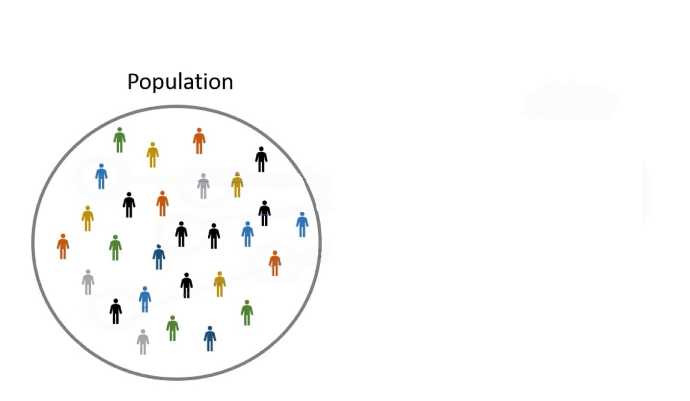
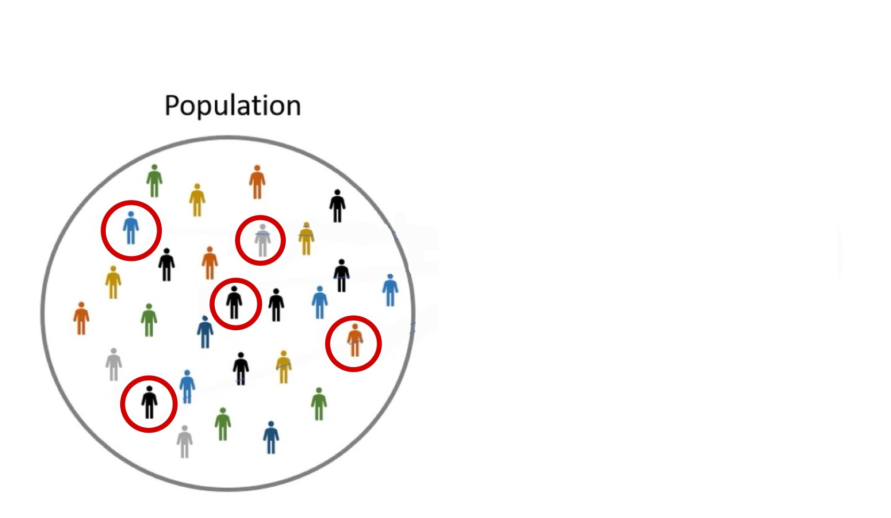
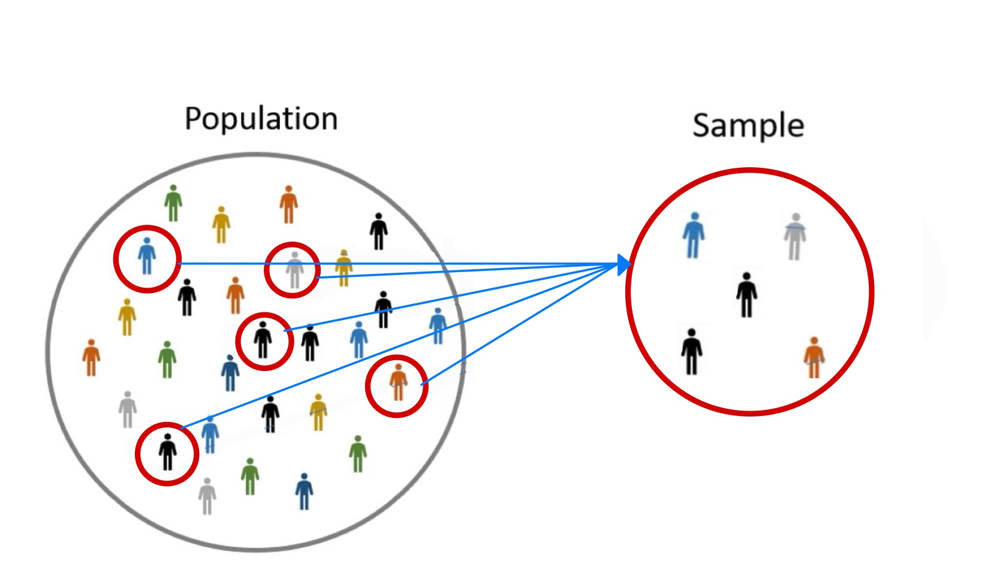
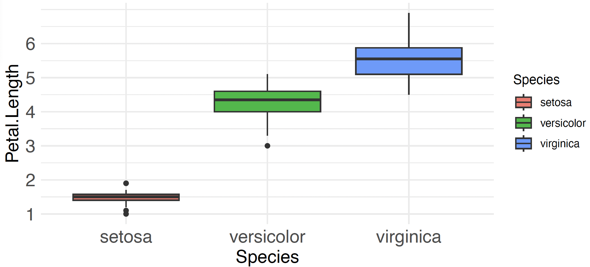



```{r, echo=FALSE, results='hide', message=FALSE}
library("tidyverse");theme_set(theme_minimal());library("patchwork");library("ggfunction");library("qqplotr")
```

## Review: Hypothesis Tests for One Population

:::{style="font-size:.8em;"}
- Previously, we learned hypothesis tests for one population parameter
:::

:::{.fragment .callout-tip title="Example"}
Suppose we are interested in determining if the average starting salary of UT Austin students is different from \$72k. Thus, our null and alternative hypothesis are

$$
H_{0}: \mu = 72,000 \\
H_{a}: \mu \neq 72,000.
$$
:::

:::{.fragment}
::: {.absolute top=340px left="300"}
{width="60%"}
:::

::: {.absolute top=340px left=280px style="font-size:.9em;"}
All UT Austin Students Ever
:::
:::

:::{.fragment}
::: {.absolute top=340px left="300"}
{width="60%"}
:::

::: {.absolute top=340px left=280px style="font-size:.9em;"}
All UT Austin Students Ever
:::
:::

:::{.fragment}
::: {.absolute top=340px left="300"}
{width="60%"}
:::

::: {.absolute top=340px left=280px style="font-size:.9em;"}
All UT Austin Students Ever
:::

::: {.absolute top=340px left=600px style="font-size:.9em;"}
Some UT Austin Students
:::
:::

::: {.fragment .absolute top="600" left="0"}
From our sample we get the average starting salary was \$75,000. Thus, we want to know if this is statistically significantly different from \$72,000.
:::

## Hypothesis Testing for Multiple Populations

:::{.callout-tip style="font-size:1.1em;" title="Example"}
Suppose we are interested in determining if there is a difference among the average starting salary of students that graduated from [UT Austin]{style="color:#BF5700;"}, [Texas A&M]{style="color:#500000;"}, and [Oklahoma University]{style="color:#841617;"}. 
:::

:::{.fragment}

::: {.absolute top=520px width="30%"}

:::

::: {.absolute top=360px width="30%"}

:::

::: {.absolute top=190px width="30%"}

:::

:::{.absolute top=530px}
[All Oklahoma Students Ever]{style="color:#841617; font-size:.5em;" .underline}
:::

:::{.absolute top=370px}
[All Texas A&M Students Ever]{style="color:#500000; font-size:.5em;" .underline}
:::

:::{.absolute top=190px}
[All UT Austin Students Ever]{style="color:#BF5700; font-size:.5em;" .underline}
:::

:::

::: {.fragment}

::: {.absolute top=520px width="30%"}

:::

::: {.absolute top=360px width="30%"}

:::

::: {.absolute top=190px width="30%"}

:::

::: {.absolute top=530px}
[All Oklahoma Students Ever]{style="color:#841617; font-size:.5em;" .underline}
:::

::: {.absolute top=370px}
[All Texas A&M Students Ever]{style="color:#500000; font-size:.5em;" .underline}
:::

::: {.absolute top=190px}
[All UT Austin Students Ever]{style="color:#BF5700; font-size:.5em;" .underline}
:::

:::

::: {.fragment}

::: {.absolute top=520px width="30%"}

:::

::: {.absolute top=360px width="30%"}

:::

::: {.absolute top=190px width="30%"}

:::

::: {.absolute top=530px}
[All Oklahoma Students Ever]{style="color:#841617; font-size:.5em;" .underline}
:::

::: {.absolute top=370px}
[All Texas A&M Students Ever]{style="color:#500000; font-size:.5em;" .underline}
:::

::: {.absolute top=190px}
[All UT Austin Students Ever]{style="color:#BF5700; font-size:.5em;" .underline}
:::

::: {.absolute top=530px left=190px}
[Some Oklahoma Students]{style="color:#841617; font-size:.5em;" .underline}
:::

::: {.absolute top=370px left=190px}
[Some Texas A&M Students]{style="color:#500000; font-size:.5em;" .underline}
:::

::: {.absolute top=190px left=190px}
[Some UT Austin Students]{style="color:#BF5700; font-size:.5em;" .underline}
:::

:::

:::{.fragment}
::: {.absolute top=270px left=300px style="color:#BF5700; font-size:1em;"}
$\longrightarrow \quad \bar{x}_{UT} = \$75k$
:::

::: {.absolute top=440px left=300px style="color:#500000; font-size:1em;"}
$\longrightarrow \quad \bar{x}_{A\&M} = \$73k$
:::

::: {.absolute top=600px left=300px style="color:#841617; font-size:1em;"}
$\longrightarrow \quad \bar{x}_{OU} = \$65k$
:::
:::

:::{.fragment .absolute left=600px top=350px}

[Is there a significant difference in salary?]{.underline}

:::{.mysolution}
(\$) difference due to school? 
<br>
Or natural variability?
:::

:::

# Hypothesis Testing for Two Population Means: Paired & Independent T

## Hypothesis Testing for Two Pop Means

:::{.incremental}
- We may be interested in determining if there is a difference between two means
  - i.e. is $\mu_{1} = \mu_{2}$? [$\mu_{1}$ & $\mu_{2}$ is mean for population 1 and 2, respectively]{.subtext}
:::

:::{.incremental}
- To perform a hypothesis test for $\mu_{1}$ and $\mu_{2}$, we must determine:
  - Are the two populations *independent* or *dependent* of one another?
:::

:::{.incremental}
- **Independent Populations:** *populations are independent of one another if they have no influence on, and are completely unrelated to, other populations* [i.e. the outcomes from populations are not dependent on one another]{.subtext}

- **Dependent Populations:** *populations are dependent on one another if the outcomes from one population influence, or are related to, the outcomes from other populations*
  - Why does dependence matter?
:::

## Why Dependence Matters

:::{.callout-tip title="Example"}
Suppose one is interested in determining if there is a difference between $\mu$ = *the mean SAT scores* for the genders Male and Female. For $H_{0}$, we assume that there is no difference in SAT scores between genders. That is, 

:::{.fragment }
$$H_{0}: \mu_{Female} = \mu_{Male}$$
:::

:::{.fragment}
Previously, we said p-value $= 0.02 < \alpha = 0.05$. Thus, there is sufficient evidence that there is a significant difference between $\mu_{Female}$ and $\mu_{Male}$. [However, are there other factors aside from gender that can cause a difference in SAT scores?]{.underline}
::: 
:::


:::{.fragment .absolute top=600px}
[Dependent populations can eliminate confounding factors]{.mysolution}
:::

## Dependent Populations

:::{.fragment style="font-size:.9em;" fragment-index=1}
- There are multiple ways we get dependent populations
  - [pre and post treatment from the same subject]{.fragment fragment-index=2}
  - ["pair" subjects based upon similarities [most common]{.subtext}]{.fragment fragment-index=3}
  - [genetics: twins, litters, ect.]{.fragment fragment-index=4}
::: 

:::{.fragment fragment-index=5}
- For dependent populations, to test whether there is a difference, we consider the [[differenced data]{.mysolution}]{.fragment fragment-index=7}
:::

:::{.fragment fragment-index=6}
| $X_{1}$ = Dep Pop 1 | $X_{2}$ = Dep Pop 2 | [[Difference ($X_{1} - X_{2}$)]{.mysolution}]{.fragment fragment-index=7} |
|:------------------:|:-----------------:|:-----------------------------:|
| 74                 | 70                | [[$4$]{.mysolution}]{.fragment fragment-index=7}                          |
| 80                 | 73                | [[$7$]{.mysolution}]{.fragment fragment-index=7}                          |
| 68                 | 69                | [[$-1$]{.mysolution}]{.fragment fragment-index=7}                           |
| 71                 | 76                | [[$-6$]{.mysolution}]{.fragment fragment-index=7}                         |
| $\vdots$                | $\vdots$               | [[$\vdots$]{.mysolution}]{.fragment fragment-index=7}                          |
:::

## Hypothesis Test for Two Dependent Means

:::{.callout-note title="Paired t-Test" style="font-size:1.1em;"}
Let $X_{1}$ and $X_{2}$ represent populations 1 and 2, respectively, and, let $X_{d} = X_{1} - X_{2}$ and $\mu_{d} = \mu_{1} - \mu_{2}$. Then, o conduct a hypothesis test for two dependent population means, we will use the *Paired t-Test*:

:::{.fragment}
[Null and Alternative Hypothesis]{.underline}

:::{.fragment}
$H_{0}: \mu_{d} = value$ [typically $value = 0$, i.e. $\mu_{1} = \mu_{2}$]{.subtext}
:::

:::{.fragment}
$H_{a}: \mu_{d} < value$, $> value$, or $\neq value$
:::
:::

:::{.fragment}
[Test-Statistic and Distribution]{.underline}
:::


:::{.fragment}
:::{.mysolution .center }
[$t$]{style="font-size:1.4em;"} [$= \frac{\bar{x}_{d} - \mu_{d}}{s_{d}/\sqrt{n}}$]{style="font-size:1.5em;"} [[$\sim t(df = n - 1)$]{style="font-size:1.2em;"} <br> [again $\mu_{d} = 0$ is the common case]{.subtext}]{.fragment}
:::
:::

:::{.fragment}
**Assumption for Paired t-Test:** [[Normality of the $X_{d}$ [(check with QQ-Plot of the differenced data)]{.subtext}]{.mysolution}]{.fragment}
:::
:::

:::{.incremental}
- To do a paired t-Test in $\texttt{R}$, we will just the `t.test()` function on the differenced data
:::

## Paired t-Test in R

:::{.incremental style="font-size:0.8em;"}
- To conduct a paired t-test in R, we can create the differenced data $X_{d} = X_{1} - X_{2}$ and then use the `t.test()` function on it. The arguments of interest are: 
  - `x`: the numeric vector of the differenced data
  - `mu`: the hypothesized value of $\mu_{d}$ in $H_{0}$ (default is 0)
  - `alternative`: the form of $H_{a}$, either `"less"`, `"greater"`, or `"two.sided"` (default is `"two.sided"`)
-  Or, we can keep our variables separate and use `t.test(x, y, paired = TRUE)`
:::

:::{.fragment}
:::{.absolute top=300px width=80%}
:::{style="transform: scale(0.7); transform-origin: top left;"}
```{webr}
# Hours of extra sleep for the same 10 patients under drug 1 and drug 2
drug1 <- sleep$extra[sleep$group == 1]
drug2 <- sleep$extra[sleep$group == 2]

# Differenced data: X_d = X_1 - X_2, with X_1 = drug 1 and X_2 = drug 2
diff_data <- drug1 - drug2

# Test H0: mu_d = 0 vs Ha: mu_d > 0 i.e. drug 1 > drug 2
t.test(diff_data, alternative = "greater")
```
:::
:::


```{webr}
#| include: false
# Hours of extra sleep for the same 10 patients under drug 1 and drug 2
drug1 <- sleep$extra[sleep$group == 1]
drug2 <- sleep$extra[sleep$group == 2]
```

:::{.absolute top=300px left=600px width=60%}
:::{style="transform: scale(0.7); transform-origin: top left;"}
```{webr}
# Equivalent: let t.test() do the differencing with paired = TRUE
t.test(drug1, drug2, paired = TRUE, alternative = "greater")
```
:::
:::
:::


## Paired t-Test Example
:::{.callout-tip title="Example" style="font-size:1.1em;"}
Suppose one is interested in determining if there is a difference between the mean SAT scores for the genders Female and Male at the 10% significance level. 100 female students were paired to 100 male students based upon their GPA and SAT tutoring and studying hours. The mean difference (Female - Male) for the sample was 9.64, and the standard deviation of the difference was 65.63. 
:::

::::{.columns}

:::{.column width=45% .fragment}
```{r, echo=TRUE}
sat_scores <- read.csv("data/sat_scores.csv")
```


:::{style="font-size:.6em;"}
```{r, echo=FALSE}
sat_scores |> 
  head(10) |> 
  knitr::kable()
```
:::
:::


:::{.column width=55% style="font-size:.9em;"}

:::{.incremental}
1. What are the null and alternative hypotheses?

:::{.fragment}
[$H_{0}: \mu_{d} = 0$ [where $\mu_{d} = \mu_{female} - \mu_{male}$]{.subtext}]{.mysolution}
:::

:::{.fragment}
[$H_{a}: \mu \neq 0$]{.mysolution}
:::

2. What is the Test-Statistic?

:::{.fragment}

[$$t = \frac{9.64 - 0}{65.63/\sqrt{100}} = 1.47$$]{.mysolution}

:::

:::

:::

::::

## Paired t-Test Example: Assumptions

- Before we can perform the paired t-Test, we must check the assumptions for the test

```{r, results='hide'}
diff_data <- sat_scores$female - sat_scores$male
```

:::{style="font-size:.6em;"}
```{r, eval=FALSE}
#| code-fold: true
#| code-summary: "Show the code"

library("qqplotr")
ggplot(aes(sample = diff_data), data = NULL)+
  stat_qq_band(color = "lightgrey")+
  stat_qq_line(color = "red") +
  stat_qq_point()
```
:::

:::{.center}
```{r, echo=FALSE, fig.height=4}
library("qqplotr")
ggplot(aes(sample = diff_data), data = NULL)+
  stat_qq_band(color = "lightgrey")+
  stat_qq_line(color = "red") +
  stat_qq_point()
```
:::

:::{.fragment}
[The normality assumption is reasonable]{.mysolution}
:::


## Paired t-Test Example
:::{.callout-tip title="Example" style="font-size:.8em;"}
Suppose one is interested in determining if there is a difference between the mean SAT scores for the genders Female and Male at the 10% significance level. 100 female students were paired to 100 male students based upon their GPA and SAT tutoring and studying hours. The mean difference (Female - Male) for the sample was 9.64, and the standard deviation of the difference was 65.63. 
:::

:::{.incremental}
3. Make a conclusion for the test.

:::{.fragment}
```{webr}
#| include: false
# sat_scores <- read.csv("data/sat_scores.csv")
# diff_data <- sat_scores$female - sat_scores$male
```

:::{style="font-size:.9em;"}
```{r}
t.test(diff_data, conf.level = 0.90)
```
:::
:::

:::{.fragment}
:::{.mysolution style="font-size:.8em;"}
The p-value $= 0.1451 > \alpha = 0.10$. Therefore, we fail to reject $H_{0}$ & conclude there is not sufficient evidence that mean SAT scores are different between genders.
:::
:::

4. What do we notice about the confidence interval? [[The 95% confidence interval for $\mu_{d}$ is (-3.38, 22.66), and it contains 0, which agrees with failing to reject $H_{0}$.]{.mysolution style="font-size:.9em;"}]{.fragment}
:::


## Hypothesis Test for Two Independent Means

:::{.callout-note title="Pooled t-Test" style="font-size:1.em;"}
Let $X_{1}$ and $X_{2}$ represent populations 1 and 2, respectively, with means $\mu_{1}$ and $\mu_{2}$. Then, to conduct a hypothesis test for two independent population means, we will use the *Pooled t-Test*:

:::{.fragment}
[Null and Alternative Hypothesis]{.underline}

:::{.fragment}
$H_{0}: \mu_{1} - \mu_{2} = value$ [typically $value = 0$, i.e. $\mu_{1} = \mu_{2}$]{.subtext}
:::

:::{.fragment}
$H_{a}: \mu_{1} - \mu_{2} < value$, $> value$, or $\neq value$
:::
:::

:::{.fragment}
[Test-Statistic and Distribution]{.underline}
:::


:::{.fragment}
:::{.mysolution .center }
[$t$]{style="font-size:1.4em;"} [$= \frac{(\bar{x}_{1} - \bar{x}_{2}) - (\mu_{1} - \mu_{2})}{\sqrt{\frac{s_{1}^{2}}{n_{1}} + \frac{s_{2}^{2}}{n_{2}}}}$]{style="font-size:1.5em;"} [[$\sim t(df = n_{1} + n_{2} - 2)$]{style="font-size:1.2em;"} <br> [again $\mu_{1} - \mu_{2} = 0$ is the common case]{.subtext}]{.fragment}
:::
:::

:::{.fragment}
[Assumptions for Pooled t-Test]{.underline} 

1. [[Normality of both $X_{1}$ and $X_{2}$ [(check with a QQ-Plot for each sample)]{.subtext}]{.mysolution}]{.fragment}
2. [[Equal Variances [(i.e. assumes $\sigma_{1} = \sigma_{2}$. Check with boxplots/densities/histograms)]{.subtext}]{.mysolution}]{.fragment}
:::

:::{.incremental}
- Note: If the equal variance assumption is not reasonable, then we could perform Welch's Unpooled t-Test [(less powerful than pooled t-Test)]{.subtext}
:::
:::


## Pooled t-Test in R

:::{.incremental style="font-size:0.8em;"}
- To conduct a pooled t-test in R, we can keep the two samples separate and use the `t.test()` function with `var.equal = TRUE`. The arguments of interest are: 
  - `x`, `y`: the numeric vectors of the data for population 1 and population 2, respectively
  - `mu`: the hypothesized value of $\mu_{1} - \mu_{2}$ in $H_{0}$ (default is 0)
  - `alternative`: the form of $H_{a}$, either `"less"`, `"greater"`, or `"two.sided"` (default is `"two.sided"`)
  - `var.equal`: set to `TRUE` for the pooled test (default is `FALSE`, which gives the unpooled test)
- Or, if the data is in one column with a second column of group labels, we can use the formula version `t.test(y ~ group, data = data, var.equal = TRUE)`
:::

:::{.fragment}
:::{.absolute top=350px width=80%}
:::{style="transform: scale(0.7); transform-origin: top left;"}
```{webr}
# Miles per gallon for cars with automatic and manual transmissions
auto   <- mtcars$mpg[mtcars$am == 0]
manual <- mtcars$mpg[mtcars$am == 1]

# Test H0: mu_1 - mu_2 = 0 vs Ha: mu_1 - mu_2 != 0
# with X_1 = automatic and X_2 = manual
t.test(auto, manual, var.equal = TRUE)
```
:::
:::

:::{.absolute top=350px left=600px width=60%}
:::{style="transform: scale(0.7); transform-origin: top left;"}
```{webr}
# Equivalent: formula version, am = 0 (automatic) is group 1
t.test(mpg ~ am, data = mtcars, var.equal = TRUE)
```
:::
:::
:::

## Pooled t-Test Example

:::{.callout-tip title="Example"}
A researcher is testing a new blood pressure medication. They randomly assigns 29 patients with high blood pressure to one of two groups: 15 receive the new medication and 14 receive a placebo. After 8 weeks, they recorded each patient's reduction in systolic blood pressure (mmHg). They want to know if the new medication reduces blood pressure more than the placebo at the 5% significance level.
:::

```{r, echo=FALSE}
library(tibble)

# Synthetic data for a pooled two-sample t-test example
bp_data <- tribble(
  ~patient_id, ~group,       ~reduction_mmHg,
   1,          "Treatment", 14,
   2,          "Treatment",  8,
   3,          "Treatment", 19,
   4,          "Treatment", 11,
   5,          "Treatment",  6,
   6,          "Treatment", 16,
   7,          "Treatment", 13,
   8,          "Treatment", 21,
   9,          "Treatment",  9,
  10,          "Treatment", 15,
  11,          "Treatment",  5,
  12,          "Treatment", 12,
  13,          "Treatment", 18,
  14,          "Treatment", 10,
  15,          "Treatment", 13,
  16,          "Placebo",     7,
  17,          "Placebo",    12,
  18,          "Placebo",     3,
  19,          "Placebo",     9,
  20,          "Placebo",    -1,
  21,          "Placebo",    11,
  22,          "Placebo",     5,
  23,          "Placebo",    14,
  24,          "Placebo",     8,
  25,          "Placebo",     2,
  26,          "Placebo",    10,
  27,          "Placebo",     0,
  28,          "Placebo",     6,
  29,          "Placebo",     4
)
```


::::{.columns}

:::{.column width=45% .fragment}
```{r, echo=TRUE, eval=FALSE}
bp_data
```


:::{style="font-size:.6em;"}
```{r, echo=FALSE}
bp_data |> 
  slice_sample(n = 5, by = group) |> 
  knitr::kable()
  # head(10) |> 
  # knitr::kable()
```
:::
:::


:::{.column width=55% style="font-size:.8em;"}

:::{.incremental}
1. Are the two populations independent or dependent?

:::{.fragment}
[Independent because patients were randomly assigned to each group]{.mysolution}
:::

2. What test should we perform?

:::{.fragment}
[Pooled t-Test]{.mysolution}
:::

3. What are the null and alternative hypotheses?

:::{.fragment}
[$H_{0}: \mu_{1} = \mu_{2}$ [where $\mu_{1} =$ mean reduction in BP for Treatment  & $\mu_{2} =$  mean reduction in BP for Placebo]{.subtext}]{.mysolution}
:::

:::{.fragment}
[$H_{a}: \mu_{1} > \mu_{2}$]{.mysolution}
:::

:::

:::

::::

## Pooled t-Test Example: Assumptions

- Before we can proceed with our test, we must check the assumptions first!

::::{.columns}

:::{.column width=50% .fragment}
1. Normality

:::{style="font-size:.5em;"}
```{r, eval=FALSE}
library(qqplotr)
ggplot(aes(sample = reduction_mmHg), data = bp_data)+
  stat_qq_band(color = "lightgrey")+
  stat_qq_line(color = "red") +
  stat_qq_point()+
  facet_wrap(~group)
```
:::

```{r, echo=FALSE}
ggplot(aes(sample = reduction_mmHg), data = bp_data)+
  stat_qq_band(color = "lightgrey")+
  stat_qq_line(color = "red") +
  stat_qq_point()+
  facet_wrap(~group, scales = "free")+
  theme(strip.background = element_rect(fill = "lightgrey"), 
        strip.text = element_text(size = 16))
```

:::{.fragment}
[The normality assumption is reasonable for both populations]{.mysolution}
:::

:::

:::{.column width=50% .fragment}
2. Equal Variance

:::{style="font-size:.6em;"}
```{r, eval=FALSE}
ggplot(aes(group, reduction_mmHg), data = bp_data)+
  geom_boxplot()
```
:::

```{r, echo=FALSE}
ggplot(aes(group, reduction_mmHg), data = bp_data) +
  geom_boxplot() +
  theme(
    axis.title.x = element_text(size = 16),
    axis.title.y = element_text(size = 16),
    axis.text.x = element_text(size = 14),
    # axis.text.y = element_text(size = 14)
  )
```

:::{.fragment}
[The variability seems very similar for both populations]{.mysolution}
:::

:::

::::

## Pooled t-Test Example: Conclusions

:::{.callout-tip title="Example" style="font-size:.8em;"}
A researcher is testing a new blood pressure medication. They randomly assigns 29 patients with high blood pressure to one of two groups: 15 receive the new medication and 14 receive a placebo. After 8 weeks, they recorded each patient's reduction in systolic blood pressure (mmHg). They want to know if the new medication reduces blood pressure more than the placebo at the 5% significance level.
:::

:::{.incremental}
3. Make a conclusion for the test.

```{webr}
#| include: false

library(tibble)

# Synthetic data for a pooled two-sample t-test example
bp_data <- tribble(
  ~patient_id, ~group,       ~reduction_mmHg,
   1,          "Treatment", 14,
   2,          "Treatment",  8,
   3,          "Treatment", 19,
   4,          "Treatment", 11,
   5,          "Treatment",  6,
   6,          "Treatment", 16,
   7,          "Treatment", 13,
   8,          "Treatment", 21,
   9,          "Treatment",  9,
  10,          "Treatment", 15,
  11,          "Treatment",  5,
  12,          "Treatment", 12,
  13,          "Treatment", 18,
  14,          "Treatment", 10,
  15,          "Treatment", 13,
  16,          "Placebo",     7,
  17,          "Placebo",    12,
  18,          "Placebo",     3,
  19,          "Placebo",     9,
  20,          "Placebo",    -1,
  21,          "Placebo",    11,
  22,          "Placebo",     5,
  23,          "Placebo",    14,
  24,          "Placebo",     8,
  25,          "Placebo",     2,
  26,          "Placebo",    10,
  27,          "Placebo",     0,
  28,          "Placebo",     6,
  29,          "Placebo",     4
)
```

:::{style="transform: scale(0.7); transform-origin: top left;" .fragment}
```{r}
#| autorun: false
treatment <- bp_data$reduction_mmHg[bp_data$group == "Treatment"]
placebo <- bp_data$reduction_mmHg[bp_data$group == "Placebo"]

t.test(treatment, placebo, alternative = "greater", var.equal = TRUE)
```
:::

:::{.fragment .absolute top=520px}
[The p-value $= 0.00056 < \alpha = 0.05$. Therefore, we reject $H_{0}$ and conclude that there is sufficient evidence that the mean reduction for Treatment is larger than Placebo.]{.mysolution style="font-size:.8em;"}
:::


4. What is the effect size? [[We are 95% confident that the true mean reduction in systolic blood pressure for the new medication is at least 3.32 mmHg greater than the placebo [i.e. $\mu_{1} - \mu_{2} > 3.32$.]{.subtext}]{.mysolution style="font-size:.8em;"}]{.fragment}


:::

# Hypothesis Testing for more than Two Population Means: ANOVA

## Test for Multiple Populations


:::{.callout-tip title="Example" style="font-size:1.0em;"}
Consider the Iris dataset which consist of petal length of three different flower species: Setos, Versicolor, and Virginica of the Iris flower.
:::

:::{style="font-size:.9em;"}
:::: panel-tabset
### Boxplots

:::{.center}
{width="65%"}
:::

### Data

::: {style="font-size:.8em;"}
```{r, echo=FALSE}
iris[,c(3, 5)] |> 
  group_by(Species) |> 
  slice_sample(n = 3) |> 
  knitr::kable()
```
:::
::::
:::

::: {.fragment style="font-size:.9em;"}
-   Visually, we see there is a difference in the typical value among each Species. Now, we will formalize this into a hypothesis test.
:::

## Test for Multiple Populations Cont.

:::{.incremental}
- For testing one and two population means, we often use the t-test
  - For testing more than two population means, we need a different approach
- **Analysis of Variance (ANOVA)** *is a statistical method used to compare the means of three or more groups to determine whether there is a statistically significant difference among them.*
:::

:::{.incremental}
- ANOVA examines how the *dependent/response* variable changes with the levels of the factor(s)
  - A **factor** is a qualitative variable that represents conditions, groups, or categories [Ex: Factor is hair color with levels of brown, black, blonde, red, gray]{.subtext}
  - The **dependent/response** variable is the quantitative outcome being measured and compared across the different groups.
  - A **one-factor ANOVA** examines how a dependent/response variable changes over the levels of a single factor 
:::

## One-Factor ANOVA
:::{.callout-note title="One-Factor ANOVA" style="font-size:1.1em;"}
Let $X_{1}, \ldots, X_{K}$ represent *K* different populations and $\mu_k, k = 1, \ldots, K$ are the population means for a specific variable measured across *K* different populations. Then, to conduct a hypothesis test to determine whether the mean is different or the same across the *K* populations, we will use *ANOVA*:


:::{.fragment}
[Null and Alternative Hypothesis]{.underline}

:::{.fragment}
$H_0: \mu_1 = \mu_2 = \ldots = \mu_K$ [i.e. the means are all the same]{.subtext}
:::

:::{.fragment}
$H_{a}: \text{At least one mean } \mu \text{ is different.}$
:::
:::

:::{.fragment}
[Test-Statistic and Distribution]{.underline}
:::


:::{.fragment}
:::{.center}
$F = \frac{\sum_{k = 1}^{K}n_{k}(\bar{X}_{k} - \bar{X})^{2}/(K - 1)}{\sum_{k = 1}^{K}\sum_{i = 1}^{n_{k}}(X_{i} - \bar{X}_{k})^{2}/(n - K)}$ [[$= \frac{MSB}{MSW}$]{.mysolution}]{.fragment} [$\sim F(df_{1} = K - 1, df_{2} = n - K)$]{.fragment} <br> [F is another distribution like $t$, normal, ect.]{.subtext}
:::
:::

:::{.fragment}
[Assumptions for ANOVA]{.underline} 

1. [Normality of all populations [Check w/ QQ plots]{.subtext}]{.mysolution}
2. [Equal Variance [Check with boxplots]{.subtext}]{.mysolution} 
:::

:::

## Between vs With Variability

:::{.callout-tip title="Idea" style="font-size:1.1em;"}
The main idea of *ANOVA* is to measure the variation [between]{style="color: #005f86;"} groups relative to the variation [within]{style="color:#f8971f;"} groups.
:::

::: {.fragment .absolute top=170px left=250px style="font-size:.8em;"}
**Table 1. Sepal.Width measurement for three Iris Species**

<table border="1" style="border-collapse:collapse; text-align:center;">
  <thead>
    <tr>
      <th style="border-right:3px solid black;"></th>
      <th>setosa</th>
      <th>versicolor</th>
      <th>virginica</th>
    </tr>
  </thead>
  <tbody>
    <tr><td style="border-right:3px solid black;"></td><td><span style="visibility:hidden;">3.5</span></td><td><span style="visibility:hidden;">3.2</span></td><td><span style="visibility:hidden;">3.3</span></td></tr>
    <tr><td style="border-right:3px solid black;"></td><td><span style="visibility:hidden;">3.0</span></td><td><span style="visibility:hidden;">3.2</span></td><td><span style="visibility:hidden;">2.7</span></td></tr>
    <tr><td style="border-right:3px solid black;"></td><td><span style="visibility:hidden;">3.2</span></td><td><span style="visibility:hidden;">3.1</span></td><td><span style="visibility:hidden;">3.0</span></td></tr>
    <tr><td style="border-right:3px solid black;"></td><td><span style="visibility:hidden;">3.1</span></td><td><span style="visibility:hidden;">2.3</span></td><td><span style="visibility:hidden;">2.9</span></td></tr>
    <tr><td style="border-right:3px solid black;"></td><td><span style="visibility:hidden;">3.6</span></td><td><span style="visibility:hidden;">2.8</span></td><td><span style="visibility:hidden;">3.0</span></td></tr>
    <tr><td style="border-right:3px solid black;"></td><td><span style="visibility:hidden;">3.9</span></td><td><span style="visibility:hidden;">2.8</span></td><td><span style="visibility:hidden;">3.0</span></td></tr>
    <tr><td style="border-right:3px solid black;"><b>Mean</b></td><td><b>3.38</b></td><td><b>2.90</b></td><td><b>3.15</b></td></tr>
  </tbody>
</table>
:::

::::{.fragment}

:::{.absolute top=540px}
- [Between]{style="color:#005f86;"} group variability refers to the variation of the group means relative to the overall mean [i.e. how far apart the groups are from each other]{.subtext}
:::

::: {.absolute top="485" left="400"}
::: {style="width:300px; height:65px; border:3px solid #005f86; border-radius:50%;"}
:::
:::

::::

::::: {.fragment}
::: {.absolute top=620px}
-   [Within]{style="color:#f8971f;"} group variability refers to the variation of the measurement values inside each group [i.e. how spread out the observations are within that group]{.subtext}
:::

::: {.absolute top=170px left=250px style="font-size:.8em;"}
**Table 1. Sepal.Width measurement for three Iris Species**

<table border="1" style="border-collapse:collapse; text-align:center;">
  <thead>
    <tr>
      <th style="border-right:3px solid black;"></th>
      <th>setosa</th>
      <th>versicolor</th>
      <th>virginica</th>
    </tr>
  </thead>
  <tbody>
    <tr><td style="border-right:3px solid black;"></td><td><span>3.5</span></td><td><span>3.2</span></td><td><span>3.3</span></td></tr>
    <tr><td style="border-right:3px solid black;"></td><td><span>3.0</span></td><td><span>3.2</span></td><td><span>2.7</span></td></tr>
    <tr><td style="border-right:3px solid black;"></td><td><span>3.2</span></td><td><span>3.1</span></td><td><span>3.0</span></td></tr>
    <tr><td style="border-right:3px solid black;"></td><td><span>3.1</span></td><td><span>2.3</span></td><td><span>2.9</span></td></tr>
    <tr><td style="border-right:3px solid black;"></td><td><span>3.6</span></td><td><span>2.8</span></td><td><span>3.0</span></td></tr>
    <tr><td style="border-right:3px solid black;"></td><td><span>3.9</span></td><td><span>2.8</span></td><td><span>3.0</span></td></tr>
    <tr><td style="border-right:3px solid black;"><b>Mean</b></td><td><b>3.38</b></td><td><b>2.90</b></td><td><b>3.15</b></td></tr>
  </tbody>
</table>

:::
:::::

:::: {.fragment .absolute top="250" left="385"}
::: {style="width:70px; height:250px; border:3px solid #f8971f; border-radius:50%;"}
:::
::::


:::: {.fragment .absolute top="250" left="470"}
::: {style="width:70px; height:250px; border:3px solid #f8971f; border-radius:50%;"}
:::
::::

:::: {.fragment .absolute top="250" left="600"}
::: {style="width:70px; height:250px; border:3px solid #f8971f; border-radius:50%;"}
:::
::::

## Between vs Within Illustrated

:::{.callout-tip title="Example" style="font-size:1em;"}
Consider the width of three different flower species: Setos, Versicolor, and Virginica. 
:::

::: {.absolute top=180px left=50px}
```{r, echo = FALSE, fig.height=3.5}
mean_df <- iris |> 
  group_by(Species) |> 
  summarise("mean" = mean(Sepal.Width))

mean_df2 <- mean_df |> 
  mutate("mean" = c(NA, mean[2:3]))

mean_df2 |> 
ggplot(aes(Species, mean))+
    geom_point(shape = 4, size = 5)+
    scale_y_continuous(limits = c(2, 4.5), 
                     breaks = c(2, 2.5, 4, 4.5, round(mean_df$mean, 2)))+
    labs(y = "Sepal.Width")
```
:::

:::{.fragment .absolute top=550px style="font-size:.9em;"}
- There is some [*between*]{style="color:#005f86;"} group variability among Versicolor and Virginica [means are slightly different]{.subtext}
:::

:::{.fragment}
:::{.absolute .subbullets style="font-size:.9em;" top=580px}
- However, when we consider the [*within*]{style="color:#f8971f;"} group variability, the difference is not significant
:::

::: {.absolute top=180px left=50px}
```{r, echo = FALSE, fig.height=3.5}
iris |> 
  mutate("Sepal.Width" = case_when(Species == "setosa" ~ NA, 
                                   .default = Sepal.Width)) |> 
  ggplot(aes(Species, Sepal.Width, fill = Species))+
  geom_boxplot()+
  geom_point(aes(y = mean), shape = 4, size = 5, data = mean_df2)+
  scale_fill_manual(values = c("purple", "#fcfdbf", "#fe9f6d"))+
  scale_y_continuous(limits = c(2, 4.5), 
                     breaks = c(2, 2.5, 4, 4.5, round(mean_df$mean, 2)))+
  theme(legend.position = "none")
```
:::
:::

::: {.fragment .absolute top=180px left=50px}
```{r, echo = FALSE, fig.height=3.5}
iris |> 
  mutate("Sepal.Width" = case_when(Species == "setosa" ~ NA, 
                                   .default = Sepal.Width)) |> 
  ggplot(aes(Species, Sepal.Width, fill = Species))+
  geom_boxplot()+
  geom_point(aes(y = mean), shape = 4, size = 5, data = mean_df)+
  scale_fill_manual(values = c("purple", "#fcfdbf", "#fe9f6d"))+
  scale_y_continuous(limits = c(2, 4.5), 
                     breaks = c(2, 2.5, 4, 4.5, round(mean_df$mean, 2)))+
  theme(legend.position = "none")
```
:::

::::{.fragment}

:::{.absolute top=620px style="font-size:.9em;"}
-  Once we include Setosa, the [*between*]{style="color:#005f86;"} group variability is large enough compared to the [*within*]{style="color:#f8971f;"} group variability. Thus, the difference is significant [i.e at least one mean is different than the rest]{.subtext}
:::

::: {.absolute top=180px left=50px}
```{r, echo = FALSE, fig.height=3.5}
iris |> 
  ggplot(aes(Species, Sepal.Width, fill = Species))+
  geom_boxplot()+
  geom_point(aes(y = mean), shape = 4, size = 5, data = mean_df)+
  scale_fill_manual(values = c("#fe9f6d", "purple", "#fcfdbf"))+
  scale_y_continuous(limits = c(2, 4.5), 
                     breaks = c(2, 2.5, 4, 4.5, round(mean_df$mean, 2)))+
  theme(legend.position = "none")
```
:::
::::

## ANOVA in R

- To perform a one-factor ANOVA test in R we use the `aov()` function

```{r, eval = FALSE}
aov(response ~ factor, data = my_data)
```

:::{.fragment}
- To summarize the results of our ANOVA test (p-value and ect...) we use the `summary()` function on our `aov` object
```{r, eval = FALSE}
aov_results <- aov(response ~ factor, data = my_data)
summary(aov_results)
```
:::

:::{.fragment}
:::{.callout-tip title="Example"}
Consider the previous example comparing the width among the Species for the iris dataset.
:::

:::{style="transform: scale(0.9); transform-origin: top left;"}
```{webr}
aov_results <- aov(Sepal.Width ~ Species, data = iris)
summary(aov_results)
```
:::
:::

## ANOVA Example
:::{.callout-tip title="Example" style="font-size:.95em;"}
Suppose Starbucks wants to compare the effectiveness of different advertising channels. Starbucks selects 40 locations in the US to get TV adds only, 40 locations to get online adds, and 40 locations to get print ads. They record the sales increase percentage for all locations and want to compare the mean sales increase across the advertising methods. Using one-factor ANOVA, make a conclusion about the average sales increase across advertising methods at the 5\% significance level. 
:::


```{r, echo=FALSE}
load("data/starbucks.RData")
```

::::{.columns}

:::{.column width=45% .fragment}
```{r, echo=TRUE, eval=FALSE}
starbucks
```


::: panel-tabset

### Data

:::{style="font-size:.6em;"}
```{r, echo=FALSE}
starbucks |> 
  slice_sample(n = 3, by = method) |> 
  knitr::kable()
  # head(10) |> 
  # knitr::kable()
```
:::

### Means

:::{style="font-size:.7em;"}
```{r, eval=FALSE}
#| code-fold: true
#| code-summary: "Show code"
library(dplyr)
starbucks |> 
  group_by(method) |> 
  summarise("mean" = mean(sales))
```
:::

```{r, echo=FALSE}
starbucks |> 
  group_by(method) |> 
  summarise("mean" = mean(sales)) |> 
  knitr::kable()
```


:::
:::


:::{.column width=55% style="font-size:.8em;"}

:::{.incremental}
1. What test should we perform?

:::{.fragment}
[One-factor ANOVA because we are comparing more than 2 means]{.mysolution}
:::

2. What are the null and alternative hypotheses?

:::{.fragment}
[$H_0: \mu_1 = \mu_2 = \mu_3$ [, where $\mu_{1}, \mu_2, \mu_3$ are the means for Online, Print, and TV, respectively.]{.subtext}]{.mysolution}
:::

:::{.fragment}
[$H_a: \text{At least one mean } \mu_{k} \text{ is different}$]{.mysolution}
:::

:::

:::

::::

## ANOVA Example: Assumptions
- Before we can proceed with our test, we must check the assumptions first!

::::{.columns}

:::{.column width=50% .fragment}
1. Normality

:::{style="font-size:.5em;"}
```{r, eval=FALSE}
library("qqplotr")
starbucks |> 
ggplot(aes(sample = sales))+
  stat_qq_band(color = "lightgrey")+
  stat_qq_line(color = "red") +
  stat_qq_point()+
  facet_wrap(~method)
```
:::

```{r, echo=FALSE}
starbucks |> 
ggplot(aes(sample = sales))+
  stat_qq_band(color = "lightgrey")+
  stat_qq_line(color = "red") +
  stat_qq_point()+
  facet_wrap(~method)+
  theme(strip.background = element_rect(fill = "lightgrey"), 
        strip.text = element_text(size = 16))
```

:::{.fragment}
[The normality assumption is reasonable for all 3 populations]{.mysolution}
:::

:::

:::{.column width=50% .fragment}
2. Equal Variance

:::{style="font-size:.6em;"}
```{r, eval=FALSE}
ggplot(aes(method, sales, fill = method), data = starbucks)+
  geom_boxplot()
```
:::

```{r, echo=FALSE}
ggplot(aes(method, sales, fill = method), data = starbucks) +
  geom_boxplot() +
  theme(legend.position = "none",
    axis.title.x = element_text(size = 16),
    axis.title.y = element_text(size = 16),
    axis.text.x = element_text(size = 14),
    # axis.text.y = element_text(size = 14)
  )
```

:::{.fragment}
[The variability seems very similar for all populations]{.mysolution}
:::

:::

::::

## ANOVA Example: Conclusion
:::{.callout-tip title="Example" style="font-size:.8em;"}
Suppose Starbucks wants to compare the effectiveness of different advertising channels. Starbucks selects 40 locations in the US to get TV adds only, 40 locations to get online adds, and 40 locations to get print ads. They record the sales increase percentage for all locations and want to compare the mean sales increase across the advertising methods. Using one-factor ANOVA, make a conclusion about the average sales increase across advertising methods at the 5\% significance level. 
:::

3. Make a conclusion for the test. 

:::{.fragment}
```{webr}
#| include: false
load("data/starbucks.RData")
```

:::{style="transform: scale(0.9); transform-origin: top left;" .absolute top=280px}
```{webr}
aov_results <- aov(sales ~ method, data = starbucks)
summary(aov_results)
```
:::
:::

:::{.incremental .absolute left=630px top=260px}
- Results: 
  - Between Variability (MSB) = [255.51]{.mysolution style="font-size:.9em;"}
  - Within Variability (MSW) = [7.11]{.mysolution style="font-size:.9em;"}
  - F-Statistic = [35.93]{.mysolution style="font-size:.9em;"}
  - [p-value < 0.001]{.mysolution style="font-size:.9em;"}
:::

:::{.absolute top=580px style="font-size:.9em;"}
[**Conclusion**: [Since the p-value < 0.001 < $\alpha$ = 0.05, we  reject $H_{0}$.]{.mysolution}]{.fragment} [[Thus, there is sufficient evidence to conclude that at least one mean sales increase is different across the advertising strategies.]{.mysolution}]{.fragment}
:::

## Multiple Comparisons for ANOVA

:::{.callout-note title="Reminder" style="font-size:1.1em;"}
The hypotheses for ANOVA are 
\begin{align*}
          H_0&: \mu_1 = \mu_2 = \mu_3\\
          H_a&: \text{At least one mean } \mu \text{ is different,}
\end{align*}
:::

:::{.incremental style="font-size:.9em;"}
- Thus, if p-value $< \alpha$, we reject $H_{0}$ and conclude we have sufficient evidence that [[[at least one mean is different]{.mysolution}]{.underline}]{.fragment}
  - So, the question becomes which one(s) is/are different from one another?
:::

:::{.incremental}
- The goal of **multiple comparison** analysis is to determine which mean(s) is different from the rest [sometimes all of the means are different]{.subtext}
:::

## Multiple Comparisons for ANOVA Cont.
- We could answer this by performing pairwise hypothesis tests [i.e. test each possible pair of groups]{.subtext}

:::{.fragment}

:::{style="font-size:.9em;"}

:::{.absolute top=100 left=250}
\begin{align*}
          H_0&: \mu_1 = \mu_2 \\
          H_a&: \mu_1 \neq \mu_2
\end{align*}
:::

:::{.absolute top=100 left=450}
\begin{align*}
          H_0&: \mu_1 = \mu_3 \\
          H_a&: \mu_1 \neq \mu_3
\end{align*}
:::

:::{.absolute top=100 left=650}
\begin{align*}
          H_0&: \mu_2 = \mu_3 \\
          H_a&: \mu_2 \neq \mu_3
\end{align*}
:::

:::
:::

:::{.subbullets .absolute top=200px .fragment}
- Intuitively this method is valid, however, statistically it creates a problem
:::

:::{.fragment}
:::{.absolute top=260px}
:::{.callout-important title="Issue" style="font-size:1.1em;"}
When we run many hypothesis tests, we increase the chance of finding a “significant” difference just by "luck". [Reminder: In hypothesis testing, we never know if our conclusion is correct]{.subtext}
:::
:::
:::

:::{.fragment .subbullets .absolute top=420px}
- Now, imagine if we have 100 means to compare... 
:::

:::{.fragment style="font-size:.9em;"}
:::{.absolute top=450 left=100}
\begin{align*}
          H_0&: \mu_1 = \mu_2 \\
          H_a&: \mu_1 \neq \mu_2
\end{align*}
:::

:::{.absolute top=450 left=300}
\begin{align*}
          H_0&: \mu_1 = \mu_3 \\
          H_a&: \mu_1 \neq \mu_3
\end{align*}
:::

:::{.absolute top=450 left=500}
\begin{align*}
          H_0&: \mu_1 = \mu_3 \\
          H_a&: \mu_1 \neq \mu_3 \quad \ldots
\end{align*}
:::

:::{.absolute top=450 left=750}
\begin{align*}
          H_0&: \mu_1 = \mu_{100} \\
          H_a&: \mu_1 \neq \mu_{100}
\end{align*}
:::
:::


:::{.fragment style="font-size:.9em;"}

:::{.absolute top=450px width=35%}

:::
:::{.absolute top=450px width=35% left=200px}

:::
:::{.absolute top=450px width=35% left=400px}

:::
:::{.absolute top=450px width=35% left=600px}

:::

:::{.absolute top=450 left=100}
\begin{align*}
          H_0&: \mu_2 = \mu_3 \\
          H_a&: \mu_2 \neq \mu_3
\end{align*}
:::

:::{.absolute top=450 left=300}
\begin{align*}
          H_0&: \mu_2 = \mu_4 \\
          H_a&: \mu_2 \neq \mu_4
\end{align*}
:::

:::{.absolute top=450 left=500}
\begin{align*}
          H_0&: \mu_2 = \mu_5 \\
          H_a&: \mu_2 \neq \mu_5 \quad \ldots
\end{align*}
:::

:::{.absolute top=450 left=750}
\begin{align*}
          H_0&: \mu_2 = \mu_{100} \\
          H_a&: \mu_2 \neq \mu_{100}
\end{align*}
:::

:::

:::{.fragment style="font-size:.9em;"}

:::{.absolute top=450px width=35%}

:::
:::{.absolute top=450px width=35% left=200px}

:::
:::{.absolute top=450px width=35% left=400px}

:::
:::{.absolute top=450px width=35% left=600px}

:::

:::{.absolute top=450 left=100}
\begin{align*}
          H_0&: \mu_1 = \mu_2 \\
          H_a&: \mu_1 \neq \mu_2
\end{align*}
:::

:::{.absolute top=500 left=300}
$\ldots$
:::

:::{.absolute top=450 left=350}
\begin{align*}
          H_0&: \mu_{97} = \mu_{98} \\
          H_a&: \mu_{97} \neq \mu_{98}
\end{align*}
:::

:::{.absolute top=450 left=550}
\begin{align*}
          H_0&: \mu_{97} = \mu_{99} \\
          H_a&: \mu_{97} \neq \mu_{99}
\end{align*}
:::

:::{.absolute top=450 left=740}
\begin{align*}
          H_0&: \mu_{97} = \mu_{100} \\
          H_a&: \mu_{97} \neq \mu_{100}
\end{align*}
:::
:::

:::{.incremental .absolute top=550px}
- That leaves a lot of chance for error, which we call the **family-wise error rate (FWER) **

:::{.fragment .center}
$FWER = P(\text{at least one error}) = 1 - (1 - \alpha)^{\text{# of test}}$ <br> [This is a lot bigger than our original $\alpha$!]{.subtext}
:::
:::

## Tukey's Multiple Comparison Adjustment
- [We need a way to adjust for this inflation of error before drawing conclusions]{style="font-size:.9em;"}

:::{.callout-note title="Tukey's Multiple Comparison" style="font-size:1.1em;"}
After rejecting $H_{0}$ in ANOVA, we use *Tukey's Multiple Comparison* to determine which pairs of means are different, while keeping the family-wise error rate at $\alpha$:

:::{.fragment}
[Null and Alternative Hypothesis]{.underline}

:::{.fragment}
$H_0: \mu_i = \mu_j$ [for every pair of groups $i \neq j$]{.subtext}
:::

:::{.fragment}
$H_{a}: \mu_i \neq \mu_j$
:::
:::

:::{.fragment .incremental}
[Conclusions]{.underline} 

- If the adjusted p-value $< \alpha$, [we conclude the two means are different]{.mysolution}
- Or, if the interval for $\mu_i - \mu_j$ does not contain 0, [we conclude the two means are different]{.mysolution}
:::

:::

:::{.fragment}
- [To perform Tukey's Multiple Comparison in R, we use `TukeyHSD()` with `aov()`]{style="font-size:.9em;"}

```{r, eval=FALSE}
aov_results <- aov(response ~ factor, data = my_data)
TukeyHSD(aov_results)
```
:::

## Tukey Multiple Comparison Example

:::{.callout-tip title="Starbucks Example Revisited" style="font-size:1.1em;"}
We are wanting to compare advertising strategies for Starbucks between online, print, and tv ads at the 5\% significance level. We rejected $H_{0}$. Thus, we know at least one mean is signficantly different from another. 
:::

:::{.fragment}
- Now, we determine which mean is different using Tukey's Multiple Comparisons

```{r}
aov_results <- aov(sales ~ method, data = starbucks)
TukeyHSD(aov_results)
```
:::

:::{.fragment}
::: {.absolute left=10 top=515px style="width:100px; height:0px; border:1px solid purple;"}
:::

::: {.absolute left=420 top=515px style="width:80px; height:0px; border:1px solid purple;"}
:::

:::{.absolute left=485 top=350px style="font-size:.8em;"}
- [[Print vs Online]{.underline}]{style="color:purple;"}: [[The p-value $\approx 0 < \alpha = 0.05$. Thus, they are different]{.mysolution}]{.fragment}
:::
:::

:::{.fragment}
::: {.absolute left=10 top=535px style="width:100px; height:0px; border:1px solid green;"}
:::

::: {.absolute left=420 top=535px style="width:80px; height:0px; border:1px solid green;"}
:::

:::{.absolute left=485 top=420px style="font-size:.8em;"}
- [[TV vs Online]{.underline}]{style="color:green;"}: [[The p-value $\approx 0 < \alpha = 0.05$. Thus, they are different]{.mysolution}]{.fragment}
:::
:::

:::{.fragment}
::: {.absolute left=10 top=555px style="width:100px; height:0px; border:1px solid orange;"}
:::

::: {.absolute left=420 top=555px style="width:80px; height:0px; border:1px solid orange;"}
:::

:::{.absolute left=485 top=490px style="font-size:.8em;"}
- [[TV vs Print]{.underline}]{style="color:orange;"}: [[The p-value $= 0.005 < \alpha = 0.05$. Thus, they are different]{.mysolution}]{.fragment}
:::

[[[For this example, all the means were significantly different from one another]{.subtext}]{.mysolution}]{.fragment}
:::

## Tukey's Multiple Comparison Example Cont.

:::{.incremental}
:::{style="font-size:.9em;"}
- Using the p-values from Tukey's Multiple comparisons tells us which means are different
  - However, we also want to know how different the means are. Thus, we look at the Tukey's Confidence Intervals
:::

:::{.fragment}
```{r}
TukeyHSD(aov_results)
```
:::

- [Print vs Online:]{.underline} Print sales increase is 6.42\% to 3.59\% lower than Online, on average
- [TV vs Online:]{.underline} TV sales increase is 4.50\% to 1.67\% lower than Online, on average
- [TV - Print:]{.underline} TV sales increase is 0.51\% to 3.34\% higher than Print, on average 
:::

:::{.fragment style="font-size:.9em;"}
[Notice, none of the intervals contain 0! This gives the same conclusion we reached using p-values.]{.mysolution}
:::

## Tukey's Multiple Comparison Example Cont.

- We can also plot the confidence intervals 

```{r, eval=FALSE}
Tukey_results <- TukeyHSD(aov_results)
plot(Tukey_results)
```

:::{.center}
```{r, echo=FALSE}
Tukey_results <- TukeyHSD(aov_results)
plot(Tukey_results)
```
:::

# Hypothesis Testing for Categorical Data: $\chi^{2}$ GOF

## Chi-Square Goodness of Fit Test

:::{.callout-note title="Chi-Square Goodness of Fit Test" style="font-size:1.1em;"}
Let a categorical variable have *K* categories, and let $p_k, k = 1, \ldots, K$ be the population proportions of each category. Then, to conduct a hypothesis test to determine whether the proportions match a hypothesized distribution, we will use the *Chi-Square Goodness of Fit Test*:


:::{.fragment}
[Null and Alternative Hypothesis]{.underline}

:::{.fragment}
$H_0: p_1 = p_{1,0},\ p_2 = p_{2,0},\ \ldots,\ p_K = p_{K,0}$ [sometimes $p_{1} = p_{2} = \ldots = p_{K} = 1/K$]{.subtext}
:::

:::{.fragment}
$H_{a}: \text{At least one proportion } p_k \text{ is different from its hypothesized value.}$
:::
:::

:::{.fragment}
[Test-Statistic and Distribution]{.underline}
:::


:::{.fragment}
:::{.center}
[$\chi^{2} = \sum_{k = 1}^{K}\frac{(O_{k} - E_{k})^{2}}{E_{k}}$]{.mysolution} [[$ \stackrel{\cdot}{\sim} \chi^{2}(df = K - 1)$]{.mysolution}]{.fragment} <br> [$O_{k}$ = observed count, $E_{k} = n \cdot p_{k,0}$ = expected count if $H_{0}$ is true]{.subtext}
:::
:::

:::{.fragment}
[Assumptions for Chi-Square Goodness of Fit]{.underline} 

1. ["Sufficiently" large sample size: All expected counts are at least 5 [$E_{k} \geq 5$]{.subtext}]{.mysolution} 
:::

:::

## Chi-Square Goodness of Fit Test in R

:::{.incremental style="font-size:0.8em;"}
- To conduct a chi-square goodness of fit test in R, we can use the `chisq.test()` function on the observed counts. The arguments of interest are: 
  - `x`: the numeric vector of the observed counts $O_{k}$ for each category
  - `p`: the vector of hypothesized proportions $p_{k,0}$ in $H_{0}$, in the same order as `x` (default is equal proportions)
- Or, if we have the raw data, we can first use `table()` to get the counts and then use `chisq.test(table(data), p = p)`
- To check the assumption that all expected counts are at least 5, we can use `$expected`
:::

:::{.fragment}
:::{.absolute top=350px width=80%}
:::{style="transform: scale(0.7); transform-origin: top left;"}
```{webr}
# Number of cars with 4, 6, and 8 cylinders
observed <- c(11, 7, 14)

# Test H0: p_4 = 0.4, p_6 = 0.2, p_8 = 0.4
# vs Ha: at least one proportion is different
chisq.test(x = observed, p = c(0.4, 0.2, 0.4))
```
:::
:::

:::{.absolute top=350px left=600px width=60%}
:::{style="transform: scale(0.7); transform-origin: top left;"}
```{webr}
# Equivalent: start from the raw data and use table() for the counts
chisq.test(table(mtcars$cyl), p = c(0.4, 0.2, 0.4))
```
:::
:::
:::

## Election Example

:::{.callout-tip title="Example" style="font-size:1.2em;"}
The latest [Emerson College poll](https://emersoncollegepolling.com/texas-2026-poll-toss-up/) for the Texas Senate race polled 947 decided voters that were likely to vote. Of the 947, 476 said they would vote for James Talarico [(D)]{style="color:blue;"}, 458 for Ken Paxton [(R)]{style="color:red;"}, and 13 for Ted Brown [(L)]{style="color:green;"}. We want to make a conclusion at the 5% level of significance on whether there is a significant difference in the proportion of likely voters who support each of the three candidates. 
:::

:::{.incremental style="font-size:.9em;"}
1. What test should we perform?

:::{.fragment}
[$\chi^{2}$ GOF test because we are comparing multiple categories.]{.mysolution}
:::

2. What are the null and alternative hypothesis? 

:::{.fragment}
[$H_0: p_{D} = p_{R} = p_{L} = 1/3$]{.mysolution}
:::

:::{.fragment}
[$H_a: \text{At least one } p_{k} \text{ is different than hypothesized}$]{.mysolution}
:::

3. Are the assumptions for the Test met?

:::{.fragment}
[The assumption is $E_{k} = n \cdot p_{k} \geq 5$.]{.mysolution} [[Here, $E_{k} = 947 \cdot (1/3) > 5$ for all $k$.]{.mysolution}]{.fragment}
:::

:::


## Election Example Continued

:::{.callout-tip title="Example" style="font-size:.8em;"}
The latest [Emerson College poll](https://emersoncollegepolling.com/texas-2026-poll-toss-up/) for the Texas Senate race polled 947 decided voters that were likely to vote. Of the 947, 476 said they would vote for James Talarico [(D)]{style="color:blue;"}, 458 for Ken Paxton [(R)]{style="color:red;"}, and 13 for Ted Brown [(L)]{style="color:green;"}. We want to make a conclusion at the 5% level of significance on whether there is a significant difference in the proportion of likely voters who support each of the three candidates. 
:::

:::{.incremental}
[4. Make a conclusion for the test.]{style="font-size:.9em;"}

:::{.fragment}
:::{style="transform: scale(0.7); transform-origin: top left;"}
```{webr}
observed <- c("Talarico" = 476, "Ken Paxton" = 458, "Brown" = 13)

chisq.test(observed, p = c(1/3, 1/3, 1/3))
```
:::
:::

:::{.fragment .absolute top=450px}
[The p-value < 0.001 < $\alpha = 0.05$. Therefore, we reject $H_{0}$ and have sufficient evidence to conclude that at least one proportion is significantly different than assumed.]{.mysolution style="font-size:.9em;"}  
:::
:::

:::{.fragment .absolute top=550px style="font-size:.9em;"}
5. From the poll, Talarico "had" 476 votes $>$ Ken Paxton's 458 votes. Does our conclusion support that Talarico will win? [[We don't know! It only supports that at least one candidate's proportion of votes is different than 1/3.]{.mysolution}]{.fragment}
:::

## Bonferroni Confidence Intervals

:::{.incremental style="font-size:.9em;"}
- Since we rejected $H_{0}$, the natural question is: which proportion(s) are different from the hypothesized value?
  - We can answer this by estimating each proportion with a confidence interval
- However, just like multiple hypothesis tests, [multiple confidence intervals inflate our overall $\alpha$]{.mysolution}
:::

:::{.fragment .callout-note title="Bonferroni Confidence Intervals" style="font-size:1.1em;"}
To build $K$ confidence intervals while keeping the overall level of significance at $\alpha$, we use the *Bonferroni adjustment*:


:::{.fragment}
We will split $\alpha$ across the $K$ different confidence intervals [(i.e. each interval gets $\alpha/K$ instead of $\alpha$)]{.subtext} [and construct $K$
intervals at [$(1 - \alpha/K) \times 100\%$]{.mysolution} level of confidence. ]{.fragment}
:::

:::{.fragment}
[Bonferroni CI in $\texttt{R}$:]{.underline} Copy, paste, and save this function to your environment in $\texttt{R}$. 
```{r}
bonferroni_ci <- function(observed, alpha = 0.05) {
  K <- length(observed)
  n <- sum(observed)
  lapply(observed, function(x) {
    prop.test(x, n, conf.level = 1 - alpha / K, correct = FALSE)$conf.int
  })
}
```

:::{.fragment style="font-size:.85em;"}
- `observed`: the numeric vector of the observed counts for each category
- `alpha`: the overall (family-wise) level of significance (default is 0.05)
:::

:::

:::

## Election Example Cont. 

:::{.callout-tip title="Example" style="font-size:.8em;"}
The latest [Emerson College poll](https://emersoncollegepolling.com/texas-2026-poll-toss-up/) for the Texas Senate race polled 947 decided voters that were likely to vote. Of the 947, 476 said they would vote for James Talarico [(D)]{style="color:blue;"}, 458 for Ken Paxton [(R)]{style="color:red;"}, and 13 for Ted Brown [(L)]{style="color:green;"}. We want to make a conclusion at the 5% level of significance on whether there is a significant difference in the proportion of likely voters who support each of the three candidates. 
:::

:::{.incremental}
6. Since we rejected $H_{0}$, which candidate(s) have a proportion different from assumed?

```{webr}
#| include: false
bonferroni_ci <- function(observed, alpha = 0.05) {
  K <- length(observed)
  n <- sum(observed)
  lapply(observed, function(x) {
    prop.test(x, n, conf.level = 1 - alpha / K, correct = FALSE)$conf.int
  })
}
```

::::{.columns}

:::{.fragment .column width=50%}
:::{style="transform: scale(0.7); transform-origin: top left;"}
```{webr}
observed <- c(476, 458, 13)
bonferroni_ci(observed, alpha = 0.05)
```
:::
:::

:::{.incremental .column width=50% style="font-size:.9em;"}
- [CI for Talarico:]{.underline} (46.38%, 54.14%). [[Because the CI does not contain 1/3, we conclude the proportion of votes is different (specifically, larger than) 1/3.]{.mysolution}]{.fragment} 

- [CI for Paxton:]{.underline} (44.50%, 52.25%). [Proportion of votes is significantly larger than 1/3.]{.mysolution} 

- [CI for Brown:]{.underline} (0.72%, 2.61%) [Proportion of votes is significantly less than 1/3.]{.mysolution} 
:::

::::

:::{.fragment .subtext}
Note: This tells us which proportions are different than assumed. But, we can not make a conclusion on whether Talarico or Paxton will win. 
:::
:::

## Bonferroni Confidence Intervals: Multiple Comparisons

:::{.incremental style="font-size:.9em;"}
- Since we rejected $H_0$, we know that the candidates do not have equal support.
  - But can we conclude that one candidate is more likely to win?
- To answer this, we compare the population proportions for each pair of candidates.
  - We construct bonferroni confidence intervals for the differences between proportions, $p_i-p_j$.
:::

:::{.fragment}
More math and statistics that is beyond this course...

```{r, echo=FALSE}
bonferroni_compare <- function(observed, alpha = 0.05) {
  n <- sum(observed)
  p <- observed / n
  
  K <- choose(length(observed), 2)
  z <- qnorm(1 - alpha / (2 * K))
  
  # Get category names
  category_names <- names(observed)
  if (is.null(category_names)) {
    category_names <- paste0("Category ", seq_along(observed))
  }
  
  pairs <- combn(seq_along(observed), 2, simplify = FALSE)
  
  do.call(rbind, lapply(pairs, function(pair) {
    diff <- p[pair[1]] - p[pair[2]]
    se <- sqrt((p[pair[1]] + p[pair[2]] - diff^2) / n)
    
    data.frame(
      Comparison = paste(category_names[pair], collapse = " vs. "),
      Lower_CI = diff - z * se,
      Upper_CI = diff + z * se
    )
  }))
}
observed <- c(
  "Talarico" = 476,
  "Ken Paxton" = 458,
  "Brown" = 13
)

out <- bonferroni_compare(observed)
rownames(out) <- NULL

knitr::kable(out)
```


:::{.incremental}
- The interval for Talarico vs Ken Paxton contains 0. Thus, we can not conclude there is a significant difference between Talarico and Ken Paxton [i.e., we can not conclude who will win.]{.subtext}
:::
:::


<!-- ## [M&M Example]{style="font-size:.8em;"} -->
<!-- :::{.callout-tip title="---------- Example" style="font-size:1.2em;"} -->
<!-- According to M&M Mars Inc., the colors of M&M's  follow the distribution in the table below. We want test whether M&M's claim about distribution of colors.  -->
<!-- ::: -->
<!-- :::{.absolute top=68px left=50px width=67px} -->
<!--  -->
<!-- ::: -->

<!-- :::{style="font-size:.8em;"} -->
<!-- | Color  | Claimed Percentage | -->
<!-- |:------:|:------------------:| -->
<!-- | Blue   | 24%                | -->
<!-- | Orange | 20%                | -->
<!-- | Green  | 16%                | -->
<!-- | Yellow | 14%                | -->
<!-- | Red    | 13%                | -->
<!-- | Brown  | 13%                | -->
<!-- ::: -->

<!-- :::{.incremental style="font-size:.9em;"} -->
<!-- 1. What test should we perform? [[$\chi^{2}$ GOF test because we are comparing multiple categories.]{.mysolution}]{.fragment} -->

<!-- 2. What are the null and alternative hypothesis? <br> [[$H_0: p_{blue} = 0.24,\ p_{orange} = 0.20,\ p_{green} = 0.16,\ p_{yellow} = 0.14,\ p_{red} = 0.13,\ p_{brown} = 0.13$]{.mysolution}]{.fragment} <br> [[$H_a: \text{At least one } p_{k} \text{ is different than hypothesized}$]{.mysolution}]{.fragment} -->

<!-- ::: -->

# The End

