```{r, echo=FALSE, results='hide', message=FALSE}
library("tidyverse");theme_set(theme_minimal() + theme(strip.background = element_rect(fill = "lightgrey")));library("patchwork");library("ggfunction")
```





# Introduction to Modeling

## What is modeling?

- **Modeling** is the process of creating a more simple representation of a system, process, or relationship

::: {.incremental}
- A **model** refers to the specific representation created
  - Can be a written or verbal description
  - Can be a visual representation
  - Can be a mathematical equation or a spreadsheet
:::


## Examples of Models

::: {.center}

:::: {.columns}

::::: {.column width="45%"}


:::::

::::: {.column width="10%"}


:::::

::::: {.column width="45%"}

{width=90%}

:::::

::::

:::

## Examples of Models Cont.

:::{.center}
{width=20%}
:::

:::{.columns}

:::{.column width="33%"}
{width=70%}
:::

:::{.column width="33%"}
{width=70%}
:::

:::{.column width="33%"}
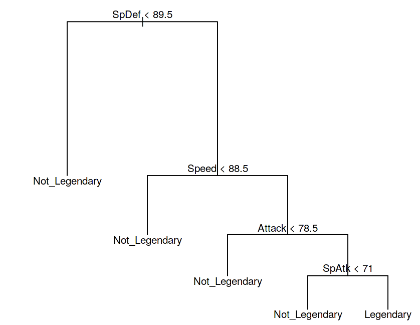{width=100%}
:::

:::

::: {.fragment }

:::{.absolute top=500px left=400px}
or a simple model
:::

:::{.absolute top=500px left=350px style="font-size:2em;"}
$$
\ldots y = 5x + 2
$$
:::

:::

## Definitions for Modeling

::: {.incremental}

- **Dependent/Response Variable** *is the variable or outcome of interest the model is trying to predict. Usually denoted by* $Y$.
  - Ex: Cancer, Predicting Stock Price, Flower Species (Iris), Pokemon Type, ect.
:::

:::{.incremental}
- **Independent/Predictor Variable** *is the variable we are using to predict the dependent/response variable. Usually denoted by* $X$
  - Ex: DNA sequences, Financial Measures, Petal Length, Pokemon Stats, ect 
:::

:::{.incremental}
- Traditionally, modeling falls into one of two categories:
  - **Supervised Learning**: Both the the response/variable $Y$ and predictor/independent variable $X$ are known. [i.e. we have data for $X$ and $Y$]{.subtext}
  - **Unsupervised Learning**: Only the predictor/independent variable $X$ is known. [i.e. only have data for $X$]{.subtext}
:::


# Unsupervised Modeling and Cluster Analysis

## Unsupervised Modeling

::: {.incremental}
- Unsupervised learning is primarily associated with *cluster analysis*
- **Cluster Analysis**: organize observations into similar groups based on recorded characteristics/variables
:::


:::{.fragment}
- Common use cases
  - Cell type identification [grouping cells with similar gene expression in single-cell RNA-seq data]{.subtext}
  - Market segmentation [grouping customers with similar purchasing behavior and demographics to target marketing campaigns]{.subtext}
  - Outliar detection [flagging unusual lab values or measurements that may indicate errors or unusual cases]{.subtext}
  - Drug repurposing [grouping drugs with similar treatment response profiles to suggest candidates for new conditions]{.subtext}
:::


## Cluster Analysis

:::{.callout-tip title="Example"}
<!-- Lets refer back to the Iris dataset where we know there are three flower species: Setosa, Versicolor, Virginica. However, lets suppose we do not know the species and we just plot the `Petal.Width` measurement. -->
Consider this dataset with the one measurement on the x-axis. [Can we identify any clusters, i.e. any obvious grouping of data?]{.underline .fragment fragment-index=2}
:::


::: {.fragment .center fragment-index=1}

```{r, echo=FALSE, fig.height=4.5}
set.seed(1)
iris |> 
ggplot(aes(Petal.Width, y = 0))+
  geom_jitter()+
  labs(x = "Measurement")
```

<!-- TODO: R code for this figure is not in the HTML (echo: false chunk). Restore the chunk or keep this static image. -->
<!-- 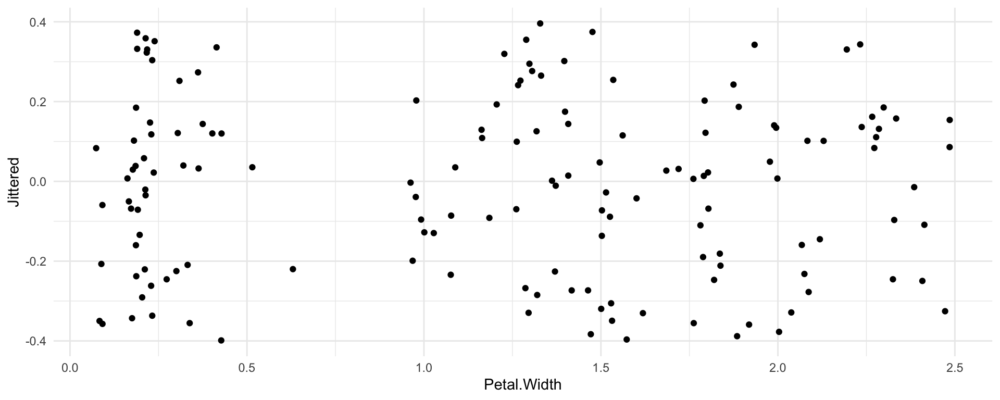 -->
:::


:::{.fragment fragment-index=3}
::: {.absolute top=230px left=60px .mysolution}

<div style="width:310px; height:355px; border:3px solid blue; border-radius:50%;"></div>

:::

::: {.absolute top=210px right="30px" .mysolution}

<div style="width:620px; height:400px; border:3px solid red; border-radius:50%;"></div>

:::
:::

::: {.fragment fragment-index=4 .absolute top=650px}

- These are obvious clusters, but what about sub-clusters?

:::

## Cluster Analysis Cont.

- We could change the number of clusters we suspect and get different results

::: {.fragment}

<!-- TODO: R code for this figure is not in the HTML (echo: false chunk). Restore the chunk or keep this static image. -->

:::{.absolute top="100px" left="50px"}
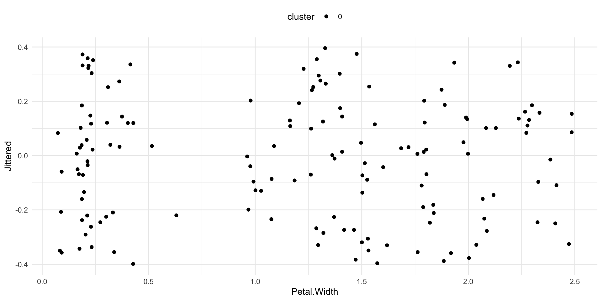
:::

:::{.absolute top=550px left=510px width=100px}

:::

:::


::: {.fragment}

<!-- TODO: R code for this figure is not in the HTML (echo: false chunk). Restore the chunk or keep this static image. -->

:::{.absolute top="100px" left="50px"}
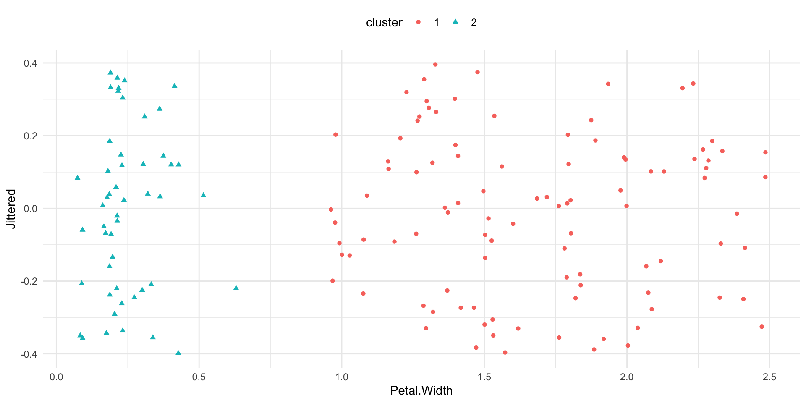
:::

:::{.absolute top=550px left=510px width=100px}

:::

:::

::: {.fragment}

<!-- TODO: R code for this figure is not in the HTML (echo: false chunk). Restore the chunk or keep this static image. -->

:::{.absolute top="100px" left="50px"}
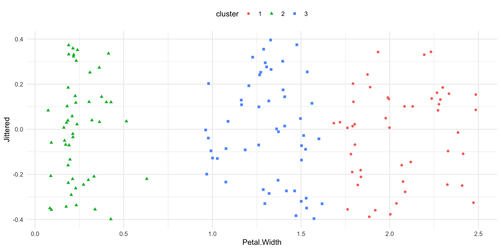
:::

:::{.absolute top=550px left=510px width=100px}

:::

:::

::: {.fragment}

<!-- TODO: R code for this figure is not in the HTML (echo: false chunk). Restore the chunk or keep this static image. -->

:::{.absolute top="100px" left="50px"}
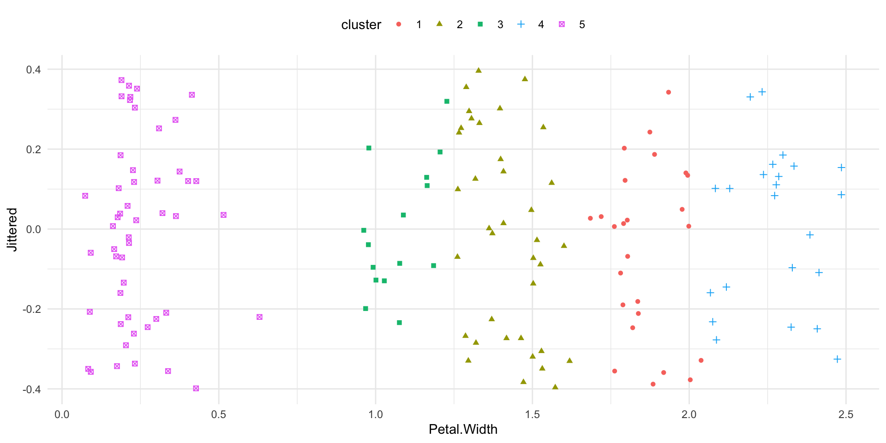
:::

:::{.absolute top=550px left=510px width=100px}

:::

:::

::: {.fragment}

<!-- TODO: R code for this figure is not in the HTML (echo: false chunk). Restore the chunk or keep this static image. -->

:::{.absolute top="100px" left="50px"}
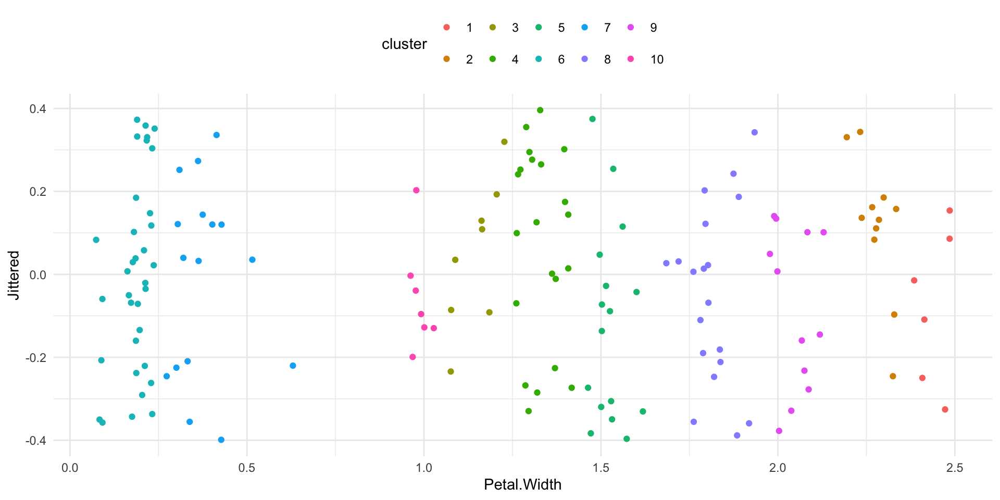
:::

:::{.absolute top=550px left=510px width=100px}

:::

:::

::: {.fragment}

<!-- TODO: R code for this figure is not in the HTML (echo: false chunk). Restore the chunk or keep this static image. -->

:::{.absolute top="100px" left="50px"}
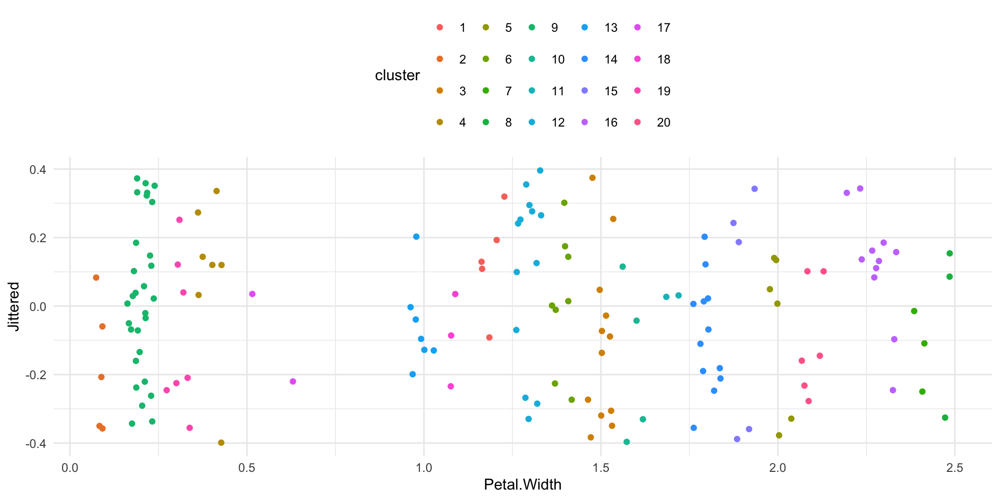
:::

:::{.absolute top=550px left=510px width=100px}

:::

:::

## How Cluster Analysis Works

::: {.incremental}

- **Goal**: organize observations into similar groups based on recorded characteristics/variables
- Clustering algorithms require two things:
  - A way to measure distance between observations
  - A rule for grouping observations that are “close” to one another 
:::


::: {.fragment .center}

](figures/img_017.png){width=45%}

[The rest of cluster analysis is a bit beyond this course, but it is essential to know the difference between unsupervised vs supervised models.]{.subtext}

:::


# Supervised Modeling

## Supervised Modeling Basics

::: {.incremental}

- The most common modeling practiced is supervised modeling/learning

:::{.callout-note title="Reminder" .fragment style="font-size:1.1em;"}
Supervised modeling is when we are trying to predict $Y$ based upon $X$, where both $Y$ and $X$ are known.
:::

- We can represent the model by $f$. Thus, $Y$ is a function of $X$, where $f$ is the function/model $$ Y = f(X) $$
:::


::: {.fragment style="font-size:.9em;"}
- Examples:
  - $f(X) = 2X + 5$ or $f(X) = X^{2} + 3$
  - $f(X)$ could be a *decision tree* that splits data by conditions like “income > 50K” or “age < 30.”
:::

:::{.incremental style="font-size:.9em;"}
- Our goal in modeling is to estimate $f$, so we can predict $Y$
:::

## An Aside: Supervised vs Unsupervised for AI

- AI is just a specific model, $f(\mathbf{X})$, based upon the following

:::{.columns .center}

:::{.column width="49%"}
](figures/nn.png)
:::

:::{.column width=2%}
:::

:::{.column width="49%"}
](figures/nuerons.jpeg){width=50%}
:::

:::

:::{.callout-tip title="Thought?" style="font-size:1.2em;" .fragment}
Do we think AI is a supervised or unsupervised modeling technique?
:::

<!-- - $f(X)$ could be a *neural network* (AI), where layers of weights learn complex relationships. -->

## Pure Mathematical Relationships

- $f(X) = 2X + 5$ and $f(X) = X^{2} + 3$ are examples of pure mathematical examples

```{r}
set.seed(1)
x <- seq(-5, 5, by = .5)
y <- 2*x + 5
```

:::{.center}
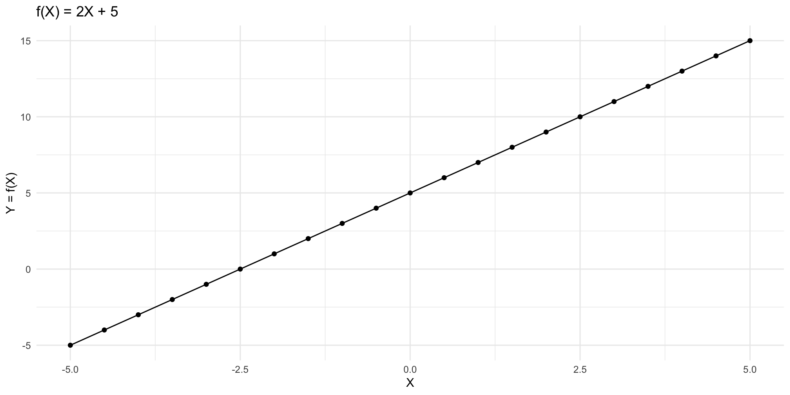{width=75%}
:::

## Mathematical Relationships Cont.

- With real data, the relationship is rarely purely mathemtical and often has some for of error $\varepsilon$. $$ Y = f(X) + \varepsilon $$

::: {.fragment}

```{r}
x <- seq(-5, 5, by = .5)
y <- 2*x + 5 + rnorm(length(x))
```

<!-- TODO: R code for this figure is not in the HTML (echo: false chunk). Restore the chunk or keep this static image. -->

:::{.center}
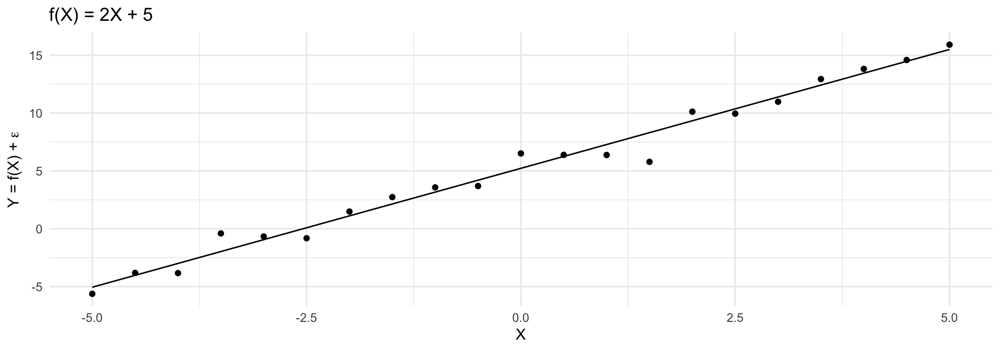
:::

:::


# Simple Linear Regression

## Regression Basics

::: {.incremental}

- **Regression** is a *supervised* statistical method used to model relationships between variables that can be used for
  - Describing the relationship between variables
  - Predicting outcomes for new observations
:::

:::{.fragment}
- There are multiple types of regression including:
  - *Simple Linear Regression*: one predictor, one response; relationship assumed linear
  - *Multiple Linear Regression*: several predictors combined linearly
  - *Logistic Regression*: models binary outcomes using a logistic function
  - *Nonlinear Regression*: assumes a specific nonlinear functional form for the relationship
  - and much more…
:::


## Introduction to Simple Linear Regression

::: {.incremental}

- Here, we will focus on *simple linear regression* where,
  - We have one independent/predictor variable $X$
  - We have one dependent/response variable $Y$
  - And we assume a linear relationship between $X$ and $Y$

:::


::: {.center .fragment}
<!-- TODO: R code for this figure is not in the HTML (echo: false chunk). Restore the chunk or keep this static image. -->
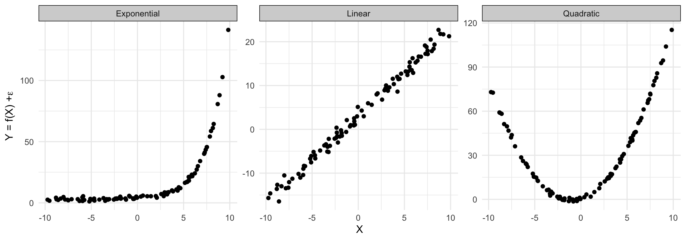

:::

::: {.fragment .absolute top="280px" left="400px"}

<div style="width:300px; height:380px; border:3px solid red; border-radius:50%;"></div>

:::

## Introduction to Simple Linear Regression Cont.

::: {.incremental}

- One subtly about regression is we are not modeling each exact value of $Y$, but we are modeling the expected value of $Y$.
  - Expected Value is denoted $E(Y) = \mu_{y}$ [i.e. the average value of $Y$.]{.subtext}
:::

:::{.notes}
Typically, in statistics, we are interested in the average. 

For example, if we want to know about $Y$, we calculate its average or expected value $E(Y) = \mu_{y}$
:::

::: {.fragment}

:::: {.center}

<!-- TODO: R code for this figure is not in the HTML (echo: false chunk). Restore the chunk or keep this static image. -->
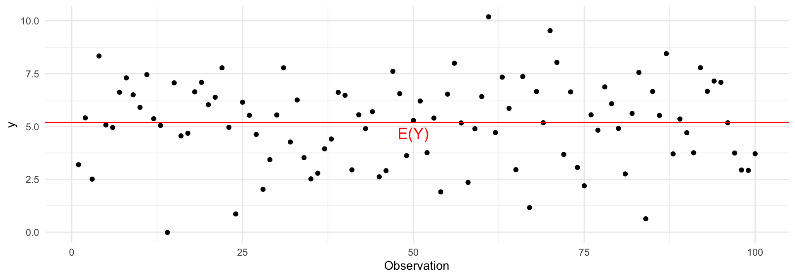

::::

:::

::: {.incremental}

- No matter what, we always predict $Y$ as [$E(Y) \approx 5$ in this example]{.mysolution}.

:::


## Introduction to Simple Linear Regression Cont.

::: {.incremental}

- Regression improves the estimation of the expected value of $Y$ by considering $X$. That is, we have $E(Y|X) = \mu_{Y|X}$
- Thus, for *simple linear regression* we assume this expectation is linear such that [$$E(Y|X) = \beta_{0} + \beta_{1}X $$]{.mysolution}

:::


::: {.fragment .absolute top=250px left=100px}


<!-- TODO: R code for this figure is not in the HTML (echo: false chunk). Restore the chunk or keep this static image. -->
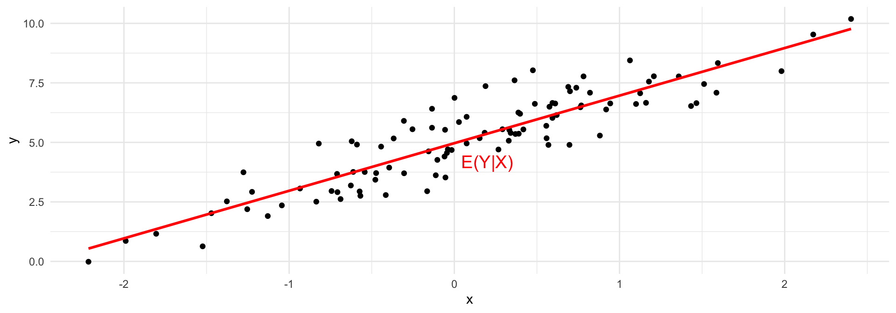


:::

::: {.fragment .absolute top=575px}
- Now, we can improve our prediction of $Y$ by considering $X$. For example, $E(Y|X = 0) \approx 5$ or $E(Y|X = 1) \approx 7$.

:::


## Simple Linear Regression Formalized

:::{.callout-note title="Simple Linear Regression Model" style="font-size:1.2em;"}

The model for simple linear regression is given by

:::{.mysolution}
$$
Y = \beta_{0} + \beta_{1}X + \varepsilon,
$$
:::

 where:

:::{.incremental}
- $\beta_{0}$ represents the [population intercept]{.underline .mysolution}
- $\beta_{1}$ represents the [population slope]{.underline .mysolution}
- $\varepsilon$ represents the [random error]{.underline .mysolution}
:::

:::


::: {.fragment}

**Interpretations**:

:::: {.incremental}

- $\beta_{0}$ is the [average value of $Y$ when $X = 0$ [only interpretable if x = 0 is in the scope of the model.]{.subtext}]{.mysolution}
- $\beta_{1}$ is the [average change in $Y$ for a one unit increase in X]{.mysolution}
- $\varepsilon$ is the “random error” associated with each point

::::


:::

## Simple Linear Regression Examples

```{r, echo=FALSE}

set.seed(123)
n <- 100

simulate_data <- function(b0, b1, line_color) {
  x <- runif(n, min = -2.2, max = 2.4)
  data.frame(
    x = x,
    y = b0 + b1 * x + rnorm(n, sd = 0.8),
    panel = paste0("Y = ", b0, ifelse(b1 > 0, " + ", " - "), abs(b1), "X"),
    b0 = b0,
    b1 = b1,
    col = line_color
  )
}

dat <- rbind(
  simulate_data(5,  2, "#E8473B"),
  simulate_data(5, -2, "#3145F0")
)

lines_df <- unique(dat[, c("panel", "b0", "b1", "col")])

ann_df <- data.frame(
  panel = c("Y = 5 + 2X", "Y = 5 - 2X"),
  label = c("E(Y|X) = 5 + 2X", "E(Y|X) = 5 - 2X"),
  x     = c(0.4, -1.3),
  y     = c(4, 3.5),
  col   = c("#E8473B", "#3145F0")
)

ggplot(dat, aes(x = x, y = y)) +
  geom_point(size = 1.5) +
  geom_abline(data = lines_df,
              aes(intercept = b0, slope = b1, color = col),
              linewidth = 1) +
  geom_text(data = ann_df,
            aes(x = x, y = y, label = label, color = col),
            size = 4, hjust = 0) +
  scale_color_identity(guide = "none") +
  scale_y_continuous(breaks = seq(0, 10, 2.5)) +
  facet_wrap(~ panel) +
  labs(x = "x", y = "y")
```


## Solving the Simple Linear Regression Model

::: {.incremental}

- For the past examples, we have assumed we knew what the model was [Ex: $Y = 5 + 2X + \varepsilon$]{.subtext}
- However, in practice, we are just given the data and have to solve for the model our self.

:::


::: {.fragment .absolute top="220px" left="100px"}

<!-- TODO: R code for this figure is not in the HTML (echo: false chunk). Restore the chunk or keep this static image. -->
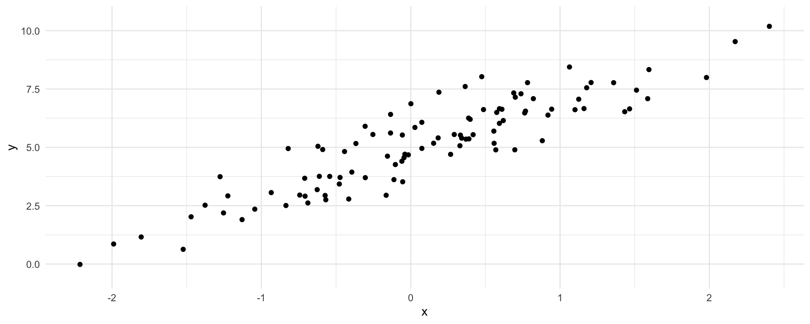

:::

::: {.fragment .absolute top="180px" left="400px"}

$$
Y = ? + ??X + \varepsilon
$$

:::

::: {.fragment .absolute top="220px" left="100px"}

<!-- TODO: R code for this figure is not in the HTML (echo: false chunk). Restore the chunk or keep this static image. -->
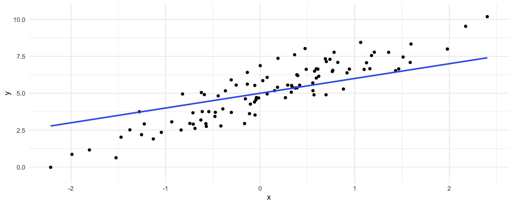

:::

::: {.fragment .absolute top="220px" left="100px"}

<!-- TODO: R code for this figure is not in the HTML (echo: false chunk). Restore the chunk or keep this static image. -->
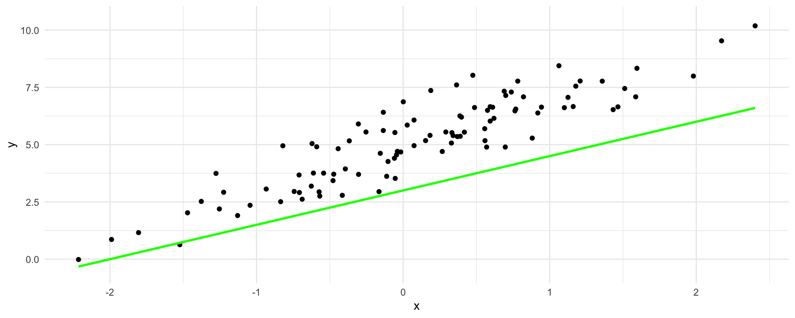

:::

::: {.fragment .absolute top="220px" left="100px"}

<!-- TODO: R code for this figure is not in the HTML (echo: false chunk). Restore the chunk or keep this static image. -->
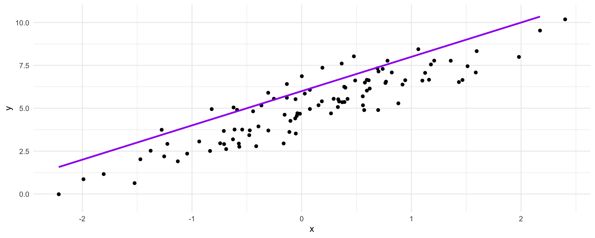

:::

::: {.fragment .absolute top="220px" left="100px"}

<!-- TODO: R code for this figure is not in the HTML (echo: false chunk). Restore the chunk or keep this static image. -->
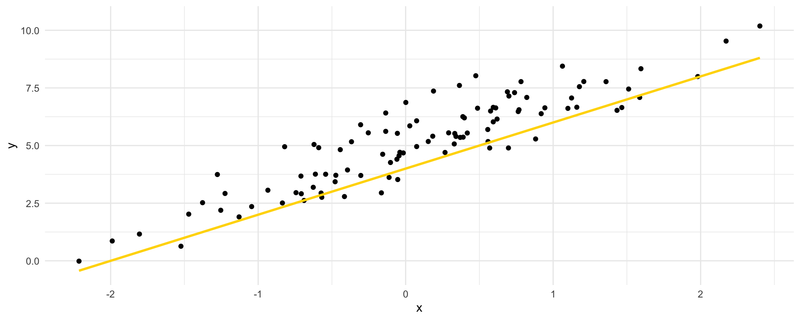

:::

::: {.fragment .absolute top="220px" left="100px"}

<!-- TODO: R code for this figure is not in the HTML (echo: false chunk). Restore the chunk or keep this static image. -->
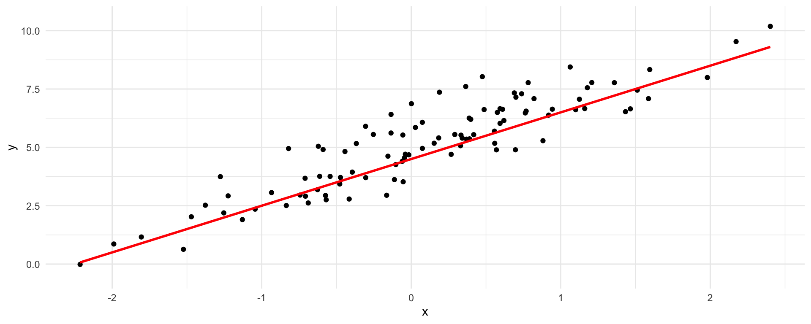

:::

::: {.fragment .absolute top="220px" left="100px"}

<!-- TODO: R code for this figure is not in the HTML (echo: false chunk). Restore the chunk or keep this static image. -->
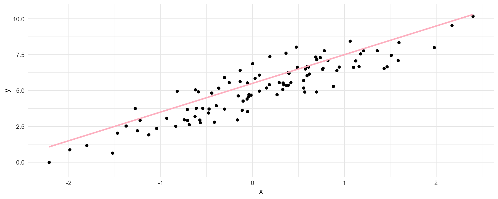

:::

::: {.fragment}

:::{.absolute top="220px" left="100px"}
<!-- TODO: R code for this figure is not in the HTML (echo: false chunk). Restore the chunk or keep this static image. -->

:::

::: {.absolute left="300px" top="600px"}

Which one is the best fit??

:::
:::

## Residuals

To solve for the best model, we use *residuals*. Here are some definitions to help:

::: {.incremental}
- **Observed values**: the known values of X and Y (our data). Coordinates:$(X, Y)$
:::


::: {.fragment}

:::{.absolute top="230px" left="50px"}
<!-- TODO: R code for this figure is not in the HTML (echo: false chunk). Restore the chunk or keep this static image. -->
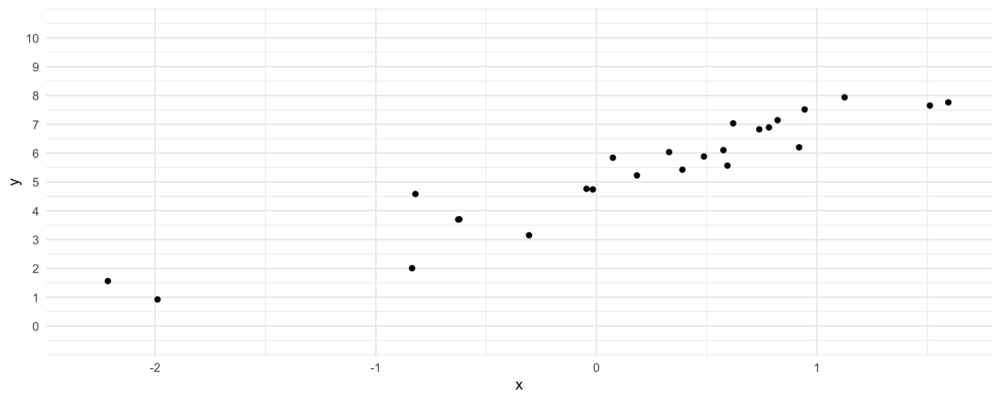
:::

::: {.absolute left="430px" top="495px"}

:::{.mysolution}
<div style="width:20px; height:20px; border:3px solid red; border-radius:50%;"></div>

$(X, Y) = (-0.83, 2.01)$
:::

:::
:::


::: {.fragment top=170px .absolute}

- **Predicted values**: the $Y$ values that are predicted by the regression equation and denoted $\widehat{Y}$. Coordinates: $(X, \widehat{Y})$.

:::


::: {.fragment}

:::{.absolute top="230px" left="50px"}
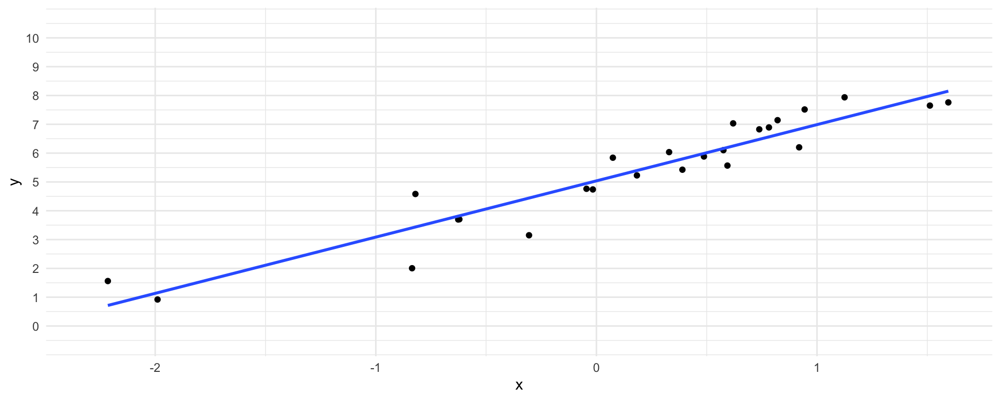
:::

::: {.absolute left="430px" top="495px" .mysolution}

<div style="width:20px; height:20px; border:3px solid red; border-radius:50%;"></div>

$(X, Y) = (-0.83, 2.01)$

:::
:::

::: {.fragment}

:::{.absolute left="435px" top="466px" .mysolution}
<div style="width:10px; height:10px; background-color:red; border-radius:50%;"></div>
:::

:::{.absolute left="135px" top="416px" .mysolution}
$(X, \widehat{Y}) = (-0.83, 3.43)$
:::

:::

::: {.fragment .absolute left="0px" top="630px" style="font-size:.9em;"}

- **Residuals**: the difference between the observed and predicted values of the response i.e. $Y - \widehat{Y}$

:::

::: {.fragment}

<!-- TODO: R code for this figure is not in the HTML (echo: false chunk). Restore the chunk or keep this static image. -->

:::{.absolute top="230px" left="50px" .mysolution}
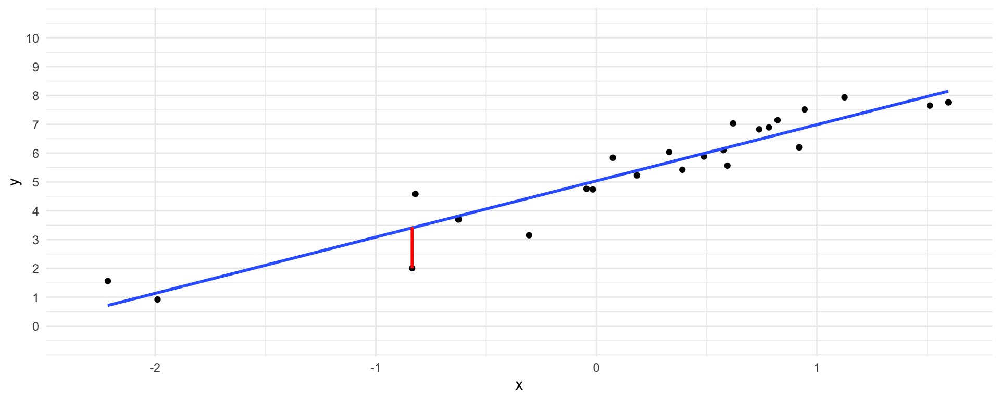
:::

::: {.absolute left="430px" top="495px" .mysolution}

<div style="width:20px; height:20px; border:3px solid red; border-radius:50%;"></div>

$(X, Y) = (-0.83, 2.01)$

:::

:::{.absolute left="435px" top="466px" .mysolution}
<div style="width:10px; height:10px; background-color:red; border-radius:50%;"></div>
:::

:::{.absolute left="135px" top="416px" .mysolution}
$(X, \widehat{Y}) = (-0.83, 3.43)$
:::

:::{.absolute left="470px" top="475px" .mysolution}
$Y - \widehat{Y} = 2.01 - 3.43 = -1.42$
:::

:::

## Residuals Cont.

:::{.callout-note title="Reminder"}
*Residuals* are the difference between the observed and predicted values.
:::

:::{.incremental}
- Would we want our model to produce [smaller]{.underline} or [larger]{.underline} residual magnitudes?
:::

:::{.fragment .absolute top=200px left=485px}
:::{.mysolution}
<div style="width:100px; height:30px; border:3px solid red; border-radius:50%;"></div>
:::
:::

:::{.notes}
Smaller residuals mean the model is predicting values closer to the actual values 

which is what we want
:::


::: {.fragment}

:::{.callout-tip title="Example" style="font-size:1em;"}
Suppose we have 3 models. Which model do we think gives the best fit?
:::

:::: {.center}

<!-- TODO: R code for this figure is not in the HTML (echo: false chunk). Restore the chunk or keep this static image. -->
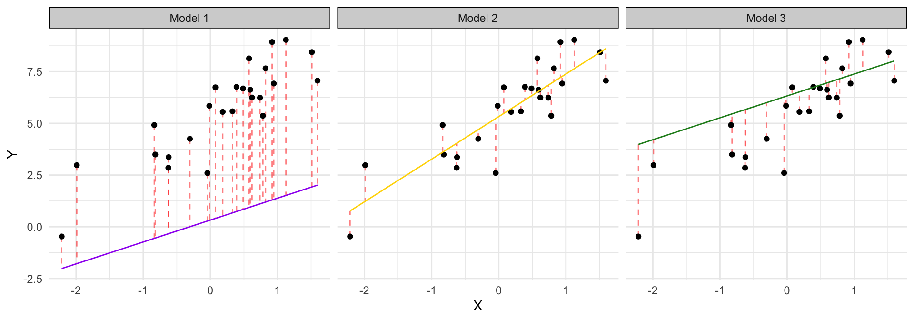{width=80%}

::::

:::

::: {.fragment .absolute left="0px" top="655px"}

[Model 2 because on average its residuals are smaller than the other models.]{.mysolution style="font-size:.9em;"}

:::

## Line of Best Fit

::: {.incremental style="font-size:.9em;"}

- Thus, we use the residuals to find the “line of best fit’’.
- Specifically, we choose the line that minimizes the **sum of squared residuals** (**SSR**) $$ SSR = \sum_{i = 1}^{N}(Y_{i} - \widehat{Y}_{i})^{2} $$
- Finding the slope and intercept that minimizes SSR requires calculus… $$ \begin{align*} \frac{\partial SSR}{\partial \beta_0} &= -2 \sum (Y_i - \beta_0 - \beta_1 X_i) = 0 \\ \frac{\partial SSR}{\partial \beta_1} &= -2 \sum X_i (Y_i - \beta_0 - \beta_1 X_i) = 0 \end{align*} $$
- Solving this gives what is called the **Ordinary Least Squares** (**OLS**) solutions: $$ \beta_1 = \frac{\sum_{i=1}^n (X_i - \bar{X})(Y_i - \bar{Y})}{\sum_{i=1}^n (X_i - \bar{X})^2}, \text{ and} \quad \beta_0 = \bar{Y} - \widehat{\beta}_1 \bar{X}. $$

:::


## Simple Linear Regression in R

- Don’t worry, you do not have to do any of the calculus by hand or plug into the **OLS** solutions. R will do everything for you.
- To perform *simple linear regression* in R we use the `lm()` function

```{r, eval=FALSE}
lm(response ~ predictor, data = my_data)
```

<!-- :::{.fragment} -->

<!-- - To summarize the results of our *simple linear regression* we use the `summary()` function -->

<!-- ```{r, eval = FALSE} -->

<!-- my_model <- lm(Y ~ X, data = my_data) -->

<!-- summary(my_model) -->

<!-- ``` -->

<!-- ::: -->

::: {.fragment}

:::{.callout-tip title="Example"}
Consider modeling `Sepal.Width` by `Petal.Length` for the `Iris` dataset.
:::

:::{style="transform: scale(0.9); transform-origin: top left;"}
```{webr}
lm(Sepal.Width ~ Petal.Length, data = iris)
```
:::

:::

## Sample Estimates for Simple Linear Regression

:::{.callout-note title="Sample Simple Linear Regression Model" style="font-size:1.2em;"}
In practice, we must estimate these parameters from our sample data which gives the sample *simple linear regression* model:

:::{.mysolution}
$$
\widehat{y} = \widehat{\beta}_{0} + \widehat{\beta}_{1}x,
$$
:::

 where:

:::{.incremental}
- $\beta_{0}$ represents the [sample intercept]{.underline .mysolution}
- $\beta_{1}$ represents the [sample slope]{.underline .mysolution}
- $\widehat{y}$ represents the [estimated mean of y (or predicted value of y)]{.underline .mysolution}
:::
:::

## Simple Linear Regression Income-Education Example

:::{.callout-tip title="Example" style="font-size:1.1em;"}
Suppose UT Austin wants to predict average income from years of education for workforce planning in Central Texas. UT sampled 120 employed adults and records each person’s years of education and annual income (thousands of dollars). Using simple linear regression, we want develop a model to predict income from years of education.
:::

:::{.fragment}
```{r}
load(file = "data/income_data.RData")
```

<!-- TODO: R code for this table is not in the HTML. -->

:::{style="font-size:.85em;"}
| income | education |
|---|---|
| 15.00000 | 10.0 |
| 20.41452 | 10.5 |
| 16.96766 | 10.5 |
| 30.23333 | 11.0 |
| 25.59243 | 11.0 |
| 21.51244 | 11.5 |
:::
:::

:::{.incremental}
- The predictor variable for this example is [[education]{.underline .mysolution}]{.fragment}
- The response variable for this example is [[income]{.underline .mysolution}]{.fragment}
:::

## [Simple Linear Regression Income-Education Example Cont.]{style="font-size:.9em;"}

- Before we fit the simple linear regression model, we must ensure we have a linear relationship between education and income.

::: {.fragment}

```{r, fig.height=4}
ggplot(aes(education, income), data = income_data)+
  geom_point()
```

:::

::: {.fragment}

[A linear relationship seems appropriate and we can continue with the model fitting]{.mysolution}

:::


## [Simple Linear Regression Income-Education Example Cont.]{style="font-size:.9em;"}

::: {.incremental}

- Now, we fit the simple linear regression model using `lm()` and get the results.

:::


::: {.fragment}

```{webr}
#| include: false
load(file = "data/income_data.RData")
```


```{r}
my_model <- lm(income ~ education, data = income_data)
my_model
```

:::

::: {.incremental}

- To write our model, do we use $Y$ or $\widehat{y}$? [$\widehat{y}$ because we are dealing with sample data.]{.mysolution}
- Thus, from the `R` output, our model is given by

:::


::: {.fragment .center}

:::{.mysolution}
$\widehat{y} = -28.897 + 4.778x,$ [where $x =$ years of education]{.subtext}
:::

:::

## [Simple Linear Regression Income-Education Example Cont.]{style="font-size:.9em;"}

:::{style="font-size:.9em;"}
- Now, lets interpret our model: $\widehat{y} = -28.897 + 4.778x$

::: {.panel-tabset style="font-size:.8em;"}

### ggplot

:::: {.center}

```{r, fig.height=2.75}
ggplot(aes(education, income), data = income_data)+
  geom_point()+
  geom_smooth(method = "lm", se = FALSE)
```

::::

### Base R

:::: {.center}

```{r, fig.height=3}
plot(income_data$education, income_data$income)
abline(my_model, col = "blue")
```

::::

:::


::: {.incremental}
- Can we interpret the:
  - sample intercept [(-28.897)]{.mysolution} in this example? [[No! $x = 0$ is not possible for this example.]{.mysolution}]{.fragment}
  - sample slope [(4.778)]{.mysolution} in this example? [[Yes! On average, income increases by \$4.78 thousand for each additional year of education.]{.mysolution}]{.fragment}

:::

:::


## Simple Linear Regression Marketing Example

```{r, echo=FALSE}
load(file = "data/income_data.RData")
```

```{webr}
#| include: false
load(file = "data/income_data.RData")
```

:::{.callout-tip title="Example" style="font-size:1.05em;"}
Suppose BUM energy , an energy-drink distributor, wants to predict monthly sales revenue from advertising expenditures. The company collects data from 80 regional markets, recording each market’s monthly advertising budget (in thousands of dollars) and total sales (in thousands of dollars). Using simple linear regression, we want develop a model to predict sales based on advertising spending.
:::

:::{.fragment}
```{r}
load(file = "data/bum_energy.RData")
```

<!-- TODO: R code for this table is not in the HTML. -->

:::{style="font-size:.80em;"}
| advertising | sales |
|---|---|
| 9.181314 | 37.07379 |
| 3.724352 | 27.43142 |
| 0.000000 | 19.37355 |
| 17.393817 | 49.51568 |
| 2.158873 | 24.36705 |
| 12.582281 | 39.17518 |
:::
:::

:::{.incremental}
- The dependent variable for this example is [[sales]{.underline .mysolution}]{.fragment}
- The independent variable for this example is [[advertising]{.underline .mysolution}]{.fragment}
:::

## Simple Linear Regression Marketing Example Cont.

- Now, before we fit the simple linear regression model, we must ensure we have a linear relationship between advertising and sales.

::: {.fragment}

```{r, fig.height=4}
ggplot(aes(advertising, sales), data = bum_energy)+
  geom_point()
```

:::

::: {.incremental}
- A linear relationship seems appropriate and we can continue with the model fitting.
:::

## Simple Linear Regression Marketing Example Cont.

:::{style="font-size:.9em;"}
- We fit the simple linear regression model using `lm()` and get the results.

```{webr}
#| include: false
load(file = "data/bum_energy.RData")
```


:::{style="transform: scale(0.9); transform-origin: top left;"}
```{r}
my_model <- lm(sales ~ advertising, data = bum_energy)
my_model
```
:::

::: {.incremental .absolute top=400px}
- Now, lets interpret our model: [$\widehat{y} = 20.058 + 1.705x$]{.mysolution}
  - Can we interpret the sample intercept in this example? [[Yes! The data contains regions with no advertising cost (i.e. x = 0 is a possible value).]{.mysolution}]{.fragment} [[$\widehat{\beta}_{0} = 20.058$ represents the average monthly sales(in thousands) when a region spends no money on advertising.]{.mysolution}]{.fragment} <br><br>
  - Can we interpret the sample slope in this example? [[Yes! On average, monthly increases by approximately \$1.705 thousand for each additional thousand dollars spent on advertising.]{.mysolution}]{.fragment}
:::

:::

# Prediction for Simple Linear Regression

## Predicting with Simple Linear Regression

:::{.callout-note title="Reminder"}
**Regression** is a *supervised* statistical method used to model relationships between variables that can be used for:

- Describing the relationship between variables [i.e. $\beta_{0}$ and $\beta_{1}$]{.subtext}
- Predicting outcomes for new observations
:::


::: {.fragment}

- We can predict the average value of $Y$ given a specific realized $x$ value i.e. $E[Y|X = x] = \beta_{0} + \beta_{1}x$

<!-- TODO: R code for this figure is not in the HTML (echo: false chunk). Restore the chunk or keep this static image. -->

:::{.absolute top=335px}
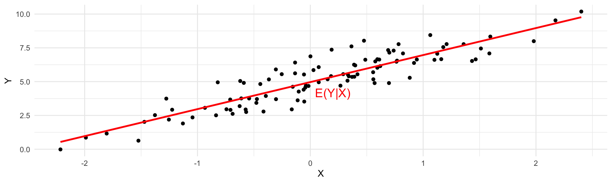
:::

:::

::: {.fragment}

:::{.absolute top=650px}
- Ex: $E[Y|X = -1] = \beta_{0} + \beta_{1}\times (-1)$
:::

<!-- TODO: R code for this figure is not in the HTML (echo: false chunk). Restore the chunk or keep this static image. -->

:::{.absolute top=335px}
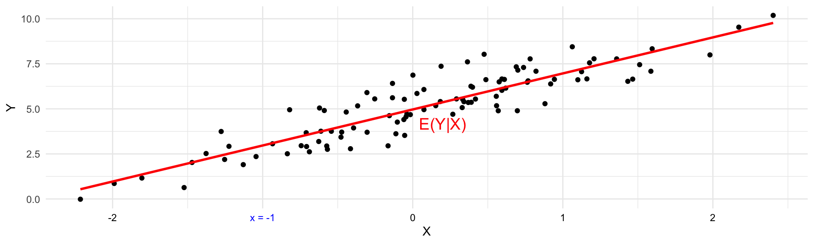
:::

:::: {.fragment .absolute top="335px"}

<!-- TODO: R code for this figure is not in the HTML (echo: false chunk). Restore the chunk or keep this static image. -->
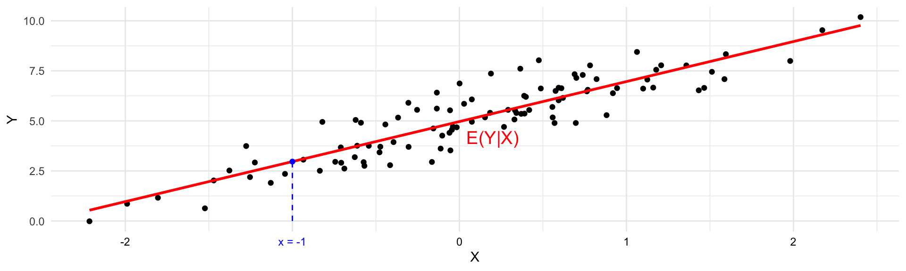

::::

:::: {.fragment .absolute top="335px"}

<!-- TODO: R code for this figure is not in the HTML (echo: false chunk). Restore the chunk or keep this static image. -->
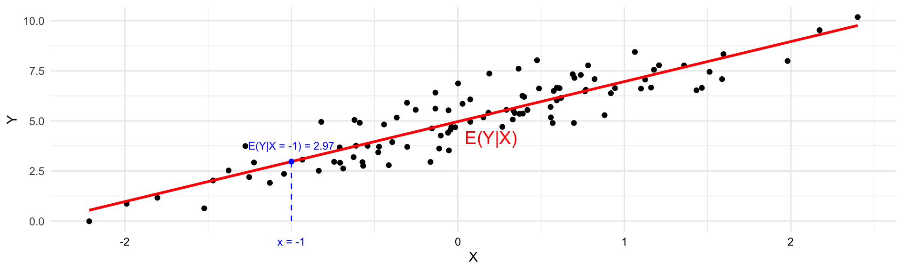

::::

:::

## Predicting in R
:::{style="font-size:.8em;"}
- To predict with *simple linear regression*, we can just evaluate our new observation in our model [i.e. $\widehat{y} = \widehat{\beta}_{0} + \widehat{\beta}_{1}\cdot (x = \text{new value})$]{.subtext}
:::

:::{.fragment style="font-size:.8em;"}
- To predict in $\texttt{R}$, we can save our model with `lm()` and then use the `predict()` function. The arguments of interest are: 
  - `object`: the saved model from `lm()`
  - `newdata`: a data frame with the new value(s) of the predictor [the column name must match the predictor's name in the model]{.subtext}

```{r, eval=FALSE}
# save our model
my_model <- lm(response ~ predictor, data = my_data)

# predict with our model
predict(my_model, newdata = data.frame(predictor = new_value))
```
:::

::: {.fragment}

:::{.callout-tip title="Example"}
Consider modeling `Sepal.Width` by `Petal.Length` for the `Iris` dataset.
:::

:::{style="transform: scale(0.8); transform-origin: top left;"}
```{webr}
#| autorun: false
my_model <- lm(Sepal.Width ~ Petal.Length, data = iris)

# predict new value of Petal Length = 4.32
predict(my_model, newdata = data.frame(Petal.Length = 4.32))
```
:::

:::

## Predicting for Education Example

:::{.callout-tip title="Income Example Revisited"}
For the income and education example, we found the estimated *OLS* solution to be $$ \widehat{y} = -28.897 + 4.778x.$$
Predict the income based upon 12 years of education.
:::


::: {.fragment}
From our linear model, [$\widehat{y} = -28.897 + 4.778(12) = 28.439$]{.mysolution}
:::


::: {.fragment}
Or in $\texttt{R}$, we can use the `predict()` function

```{r, echo=FALSE}
my_model <- lm(income ~ education, data = income_data)
```

```{webr}
#| include: false
load(file = "data/income_data.RData")
```

```{webr}
#| include: false
my_model <- lm(income ~ education, data = income_data)
```


```{webr}
predict(my_model, newdata = data.frame(education = 12))
```

:::

::: {.incremental}

- **Interpretation:** [For 12 years of education, we expect, on *average*, the annual income for a random individual to be \$28,439.]{.mysolution}

:::

## Predicting Issues: Extrapolation
::: {.incremental}
- So far, we have not made any strong assumptions, but issues can still arise in prediction when your model does not have strong assumptions
  - The most common issue in prediction is user error i.e. making improper predictions
:::

:::{.incremental}
- **Extrapolation:** *using the model to estimate/predict y based upon values of x that are “outside” of the range of values in our dataset*
  - Only reasonable if we have good reason to believe a linear trend continues beyond the range of data values we have
  - [Almost always a bad idea!!]{style="color:red;" .underline}
:::

## Extrapolation Example

:::{.callout-tip title="Sales Example Revisited"}
For the sales and advertising example, we found the estimated *OLS* solution to be $$ \widehat{y} = 20.058 + 1.705x$$ 

:::{.center}
[[i.e $Sales = 20.058 + 1.705\cdot(advertising\ expense)$]{.mysolution}]{.fragment}
:::
:::

:::{.center .fragment}
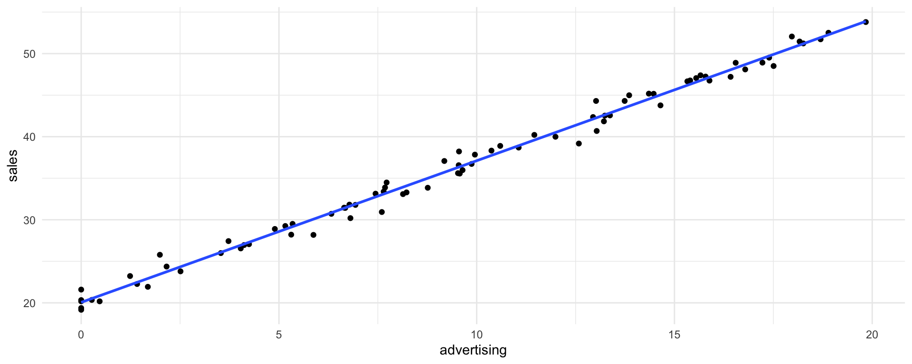{width=80%}
:::


::: {.fragment}
We only recorded advertising cost up to 20k, but is it possible to spend more? [[Of course!]{.mysolution}]{.fragment}
:::

## Extrapolation Example Cont.

Do we know the relationship between advertising and sales past 20k?

:::{.absolute top=100px}
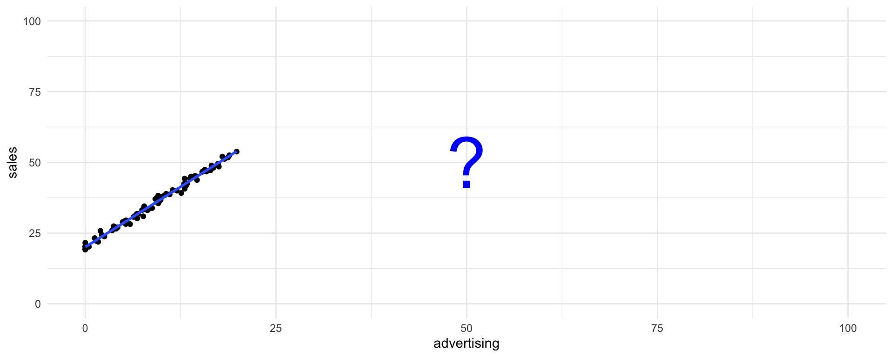
:::

:::{.fragment}
:::{.absolute top=100px}
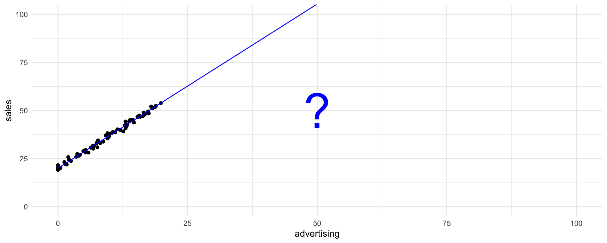
:::
:::

:::{.fragment}
:::{.absolute top=100px}
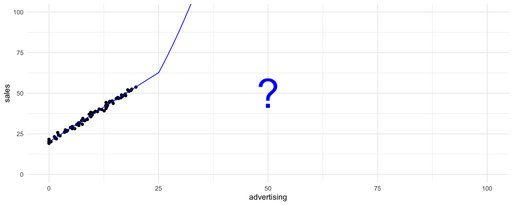
:::
:::

:::{.fragment}
:::{.absolute top=100px}
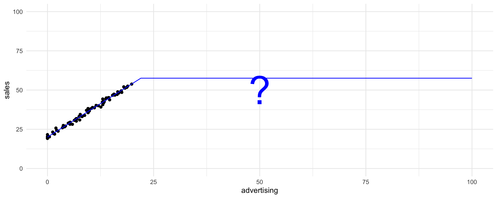
:::
:::

:::{.fragment}

:::{.mysolution .absolute top=520px}
No! We don’t have data past \$20k, so we don’t know what the relationship is in that region. Thus, we can NOT use our model past \$20K. 
:::

:::{.absolute top=100px}

:::
:::

# Statistical Inference for Regression Models


## Inference for Simple Linear Regression

::::{style="font-size:.9em;"}

::: {.incremental}
- So far, we have not made any strong assumptions to predict. However, we often want to do more than predict and make inference on our parameters $\beta_{0}$ and $\beta_{1}$.
  - Confidence intervals for $\beta_{0}$ and $\beta_{1}$.
  - Hypothesis testing for $\beta_{1}$ to determine if our predictor is significant
:::

:::{.incremental}
- To make inferences about our simple linear regression model $$ Y_{i} = \beta_{0} + \beta_{1}X_{i} + \varepsilon_{i}, $$ we must make the following assumptions:
  - 1.Linearity: There exists a linear relationship between X and Y [check w/ scatterplot]{.subtext}
  - 2.Normality: The errors $\varepsilon$ are normally distributed $\varepsilon_{i} \sim N(0, \sigma^{2})$ [check w/ QQ plot]{.subtext}
  - 3.Equal Variance: The errors $\varepsilon$ all have the same variance $\sigma^2$ [check with plot of residuals]{.subtext}
  - 4.Independence: The errors $\varepsilon$ are independent from on another. [check with autocorrelation plot]{.subtext}

:::{.fragment .subtext}
The assumptions can be summarized as $\varepsilon_{i} \stackrel{i.i.d.}{\sim} N(0, \sigma^{2})$. See the appendix for assessing theses assumptions
:::
:::

::::


## Hypothesis Testing for Slope Motivation

- If we have $\beta_{1} = 0$, then what happens to $Y$ as $X$ increases?

:::{.center}
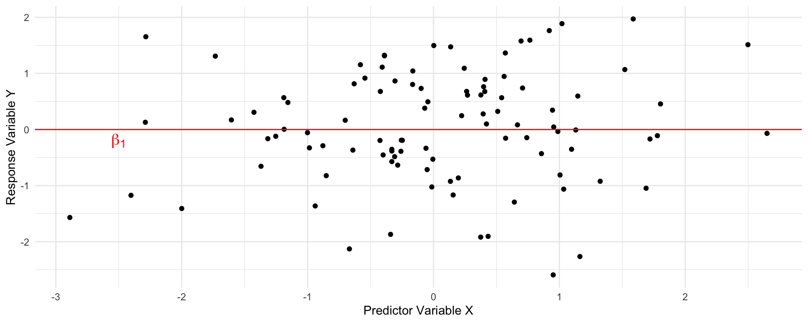
:::

:::{.fragment}
[Anything can happen!]{.mysolution} [[Thus, we want to test whether the slope is statistically different from 0.]{.mysolution}]{.fragment}
:::

## Hypothesis Testing for Slope

::: {style="font-size:.8em;"}
- **Significant Predictor**: *We say a predictor variable is significant if the relationship between the predictor and response is unlikely to have occurred by random chance.* [That is, the slope ($\beta_{1}$) is statistically different from zero.]{.subtext}
:::

:::{.fragment .callout-note title="Hypothesis Test for $\beta_{1}$" style="font-size:1.1em;"}
Let $\beta_{1}$ be the true slope of the linear relationship between a predictor $X$ and a response $Y$. Then, we can conduct a hypothesis test  to determine whether $X$ is a significant predictor for $Y$: [($\alpha$ is almost always set to 0.05)]{.subtext}: 

:::{.fragment}
[Null and Alternative Hypothesis]{.underline}

$H_0: \beta_{1} = 0$ [i.e. there is no linear relationship between $X$ and $Y$]{.subtext}

$H_{a}: \beta_{1} \neq 0$ [i.e. there is a linear relationship between $X$ and $Y$]{.subtext}
:::

:::{.fragment}
[Test-Statistic and Distribution]{.underline} <br>

:::{.fragment}
[Because $\widehat{\beta}_{1}$ is an average, then]{.mysolution}

:::{.mysolution .center}
[$t$]{style="font-size:1.4em;"} [$= \frac{\widehat{\beta}_{1} - 0}{SE(\widehat{\beta}_{1})}$]{style="font-size:1.5em;"} [$\sim t(df = n - 2)$]{style="font-size:1.2em;"}
:::
:::

:::

:::{.fragment}
[Assumptions for the Test for the Slope]{.underline} <br>
[Assess the residuals]{.mysolution}
:::
:::

## Hypothesis Test for the Slope in R

:::{style="font-size:.8em;"}
- To conduct the test in $\texttt{R}$, we can save our model with `lm()` and then use the `summary()` function. 

```{r, eval=FALSE}
# save our model
my_model <- lm(response ~ predictor, data = my_data)

# test for the slope
summary(my_model)
```
:::

::: {.fragment}

:::{.callout-tip title="Example" style="font-size:.8em;"}
Consider modeling `Sepal.Width` by `Petal.Length` for the `Iris` dataset.
:::

<!-- :::{style="font-size:.8em;"} -->
:::{style="transform: scale(0.8); transform-origin: top left;"}
```{webr}
my_model <- lm(Sepal.Width ~ Petal.Length, data = iris)
# test H0: beta_1 = 0 vs Ha: beta_1 != 0
summary(my_model)
```
:::

:::

## Hypothesis Testing for Slope Example
:::{.callout-tip title="Sales Example Revisited"}
For the Bum energy example, we are modeling monthly sales based upon monthly advertising expense, and we found the estimated model to be $$ \widehat{y} = 20.058 + 1.705x$$ 

:::{.fragment}
Our sample slope is $\widehat{\beta}_{1} = 1.705$, which is clearly different from 0. However, we want to know if this generalizes to the entire population. Thus, we want to perform a hypothesis test for $\beta_{1}$.
:::
:::

::: {.fragment style="font-size:.85em;"}

```{r}
my_model <- lm(sales ~ advertising, data = bum_energy)
summary(my_model)
```

:::


:::{.fragment}
::: {.absolute left=10 top=585px style="width:170px; height:0px; border:1px solid #BF5700;"}
:::

::: {.absolute left=10 top=600px style="width:170px; height:0px; border:1px solid #BF5700;"}
:::

:::{.absolute top=400px left=500px style="font-size:.8em;"}
- [OLS Solution]{.underline style="color:#BF5700"}: `summary` will give us the OLS solution to our line $\widehat{y} = 20.058 + 1.705x$.
:::

:::

:::{.fragment}

::: {.absolute left=350 top=600px style="width:50px; height:0px; border:1px solid purple;"}
:::

:::{.absolute top=500px left=500px style="font-size:.8em;"}
- [$\beta_{1}$ Test:]{.underline style="color:purple"} [[The p-value $\approx 0 < \alpha = 0.05$. Thus we reject $H_{0}$, and conclude that there is sufficient evidence that advertising cost is a significant predictor for sales.]{.mysolution}]{.fragment}
:::

:::

## Hypothesis Testing for Slope Example Cont.

- Lets return to this randomly generated data, where visually we think the slope may be close to zero. Now, we can fit the model and run the hypothesis test

:::{.columns}

:::{.column width=50%}
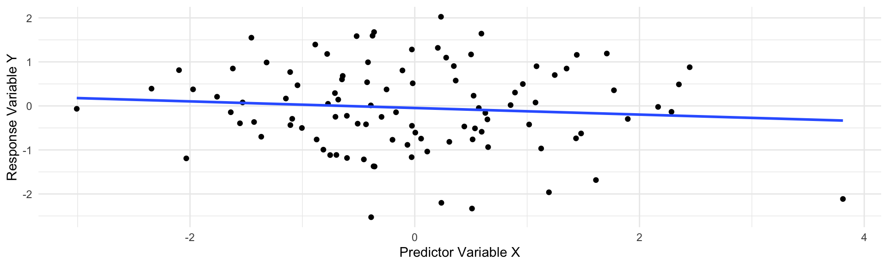{width=100%}
:::

:::{.column width=50%}

```{r, eval=FALSE}
my_model <- lm(Y ~ X, data = my_data)
summary(my_model)
```

:::{style="font-size:.8em;"}
```
Call:
lm(formula = Y ~ X, data = data.frame(Y, X))

Residuals:
     Min       1Q   Median       3Q      Max 
-2.51014 -0.60549  0.02065  0.70483  2.08980 

Coefficients:
            Estimate Std. Error t value Pr(>|t|)
(Intercept) -0.04745    0.09676  -0.490    0.625
X           -0.07495    0.08310  -0.902    0.369

Residual standard error: 0.9671 on 98 degrees of freedom
Multiple R-squared:  0.008232,  Adjusted R-squared:  -0.001888 
F-statistic: 0.8134 on 1 and 98 DF,  p-value: 0.3693
```

:::{.incremental style="font-size:.1.2em;"}
- The p-value $= 0.369 > \alpha = 0.05$. Thus, we fail to reject $H_{0}$, and do not have sufficient evidence to conclude that $\beta_{1}$ is different from 0.
  - Therefore, $X$ is not a significant predictor of $Y$.
:::

:::

:::
:::

## Confidence Interval for Regression Parameters

:::{style="font-size:.8em;"}
- Because $\widehat{\beta}_{0}$ and $\widehat{\beta_{1}}$ are averages and follow the $t$ distribution, we can also construct confidence intervals for $\beta_{0}$ and $\beta_{1}$.
:::

::: {.fragment}

:::{style="font-size:.8em;"}
- Again, $\texttt{R}$ will do all of the computation by using the `confint()` function.
:::

```{r, eval=FALSE}
my_model <- lm(repsonse ~ predictor, data = my_data) 
confint(my_model) 
```
:::

:::{.fragment .callout-tip title="Sales Example Revisited"}
Consider our Bum energy example where we are modeling monthly sales based upon monthly advertising expense and we found the model to be $\widehat{y} = 20.058 + 1.705x.$ We can use the `confint` function to get confidence intervals for $\beta_{0}$ and $\beta_{1}$.
:::

::: {.fragment}

:::{style="transform: scale(0.8); transform-origin: top left;"}
```{webr}
my_model <- lm(sales ~ advertising, data = bum_energy)
confint(my_model)
```
:::

:::

:::{.fragment style="font-size:.8em;" top=575px .absolute}
$\beta_{0}$ **CI Interpretation**: [We are 95% confident that the true average monthly sales is between \$19.66 and \$20.45 thousand if there is no month advertising cost [(i.e. 95\% Confident that $19.66 < \beta_{0} < 20.45$)]{.subtext}]{.mysolution}
:::

:::{.fragment style="font-size:.8em;"}
$\beta_{1}$ **CI Interpretation**: [We are 95% confident that the true average sales will increase between \$1.67 and \$1.74 thousand if we increase advertising expenditure by \$1,000 [(i.e. 95\% Confident that $1.67 < \beta_{1} < 1.74$)]{.subtext}]{.mysolution}
:::

# Model Performance

## Model Performance Motivation

:::{.callout-note title="Reminder"}
Reminder: If $X$ is a significant predictor for $Y$, this simply means that $\beta_{1} \neq 0$.
:::

:::{.incremental style="font-size:.9em;"}
- Thus, we still might want to know how "strong" of a predictor $X$ is for $Y$.
:::

:::{.fragment .callout-tip title="Example"}
Suppose we have two candidate predictor variables $X_{1}$ and $X_{2}$ for $Y$. We fit two models for each predictor variable and find:

:::{.columns}

:::{.column width=49% .center}
$Y = 1.2 + 0.53X_{1}$ [$+\ \varepsilon$]{.subtext}
:::

:::{.column width=2%}
:::

:::{.column width=49%}
$Y = 0.64 - 10X_{2}$ [$+\ \varepsilon$]{.subtext}
:::


:::

:::{.fragment}
Which predictor variable is better?
:::
:::

[[We don't know! The magnitude of the slopes is based upon the units of $X$ and can NOT be constrasted.]{.mysolution}]{.fragment}

## Goodness of Fit and Coefficient of Determination

- To help determine what variables should be used in a model, others have proposed criteria/measures i.e. *Model Selection Criteria*

:::{.incremental}
- **Coefficient of Determination**: *Describes the percentage of the variation in the response variable (SSR) that can be explained by the linear relationship between the predictor(s) and the response.*
  - For simple linear regression $R^{2}$ is the square of the correlation coefficient ($r$) between $x$ and $y$
  - Thus, we have $$ 0 \leq R^2 \leq 1 $$
  - Interpretation: [$R^2$% of the variation in $Y$ can be explained by $X$]{.mysolution}
  - We can compare $R^2$ vales for $X_1$ and $X_2$ to determine which is a "better" predictor for $Y$.
  - The $R^{2}$ is given by the `summary()` output in $\texttt{R}$

:::

## Coefficient of Determination Visualized

:::{.absolute top=100px left=100px}
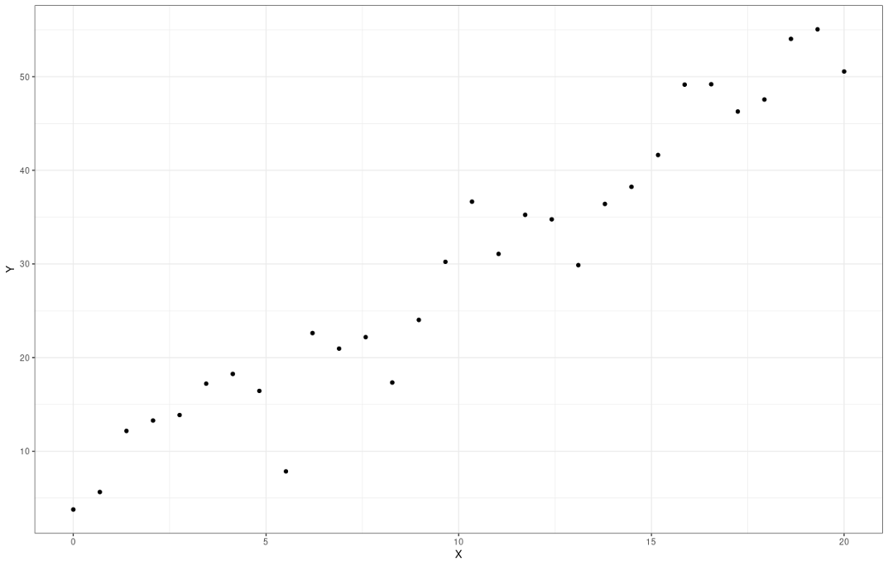{width=75%}
:::

:::{.fragment .absolute top=100px left=100px}
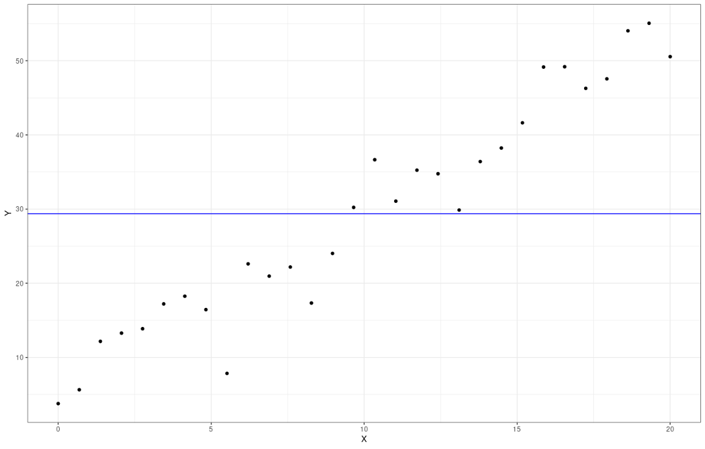{width=75%}
:::

:::{.fragment .absolute top=100px left=100px}
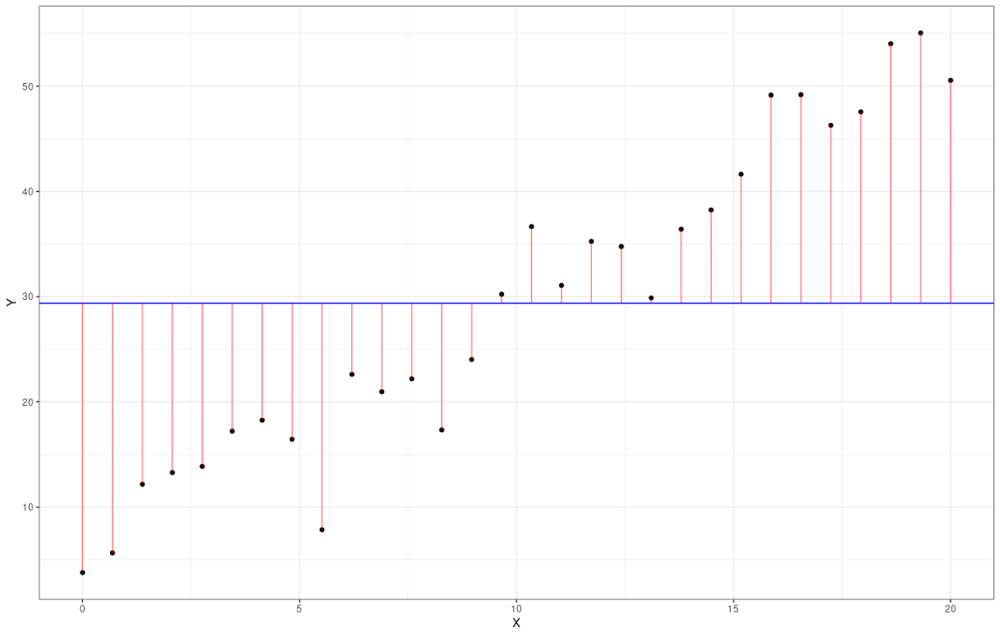{width=75%}
:::

:::{.fragment .absolute top=100px left=100px}
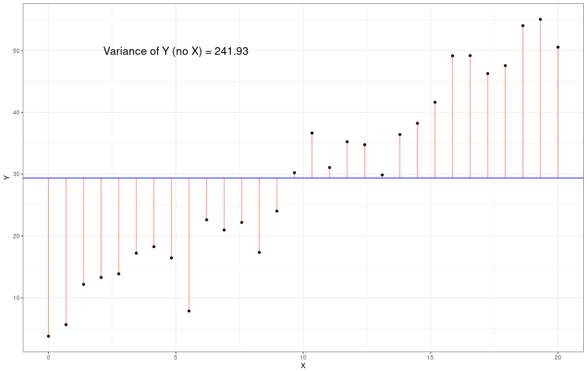{width=75%}
:::

:::{.fragment}
:::{.absolute top=100px left=100px}
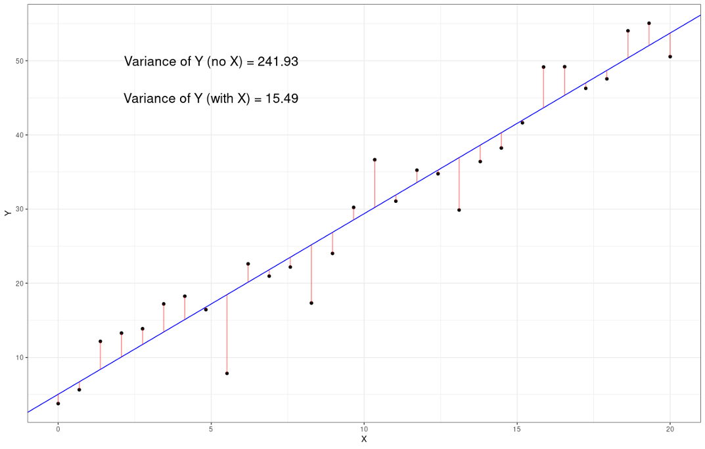{width=75%}
:::

:::{top=600px .absolute}
[$R^2 = 0.935$. Therefore, $X$ explains 93.5% of the variability in $Y$]{.mysolution}
:::
:::

## Coefficient of Determination Cont.

:::{.fragment .callout-tip title="Sales Example Revisited"}
Consider our Bum energy example where we are modeling monthly sales based upon monthly advertising expense. 

```{r}
my_model <- lm(sales ~ advertising, data = bum_energy)
summary(my_model)
```

a). Find and interpret the coefficient of determination. [[The $R^{2} = 0.9915$. Therefore, advertising cost explains 99.15% of the variability in sales.]{.mysolution}]{.fragment}

:::{.fragment}
b). Bum energy also fit a linear regression model with delivery time to predict sales and found for this model $R^2 = 0.4732$. What is a better predictor of sales, advertising cost or delivery time? [[Because $R^2_{advertising} = 0.9915 > R^2_{delivery} = 0.4735$, then advertising cost explains more of the variability in sales than delivery time.]{.mysolution}]{.fragment}
:::

:::

## Mean Squared Error (MSE) for Model Selection
:::{.incremental}
- The adjusted $R^2$ is a great model selection criteria that measures explained variability
- However, another popular measure is the mean squared error (MSE) that directly measures predictive performance [it is essentially the average of the residuals]{.subtext}
$$
MSE = \frac{1}{N} \sum_{i=1}^{N} (Y_i - \widehat{Y}_i)^2
$$
  - We want the MSE to be as small as possible
  - The MSE is commonly used in machine learning, whereas adjusted $R^{2}$ is often used for statistical purposes
  - You can calculate the MSE in R using the `Metrics` package

:::{.fragment}
```{r, eval=FALSE}
my_model <- lm(repsonse ~ predictor, data = my_data)
Metrics::mse(my_data$response, my_model$fitted.values)
```
:::
:::

## MSE Example

:::{.callout-tip title="Example"}
Consider modeling miles per gallon, `mpg`, using the `mtcars` dataset. Which simple linear regression model has the smaller MSE: one using the weight of the car, `wt`, or one using the horsepower, `hp`?
:::

:::{style="transform: scale(0.8); transform-origin: top left;"}
```{r}
#| autorun: false
model1 <- lm(mpg ~ wt, data = mtcars)
model2 <- lm(mpg ~ hp, data = mtcars)

# weight MSE
Metrics::mse(mtcars$mpg, model1$fitted.values)

# Horsepower MSE
Metrics::mse(mtcars$mpg, model2$fitted.values)
```
:::

:::{.fragment}
[Model 1 has the smaller MSE, so weight predicts mpg better than horsepower does.]{.mysolution}
:::


# The End

# Appendix: Assumptions for Regression {visibility="uncounted"}

## Regression Assumptions: Linearity {visibility="uncounted"}

:::{style="font-size:.9em;"}
- We can easily check the linearity assumption with a scatter plot of our data.
- We are looking for the scatter plot to show a linear relationship between our predictor and response.

```{r}
my_model <- lm(sales ~ advertising, data = bum_energy)
```
:::


::: {.panel-tabset}

### ggplot

```{r, fig.height=3}
ggplot(aes(advertising, sales), data = bum_energy)+
  geom_point()
```

### Base R

```{r, fig.height=3}
plot(bum_energy$advertising, bum_energy$sales)
```

:::

- This step is generally done before we run the model when doing exploratory analysis.

## Regression Assumptions: Normality {visibility="uncounted"}
:::{style="font-size:.9em;"}
- To access the normality assumption, we plot a QQ plot of the residuals from our model.
- To get the residuals from our model we use `$`

```{r}
my_model <- lm(sales ~ advertising, data = bum_energy)
my_model$residuals
```
:::

## Regression Assumptions: Normality {visibility="uncounted"}
:::{style="font-size:.9em;"}
- To access the normality assumption, we plot a QQ plot of the residuals from our model.
- To get the residuals from our model we use `$`

```{r}
my_model <- lm(sales ~ advertising, data = bum_energy)
residuals <- my_model$residuals
```

- We are looking more most of the points to follow the line and stay in the bounds.
:::

::: {.panel-tabset}

### ggplot

:::{style="font-size:.8em;"}
```{r, fig.height=2}
library("qqplotr")
ggplot(aes(sample = residuals), data = NULL)+
  stat_qq_band(color = "lightgrey")+
  stat_qq_line(color = "red") +
  stat_qq_point()
```
:::

### Base R

:::{style="font-size:.8em;"}
```{r, fig.height=3.5}
library("car")
car::qqPlot(residuals, col.lines = "red")
```

:::
:::

## Regression Assumptions: Equal Variance {visibility="uncounted"}
:::{style="font-size:.9em;"}
- To access the equal variance assumption, we plot a scatterplot of the residuals from our model against our predicted or fitted values.
- What we are looking for is to see now discerning pattern i.e all of the points look random.
:::
::: {.panel-tabset}

### ggplot

```{r, fig.height=3}
ggplot(aes(bum_energy$advertising, residuals), data = NULL)+
  geom_point()+
  geom_hline(yintercept = 0, color = "red")
```

### Base R

```{r, fig.height=3}
plot(bum_energy$advertising, residuals)
abline(h = 0, col = "red")
```

:::

## Regression Assumptions: Equal Variance Cont. {visibility="uncounted"}
:::{style="font-size:.9em;"}
- Below is an example of when the equal variance assumption is *not* met.
- We see a cone pattern as we increase the value of our predictor, which means the variability changes as our predictor changes[i.e. we do not have equal variances]{.subtext}
:::

::: {.center}

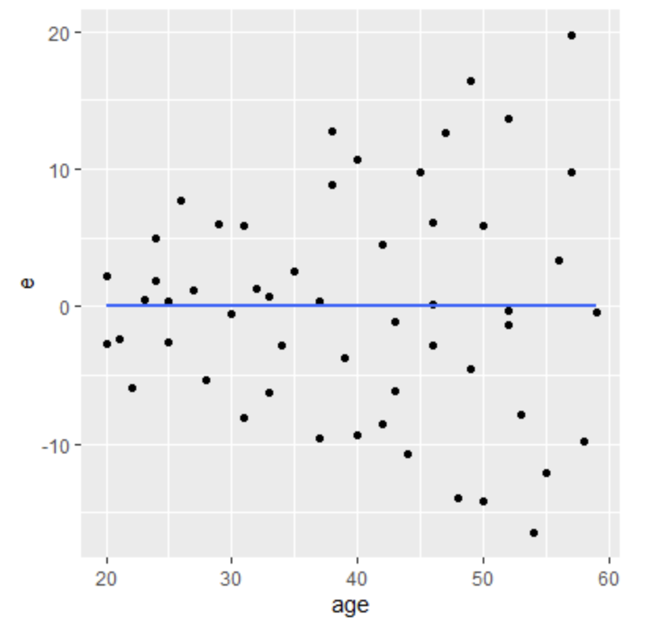{width=40%}

[Figure source: [jpstats.org/Regression/ch\_03\_03.html](http://www.jpstats.org/Regression/ch_03_03.html)]{.subtext}

:::

## Regression Assumptions: Independence {visibility="uncounted"}
:::{style="font-size:.9em;"}
- To access the independence assumption, we plot an autocorrelation plot of our residuals
  - The plot tells us if a specific lag (distance between past observations) is significantly correlated.
- We are looking for all of the vertical lines to stay inside the horizontal lines. [one a little out may be okay]{.subtext}
:::

::: {.panel-tabset}

### ggplot

```{r, fig.height=2.5}
library("forecast")
forecast::ggAcf(residuals)
```

### Base R

```{r, fig.height=3}
## For base R, we ignore the 0 lag line
acf(residuals)
```

:::

## Regression Assumptions: Independence Cont. {visibility="uncounted"}

- Below are examples of when the independence assumption is *not* met.
- We see within each graph there are multiple lags that are significantly large.

::: {.center}

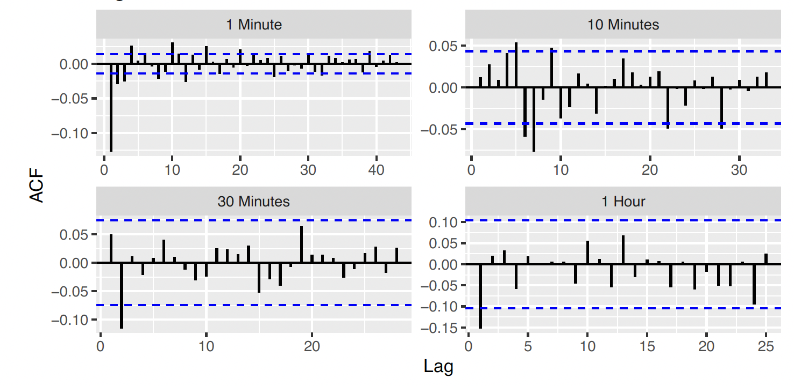{width=75%}

:::

## Regression Assumptions: Code {visibility="uncounted"}
:::{style="font-size:.9em;"}
- I have made a wrapper function that makes all of the plots for you and puts them together. It can be found here: 
[`residual_diagnostics.R`](residual_diagnostics.R){download="residual_diagnostics.R"}
<!-- [`residual_diagnostics.R`](https://github.com/DerikTBoonstra/UT-SDS320E/blob/main/residual_diagnostics.R) -->
- You can just copy the function and save it into your R environment and then run it.
:::
::: {.panel-tabset}

### ggplot
:::{style="font-size:.9em;"}
```{r}
#| code-fold: true
#| code-summary: "Wrapper Function Code"
residual_diagnostics <- function(model){
  pkgs <- c("qqplotr", "patchwork", "forecast")
  installed <- pkgs %in% installed.packages()[, "Package"]
  if (any(!installed)) {
    install.packages(pkgs[!installed])
  }
  library("qqplotr")
  library("patchwork")
  
  residuals <- model$residuals
  
  p1 <- ggplot(aes(sample = residuals), data = NULL)+
    stat_qq_band(color = "lightgrey")+
    stat_qq_line(color = "red") +
    stat_qq_point()+
    labs(x = "Theoretical Residuals", y = "Sample Residuals")+
    theme_minimal()
  
  p2 <- ggplot(aes(model$fitted.values, residuals), data = NULL)+
  geom_point()+
  geom_hline(yintercept = 0, color = "red")+
    labs(x = "Fitted Values", y = "Residual")+
    theme_minimal()
  
  p3 <- forecast::ggAcf(residuals)+
    theme_minimal()
  
  ## Return
  p1 / (p2 + p3)
}
```

```{r, fig.height=3}
residual_diagnostics(my_model)
```
:::

### Base R

:::{style="font-size:.9em;"}
```{r}
#| code-fold: true
#| code-summary: "Wrapper Function Code"
residual_diagnostics <- function(model) {
  
  if (!requireNamespace("car", quietly = TRUE)) {
    install.packages("car")
  }
  
  residuals <- model$residuals
  
    layout(matrix(c(1, 1, 2, 3), nrow = 2, byrow = TRUE),
         heights = c(1.5, 1))
  par(mar = c(4, 4, 1, 1))
  
  car::qqPlot(residuals,
              col.lines = "red",
              xlab = "Theoretical Residuals",
              ylab = "Sample Residuals")
  
  plot(model$fitted.values, residuals,
       pch = 19,
       xlab = "Fitted Values",
       ylab = "Residual")
  abline(h = 0, col = "red")
  
  plot(acf(residuals, plot = FALSE)[1:20])
}
```

```{r, fig.height=3}
residual_diagnostics(my_model)
```
:::
:::